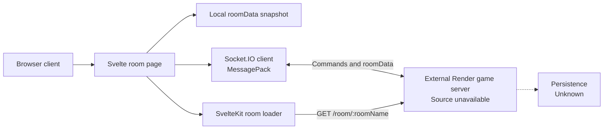
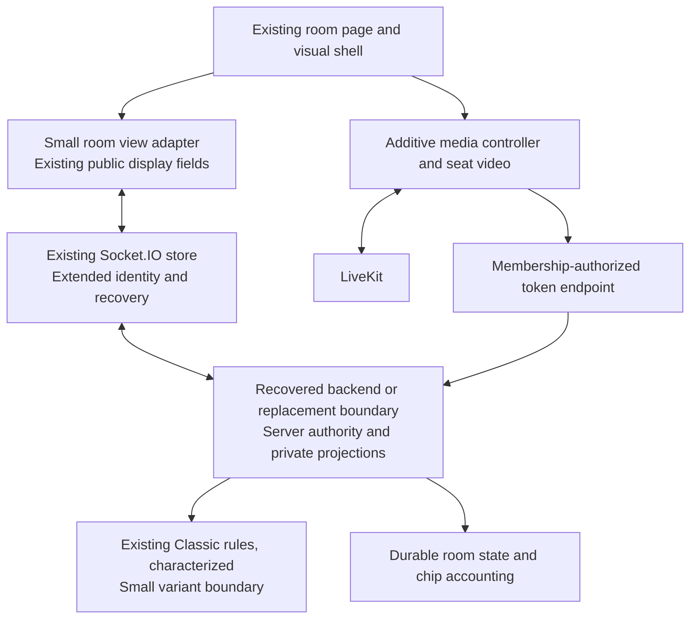

# Repository Audit and Implementation Plan

Repository: https://github.com/mustafa-kapadia1483/teen-patti  
Audited commit: `3f0cb69a71d922557f9b17a08a78f413b2e90774`  
Audit date: 2026-10-13  
Status: Preservation-first plan with Phase 0–9 implementation updates; Phase 9 production validation remains open. The initial audit below is retained as historical context.

Visual baseline: [VISUAL_PRESERVATION_PLAN.md](VISUAL_PRESERVATION_PLAN.md).

Phase 5 update: the extracted original player panels now form a six-person table with the viewer anchored at bottom center. The pot/header, game actions, cards, turn and winner cues, LiveKit media ownership and styling are reused. A server-owned cumulative per-hand contribution is added for the seat bet display; existing chip, turn and winner calculations are unchanged. Two-through-six-player layouts and six real LiveKit participants passed browser checks. See the [Phase 5 implementation and screenshots](docs/phase5/IMPLEMENTATION.md).

Phase 6 update: the table now puts the center first and the local seat directly below it on phones, with friends in a compact two-column layout. A fixed safe-area-aware action bar reuses the existing controls and stays reachable while scrolling. Two-through-six-player portrait rooms and six-player short-landscape/narrow widths passed browser checks. See the [Phase 6 implementation and screenshots](docs/phase6/IMPLEMENTATION.md). Hands-on iOS/Android media checks and production deployment remain future work.

Phase 7 update: all requested Teen Patti variants now have separate server rule files: Classic, Muflis, AK47, Joker, Lowest Joker, 999, 2 Card and 4 Card. The shared engine supports declared hand sizes and a public Joker rank marker while retaining private player cards and shared room/betting infrastructure. See [variant rules and verification](docs/phase7/IMPLEMENTATION.md).

Phase 8 update: the existing room waiting screen now includes a server-backed readiness lobby, host start gate, seat/host/connection status, starting-chip display, optional media preview and copy-invite button. Existing create-room settings and game controls remain in place. See [Phase 8 implementation](docs/phase8/IMPLEMENTATION.md).

Phase 9 update: the service now exposes separate liveness and SQLite-backed readiness probes, checkpoints committed WAL state on shutdown, waits for LiveKit cleanup and supports repeatable close. Multiplayer, race, restart and media-failure checks are automated; production deployment, backup restoration and WAN load tests remain outstanding. See [Phase 9 implementation](docs/phase9/IMPLEMENTATION.md).

Phase 4 update: optional LiveKit media is integrated into the existing player grid, with server-owned media identities, separate device controls and six real local media connections verified. See [setup, verification and production admission limitations](docs/phase4/IMPLEMENTATION.md).

Phase 3 update: Muflis is registered using the exact reverse of the existing Classic ranking. The existing create-room form and Game Settings offer variant selection; only the host can choose new rules at the next hand's start. The theme, cards, player presentation and action controls are retained. See [rules, implementation and verification](docs/phase3/IMPLEMENTATION.md).

Phase 2 update: Classic was moved behind a minimal versioned registry, reusing the evaluator/comparer unchanged and preserving all Phase 1 frontend/static files. See the [historical Phase 2 report](docs/phase2/IMPLEMENTATION.md).

Phase 1 update: the owned local Classic service now supplies authoritative settlement, private recipient views, durable sessions/receipts and refresh recovery behind the preserved UI. See [implementation and rule defaults](docs/phase1/IMPLEMENTATION.md) and [visual evidence](visual-baselines/phase1/README.md). Earlier unverified/missing-runtime entries below are historical audit findings.

Phase 0 progress: the original frontend is imported unchanged, runs locally, and has 20 real UI captures and a completed six-player smoke path. Card/deck disclosure and refresh failure are confirmed. See [current results](docs/phase0/RESULTS.md) and [setup](docs/phase0/SETUP.md). The audit tables below describe the initial inspection; current runtime findings supersede their earlier unverified entries. Backend source, complete rule verification and restart testing remain unresolved; Phase 1 subsequently delivered the local foundation described above.

**Recommendation: evolve the original Teen Patti application in place, preserving its appearance, components, interactions, and Socket.IO model wherever safe.** The existing room page is the product baseline. Add variants, media, and reliability through the smallest useful changes.

The supplied repository contains no game server, deck implementation, hand evaluator, or persistence layer. Backend reuse remains unverified. Obtain that source and characterize Classic first. If unavailable, replace only the backend boundary with an authoritative service and adapt the existing frontend incrementally.

## 1. Audit scope and verification

I inspected the repository at commit `3f0cb69a71d922557f9b17a08a78f413b2e90774`, including source files, configuration, dependencies, and the historical file inventory.

The audit clone is at `/private/tmp/teen-patti-audit`. Your working directory has pre-existing deleted tracked files; I left those untouched.

| Check                          | Result                                                      |
| ------------------------------ | ----------------------------------------------------------- |
| Install pinned dependencies    | Passed in isolated clone                                    |
| Production build               | Passed, with accessibility warnings                         |
| Start development server       | Passed                                                      |
| Home and create/join routes    | Both returned HTTP 200                                      |
| Formatting                     | Failed in four files                                        |
| ESLint                         | Cannot start: configuration imports undeclared `@eslint/js` |
| Svelte type checking           | Fails resolving `$app/tsconfig`                             |
| External room endpoint         | Responded with expected 404 for a nonexistent room          |
| Automated game tests           | None found                                                  |
| Complete multiplayer gameplay  | Not verified                                                |
| Private-card network isolation | Not verified                                                |
| Server restart/recovery        | Not verifiable from supplied source                         |

A successful frontend build does **not** establish that room creation, dealing, betting, settlement, or reconnection works correctly.

The configured backend is `https://teen-patti.onrender.com`. I found no backend source in this repository or its historical file inventory. Checking the owner's public repository listing did not establish where this service's source lives.

## 2. Existing architecture

The project is a Svelte application with a thin SvelteKit server-side room lookup. It depends on an external game service.



**Where authority currently lives:** the frontend sends commands and displays state returned by the external server, so that service is the apparent state owner. Its actual validation and authority cannot be confirmed. Winner selection is explicitly delegated to a human client in the frontend.

The local `roomData` object is a rendering snapshot, not an independently implemented game engine.

| Area               | What the source establishes                                                         |
| ------------------ | ----------------------------------------------------------------------------------- |
| Frontend           | Svelte 5, SvelteKit 3, TypeScript, Vite, Tailwind, DaisyUI, Lucide                  |
| Backend            | Only a SvelteKit route loader is included; gameplay service is external             |
| Multiplayer        | Socket.IO client with MessagePack parser; WebSocket and polling configured          |
| Room creation      | Emits `createRoom(roomName, table)`                                                 |
| Room joining       | HTTP room check, then `joinRoom(username, roomName)`                                |
| Player identity    | `User.id` is a socket ID                                                            |
| Seats              | No durable seat model; array order drives display and turn lookup                   |
| Player state       | Username, balance, cards, blind flag, packed flag                                   |
| Game state         | Started/show flags, initiator, current-player index, stake, pot, table value, users |
| Dealing            | Client sends `start(roomName, cutAt, cardsToDeal)`; implementation absent           |
| Hand evaluation    | No executable evaluator found; homepage contains ranking descriptions               |
| Betting            | Client sends a requested amount through `play(false, chal)`                         |
| Blind/seen         | `seeCards` command; UI derives suggested stake from blind status                    |
| Pack               | `play(true)` after a browser confirmation                                           |
| Chaal              | Input amount and action button; server constraints unknown                          |
| Show               | `show(roomName)`; button shown with two active players on the local turn            |
| Winner calculation | Initiator selects a player and sends `confirmWin`                                   |
| Reconnection       | Transport reconnect attempts; no application resume protocol found                  |
| Synchronization    | Incoming `roomData` shallow-merges into local state                                 |
| Persistence        | No database, durable room storage, migrations, or recovery implementation           |
| Networking         | HTTP room lookup plus Socket.IO commands/events                                     |
| Deployment         | Netlify adapter for frontend; external Render service                               |
| Testing            | Card preview route, but no automated test suite                                     |
| Security           | Client-side visibility and action restrictions; server enforcement unknown          |

Principal evidence, relative to the upstream repository:

- `src/routes/[roomName]/+page.svelte:68` — room commands, rendering, and winner submission.
- `src/routes/[roomName]/types.d.ts:1` — player and room data model.
- `src/lib/stores/socket-store.svelte.ts:1` — socket lifecycle.
- `src/lib/utils/room.ts:1` — room access check.
- `src/routes/create-room/+page.svelte:1` — create/join flow.

### Important behavioral problems

1. **Refresh/rejoin conflicts with room access.** The room loader rejects rooms whose `isStarted` flag is true. It does not distinguish a returning participant from a new arrival.
2. **Identity is tied to a connection.** There is no persistent player identity or authenticated seat-resume mechanism in this frontend.
3. **Join success is ambiguous.** `UsernameForm` treats a generic `message` event as successful joining. It registers that listener after emitting the request.
4. **Requests lack correlation.** Creation and joining share generic success/error events instead of request-specific acknowledgements.
5. **No versioned synchronization.** There are no application state revisions, gap detection, stale-command rejection, or explicit snapshot recovery.
6. **Rule behavior is embedded in UI.** Betting defaults, turn restrictions, and show availability are calculated directly in the room page.
7. **Configuration is misleading.** The development URL comment says localhost, but the implementation connects to Render.
8. **The Classic rules are incomplete.** Ranking prose exists, but executable evaluation and precise betting/show/tie rules do not.

## 3. Security and cheating risks

A risky frontend contract does not prove the unavailable server accepts every malicious request.

| Risk                                              | Evidence and certainty                                                                     | Required resolution                                                   |
| ------------------------------------------------- | ------------------------------------------------------------------------------------------ | --------------------------------------------------------------------- |
| Arbitrary winner selection                        | **Confirmed:** initiator chooses a winner and submits their ID                             | Server computes and settles every result                              |
| Opponent-card exposure                            | **Unverified, critical:** every user has `cardsInHand`; frontend hides faces conditionally | Inspect actual packets; replace with recipient-specific projections   |
| Blind player secretly reading their own hand      | **Unverified, critical:** face-down rendering alone does not enforce blindness             | Withhold card identities until server accepts “See”                   |
| Invalid bets                                      | **Confirmed attack surface:** client sends arbitrary amount; server checks unknown         | Validate integer amount, balance, limits, phase, and turn             |
| Out-of-turn actions                               | UI hides buttons; server checks unknown                                                    | Authorize every command against current server state                  |
| Starting another room or changing deal parameters | Client sends room name, cut position, and card count                                       | Derive membership server-side; validate host and locked configuration |
| Predictable or manipulated shuffle                | No shuffle implementation available                                                        | Server CSPRNG and unbiased shuffle; never accept client deck/seed     |
| Seat hijacking                                    | No stable authenticated resume identity in frontend                                        | Server-issued session and room membership                             |
| Room enumeration                                  | Human-selected room names; room lookup without explicit auth in client                     | Rate limits, generated codes, membership rules, minimal responses     |
| Duplicate/replayed bets                           | No command IDs or revision checks                                                          | Idempotency keys, serialized processing, stale-command rejection      |
| Client state manipulation                         | Local state can be edited; server consequences unknown                                     | Client submits intent only                                            |
| Cross-room access                                 | Some commands accept room names                                                            | Validate membership and authorization for every command               |
| External script compromise                        | Playing cards load JavaScript from an external URL                                         | Bundle a reviewed, licensed dependency or local renderer              |
| Information in diagnostics                        | `$inspect(roomData)` exists                                                                | Remove full-state logging; redact private fields elsewhere            |

The private-card concern comes directly from the rendering loop at `src/routes/[roomName]/+page.svelte:307`. It iterates each player's card array, then decides whether to display a face or back. **We cannot determine whether the server sends real cards or placeholders without examining its serializer or controlled network traffic.**

The target privacy rule should be stricter than simply separating “my cards” from “their cards”:

- A blind player receives card counts, not their card identities.
- After an accepted “See,” only that player receives their private hand.
- Other hands remain absent until a rule explicitly authorizes disclosure.
- Folded hands remain private by default.
- HTTP responses, reconnect snapshots, event history, analytics, logs, and error reports follow the same rules.
- Showdown disclosure is a game-rule decision, not a frontend condition.

## 4. Preservation strategy and corrections to the previous plan

The product is **the original Teen Patti application evolved into a social video Teen Patti experience**. It should remain recognizable at every stage.

For every change, apply this order:

1. REUSE AS IS.
2. EXTEND EXISTING CODE.
3. REFACTOR EXISTING CODE.
4. REPLACE only when the first three cannot meet a concrete requirement.

Keep Svelte, Tailwind, DaisyUI, the existing theme, PlayingCard presentation, room routes, forms, control labels, and animation language. Security fixes may change what the server accepts or sends; they do not require restyling the interface.

### Unnecessary rewrite work removed

| Earlier proposal                               | Why it created avoidable work                                         | Revised approach                                                                                                           |
| ---------------------------------------------- | --------------------------------------------------------------------- | -------------------------------------------------------------------------------------------------------------------------- |
| Immediate `apps/` and `packages/` monorepo     | File moves and tooling before a feature needs them                    | Keep current root and `src/`; add a directory only when needed                                                             |
| Replace the card-panel grid                    | Discarded reusable player markup and styling                          | Extract the existing panel into PlayerSeat, add media, then change only placement                                          |
| New table shell and action UI                  | Risked recreating equivalent controls                                 | Extract the existing room blocks and control markup without changing classes or behavior                                   |
| Remove DeclareWinner wholesale                 | Its unsafe selection logic does not invalidate its visual shell       | Refactor in place into a server-result panel using existing card, trophy, colors, spacing, and feedback                    |
| Replace the PlayingCard renderer               | Security of script delivery is separate from its appearance           | Keep the component and Cardmeister rendering; pin/localize the same asset after license and behavior checks                |
| Remove arbitrary deal/cut controls immediately | Could erase intentional original interactions before characterization | Capture and understand them; retain verified supported modes, constrain Classic to its agreed rules                        |
| Broad variant/platform framework upfront       | Guessed at future needs                                               | Extract only Classic decisions that Muflis actually varies; grow the contract when a later variant requires it             |
| Broad protocol replacement                     | Would force unrelated UI changes                                      | Keep event names and interaction flow where safe; add acknowledgements, authorization, revisions, and resume incrementally |
| Early generalized Poker platform               | Adds abstractions without an immediate consumer                       | Keep stable room/media boundaries; evaluate a sibling Poker engine in Phase 10                                             |

A server-only Classic implementation may be necessary because the backend is missing. That is not permission to rebuild the frontend. Missing code cannot be reused; available frontend code should be.

### Change review rules

Every implementation change should state its feature or security reason, original file/block reused, expected visible difference, and verification. Avoid unrelated formatting, dependency upgrades, renaming, or folder moves. Extract markup before changing layout, so those changes can be reviewed separately. No new theme, fonts, card style, or design system without explicit approval.

## 5. Frontend reuse matrix

Percentages estimate the proportion of current code that can survive in place or be moved with small edits through the planned release. They are planning ranges, not measured results or quotas. A security-sensitive ten-line handler may need more change than a large template. New feature code can grow a file without reducing reuse of its existing content.

Paths are relative to the audited upstream repository. These reuse estimates were written before import. Phase 0 has now imported the pinned source into the existing root and verified all 29 src/static files remain byte-identical; no component extraction has started.

| Existing file/component                      | Decision                                    | Current responsibility                                    | Future responsibility                                                         | Likely reusable     | Replacement/removal reason                                     | UI impact                                                     |
| -------------------------------------------- | ------------------------------------------- | --------------------------------------------------------- | ----------------------------------------------------------------------------- | ------------------- | -------------------------------------------------------------- | ------------------------------------------------------------- |
| `src/routes/+page.svelte`                    | KEEP AS IS initially; EXTEND only if needed | Landing page, ranking guide, animations                   | Same landing identity; existing create/join entry                             | 95–100%             | No replacement                                                 | Preserve layout, cards, guide, colors; keyboard fixes only    |
| `src/routes/+layout.svelte`                  | EXTEND                                      | Navigation, container, route animation, toasts, analytics | Same shell; small room/media lifecycle integration where required             | 90–100%             | No replacement; remove upstream analytics hookup               | Preserve navbar and route transitions                         |
| `src/routes/create-room/+page.svelte`        | EXTEND                                      | Combined create/join form and table-stake input           | Same screen plus code/invite, validated settings, lobby entry                 | 75–90%              | Generic message listeners need safer request acknowledgements  | Same form cards, labels, spacing and buttons; additive fields |
| `src/routes/[roomName]/+page.svelte`         | REFACTOR incrementally                      | Room orchestration, header, player panels, game actions   | Same route; extracted existing blocks with media and layout additions         | 65–85%              | No page replacement; inline trust/identity logic must change   | No redesign in Phases 1–4; perimeter placement in Phase 5     |
| `src/routes/[roomName]/+page.server.ts`      | REFACTOR                                    | Room existence/started check                              | Membership-aware admission and authenticated resume                           | 40–65%              | Existing started-game rejection cannot serve returning members | Same room route; correct rejoin behavior                      |
| `src/routes/[roomName]/UsernameForm.svelte`  | EXTEND                                      | Name entry and join event                                 | Same name form; join acknowledgement and resume status                        | 75–90%              | Replace ambiguous join success handling only                   | Same Take a Seat card and input/button                        |
| `src/routes/[roomName]/UsersTable.svelte`    | EXTEND                                      | Waiting-player balances and net table                     | Retained waiting/lobby list with ready/connection/seat information            | 85–95%              | No replacement                                                 | Keep table-zebra, panel and balance styling                   |
| `src/routes/[roomName]/DeclareWinner.svelte` | REFACTOR                                    | Initiator selects winner and confirms                     | Displays trusted server winner/result; next-hand acknowledgement if useful    | 40–60%              | Winner selector and confirmWin semantics must be replaced      | Preserve trophy, panel, accent styling and winner feedback    |
| `src/routes/[roomName]/types.d.ts`           | REFACTOR                                    | Ambient Card/User/RoomData types                          | Separate public/private wire types and view types; stable identity            | 30–55%              | Unsafe combined state model must be replaced progressively     | None; compatibility view preserves rendering shapes           |
| `src/routes/[roomName]/+error.svelte`        | EXTEND                                      | Error message                                             | Same error presentation with appropriate retry/rejoin action                  | 70–90%              | No replacement                                                 | Additive themed action only                                   |
| `src/routes/test-cards/+page.svelte`         | KEEP AS IS                                  | Visual deck test                                          | Development visual-regression fixture                                         | 95–100%             | No deletion; decide production exposure later                  | No appearance change                                          |
| `src/lib/components/PlayingCard.svelte`      | REFACTOR narrowly                           | Rank/suit normalization, Cardmeister faces, custom backs  | Same API and appearance inside existing fans/seats                            | 90–98%              | Change external script delivery, not renderer or design        | Pixel-equivalent faces and backs required                     |
| `src/lib/components/GoogleAnalytics.svelte`  | REMOVE from runtime initially               | Sends events to upstream tracking property                | No upstream tracking; retain integration only if owned analytics is requested | 0% active initially | Original tracking destination is not ours                      | None                                                          |
| `src/lib/components/Toasts/Toasts.svelte`    | KEEP AS IS initially                        | Themed message display                                    | Same display for game, room and media feedback                                | 90–100%             | No replacement                                                 | Preserve toast style; accessible semantics if needed          |
| `src/lib/components/Toasts/index.ts`         | KEEP AS IS                                  | Toast exports                                             | Same exports                                                                  | 100%                | None                                                           | None                                                          |
| `src/lib/components/Toasts/stores.svelte.ts` | EXTEND                                      | Timed toast queue                                         | Same API; correct dismissal/request error deduplication if needed             | 75–95%              | No replacement                                                 | Same feedback behavior                                        |
| `src/lib/stores/socket-store.svelte.ts`      | REFACTOR                                    | Socket.IO connection and connected flag                   | Same transport owner with stable session, typed acknowledgements and resume   | 45–70%              | Extend connection lifecycle; socket ID cannot remain identity  | Existing actions stay recognizable; reconnect feedback added  |
| `src/lib/utils/room.ts`                      | REFACTOR                                    | HTTP room validation                                      | Public room check plus authenticated admission/resume distinction             | 45–70%              | Started flag alone is insufficient authorization               | Same create/join flow with corrected errors                   |
| `src/lib/config.ts`                          | REFACTOR narrowly                           | Environment-dependent server URL                          | Explicit local/production game endpoint; public media URL if needed           | 50–80%              | Remove hardcoded development dependency on hosted server       | None                                                          |
| `src/app.css`                                | KEEP AS IS                                  | Teen Patti theme and base styling                         | Design source of truth; scoped layout additions only                          | 98–100%             | None                                                           | Preserve all existing tokens                                  |
| `src/app.html`                               | KEEP AS IS initially; EXTEND                | Document shell, metadata, icons, theme                    | Same shell; security/header deployment work separately                        | 95–100%             | None                                                           | Preserve theme and branding                                   |
| `src/app.d.ts`                               | EXTEND                                      | SvelteKit ambient app types                               | Session/load typing as required                                               | 80–100%             | No replacement                                                 | None                                                          |
| `static/` icons and `site.webmanifest`       | KEEP AS IS initially                        | Favicons and install metadata                             | Same assets; correct manifest names only if approved                          | 95–100%             | None                                                           | Preserve identity                                             |

Tooling is also retained: `package.json`, lockfile, Vite, TypeScript, ESLint, Prettier and Netlify adapter configuration are repaired or extended in place. No package-manager migration, build-system replacement, or broad version upgrade is planned.

### Specific replacements and removals

| Boundary/file                                                                                   | Why extension alone is insufficient                                                                           | Behavior/styling that survives                                                  | Original code still reusable                                                 |
| ----------------------------------------------------------------------------------------------- | ------------------------------------------------------------------------------------------------------------- | ------------------------------------------------------------------------------- | ---------------------------------------------------------------------------- |
| Unavailable external game service; frontend call sites in socket store, room utility and loader | Cannot own, audit, recover or deploy a service whose source is unavailable; create one only if recovery fails | Event-driven create/join/start/see/play/show flow and all frontend presentation | Existing client transport, handlers and rendering adapted through a boundary |
| Winner selection block in DeclareWinner and confirmWin handler in room page                     | A client-selected player ID cannot be trusted as the game result                                              | Winner panel, trophy, spacing, colors and toast feedback                        | Panel/template shell and display formatting                                  |
| Socket-based identity in types, room page and store                                             | Socket IDs describe connections; they cannot securely authenticate refresh/rejoin                             | You badge, player name, turn cue and seat                                       | Existing presentation and transport lifecycle                                |
| Raw roomData private-card model in types/handlers                                               | Client-side hiding cannot protect cards that have already been delivered                                      | Same face-down backs, See transition, showdown faces and card counts            | Renderer, fan markup and public state fields                                 |
| External script loading line in PlayingCard                                                     | Unpinned remote executable code adds availability and supply-chain risk                                       | Exact Cardmeister faces, normalization, court colors and custom back            | Almost the entire component; reviewed asset bundled locally if permitted     |
| Upstream analytics integration                                                                  | Extending it while retaining the original destination sends data to someone else's property                   | No visual change                                                                | Component pattern can be reused later for owned, approved analytics          |

No complete frontend component is scheduled for wholesale replacement. Preserve the development card fixture. Do not remove unsupported-looking controls until their original behavior has been characterized and a reason is documented.

## 6. Smallest-change target architecture

Keep the current routes and UI as the host of the experience. Introduce a small game-facing view adapter only where the safer protocol would otherwise force widespread template edits.



If recovered server logic is sound, fix it in its current structure and language. Node/TypeScript is a reasonable fallback if new server code is necessary; it is not grounds to port working backend code. The supplied frontend root remains intact. A separate deployable `server/` directory is added only if no backend is recovered; no workspace/monorepo tooling is required.

### Preserve the Socket.IO interaction model

Retain `createRoom`, `joinRoom`, `start`, `seeCards`, `play`, `show`, `leaveRoom` and room updates when reasonable. Names are reusable; insecure semantics are not. Preserve MessagePack initially if needed for existing-server compatibility.

Add acknowledgements rather than infer success from any message. Add authenticated session binding, command IDs, hand/revision checks and resume inside a thin adapter. Do not send a claimed winner or trust a submitted actor ID. A client submits intent; the server validates membership, phase, turn, integer bet, balance and legal action.

State changes are serialized per room. Persist state, chip movement and command receipt atomically before broadcasting. Retried commands have one effect. Use versioned snapshots and a complete-snapshot fallback on reconnect; reject stale actions. Keep presence revisions separate from game revisions.

Socket.IO's default delivery is at most once; transport reconnect is not a complete application recovery protocol. [Delivery guarantees](https://socket.io/docs/v4/delivery-guarantees/), [connection recovery](https://socket.io/docs/v4/connection-state-recovery/).

### Privacy without a visual rewrite

Public state contains player identity, seat, balance, bet, card count, blind/seen, packed and turn status. Private card identities are absent while blind, delivered only to their owner after accepted See, and exposed to other recipients only when showdown rules allow it. Folded hands remain hidden unless explicitly required.

A compatibility view can generate face-down placeholders from card counts so the existing PlayingCard/fan rendering survives. It must never manufacture an object containing another player's secret cards. Replace prior snapshots or explicitly clear private fields at hand changes to avoid stale-card retention from shallow merges.

Server-only state holds deck order, every private hand, settlement information and deadlines. HTTP room checks, event recovery, logs, errors and analytics obey the same disclosure rules.

### Reliability and persistence

Stable `playerId`, immutable `roomId`, seat number and authenticated session are distinct from socket ID. Guest play can remain signup-free through a server-issued opaque session; a display name or room code is not resume authority. Choose a secure cookie or equally reviewed session mechanism compatible with the actual deployment.

On refresh, a recognized member resumes the same seat even during a hand. Explicit leave differs from temporary disconnect. Decide turn timeout, seat grace, insufficient balance and host transfer from characterization and written rules; media loss never triggers pack. Rejoining after removal requires authorization again.

Reuse recovered persistence if adequate. Otherwise add durable room snapshots, configuration/rules versions, command receipts and transactional chip entries. Store confidential deal order for restart recovery; do not reshuffle a committed hand. Use server CSPRNG/unbiased shuffle in production and injected decks/clock in tests. Start with one game-service owner; add fencing before multiple instances may mutate a room.

## 7. Component evolution and additive video

Each extraction starts by moving the existing markup, classes and callbacks without redesign. Extract only when the current feature needs reuse; do not create every component on day one.

| Existing block                        | Incremental evolution                                           | Required preservation                                                           |
| ------------------------------------- | --------------------------------------------------------------- | ------------------------------------------------------------------------------- |
| Room header with pot/max/player count | Keep in room page initially; extract only if layout requires it | Icons, typography, keyed pot/stake fly animations and room identity             |
| Existing player panel loop            | Extract locally to PlayerSeat; first retain existing grid       | Name, You badge, balance, borders, ring, status and card fan                    |
| Existing card loop                    | Optional CardFan extraction around PlayingCard                  | Original faces/backs, overlap and hover/focus lift                              |
| See, Pack, Blind/Chal, Show block     | Extract locally to ActionBar when needed                        | Existing button classes, input, labels, visibility intent and pack confirmation |
| Room layout                           | Add TableScene only when perimeter placement is needed          | Existing room page remains route/orchestration owner                            |
| Existing player panel                 | Add SeatVideo/media status inside its shell                     | It remains a game seat; camera is an optional enrichment                        |
| Create/join and UsernameForm          | Extend existing forms and waiting flow                          | Same forms, panel language and navigation                                       |
| DeclareWinner                         | Refactor to authoritative result display                        | Familiar result panel and feedback; no client adjudication                      |

### Phase 4 versus Phase 5

Phase 4 proves media inside the existing player-panel grid. Camera-disabled seats still look like the original panels; no empty video rectangle is reserved when media is absent. Phase 5 then changes outer placement and adjusts panel sizing to create the table composition. This separates media faults from layout changes.

### Six-seat composition

The original repository has a player-panel grid, not a distinct central table canvas. The smallest new visual element is a central felt/status area built from existing surfaces and pot/header information. It should not introduce a new illustrated poker table, card deck style, or decorative system.

Reuse player panels as perimeter seats. Keep the current cards attached to their players; place shared pot/status centrally, and keep local controls near the local hand. Do not create a second copy of pot, cards or controls just for the new scene.

| Players | Placement                                         |
| ------- | ------------------------------------------------- |
| 2       | You at bottom; opponent opposite                  |
| 3       | You at bottom; two opponents on upper arc         |
| 4       | You bottom; opponents left/top/right              |
| 5       | You bottom; four opponents around perimeter       |
| 6       | You bottom; five remaining positions around table |

Use stable server seat numbers and rotate only the visual mapping to anchor You at bottom. Do not move/reorder seats for speaking activity, disconnects or packing. Adjust layouts at safe hand boundaries. Preserve the gold turn ring and badge as the strongest signal. Keep the packed stamp over game content without obscuring media controls or preventing folded friends from talking.

### LiveKit remains optional

A media controller separate from the socket/game store owns tracks, permissions and media reconnection. One logical room maps to one LiveKit room using immutable internal `roomId`; a human-friendly room code resolves to it. LiveKit participant identity maps to stable `playerId`. Join seats by that mapping, never by name, socket ID or connection order.

Issue tokens server-side after membership authorization; derive room and identity from records, grant minimum publishing/subscription permissions, keep API secrets server-side, and recheck authorization for replacement tokens. Consider duplicate-tab takeover for game and media together to avoid identity reconnect loops. Cloud and self-hosted token revocation differ and require deployment-specific tests. [Tokens and grants](https://docs.livekit.io/frontends/reference/tokens-grants/).

Use `livekit-client` behind a Svelte adapter, with a server SDK for tokens. Managed LiveKit is a candidate pending a small six-device reliability/cost spike, not a requirement to change frontend technology. Adaptive stream/dynacast may reduce media cost and CPU where supported. [Connection model](https://docs.livekit.io/intro/basics/connect/), [Room options](https://docs.livekit.io/reference/client-sdk-js/interfaces/RoomOptions.html).

| Failure/choice                      | Expected behavior                                                          |
| ----------------------------------- | -------------------------------------------------------------------------- |
| Camera unavailable/denied/off       | Original panel or avatar; game continues                                   |
| Microphone unavailable/denied/muted | Muted/unavailable badge; game continues                                    |
| Audio only                          | No camera required; same game controls                                     |
| All media disabled                  | Complete original game experience                                          |
| Media disconnect/outage             | Recover media independently; no game action or seat loss                   |
| Game disconnect                     | Disable pending/invalid game actions; resume same player; media may remain |
| Poor network                        | Reduce video then offer audio only; never change game rules                |
| Leave                               | Explicit game departure policy plus media cleanup                          |
| Rejoin                              | Authenticate, restore game seat/snapshot, reconnect media                  |

Ask for camera and microphone separately. Keep preview local until joining. Attach remote audio once per participant, not once per layout/render. Handle autoplay with a user gesture. No media state becomes game authority.

## 8. Smallest useful variant boundary

First characterize actual Classic behavior. Reuse recovered Classic deck, evaluator and betting code where tests establish correctness. Extract rule decisions only when they vary; retain room/turn/accounting implementations unless a concrete problem demands changes.

For Classic and Muflis, the first contract can be limited to identity/version, validated configuration, evaluation/comparison, and player-facing rules. If existing Classic evaluation already returns a useful structured result, retain it. Muflis supplies its documented comparison policy. Do not prebuild a general plugin platform for all future variants.

Later grow the boundary only when needed:

| Need            | Add only when required                                         |
| --------------- | -------------------------------------------------------------- |
| Muflis ordering | Hand comparison policy with explicit tie/ace rules             |
| AK47/Joker      | Wildcard context and evaluation                                |
| Lowest Joker    | Per-hand/per-player wildcard derivation                        |
| 999             | Scoring/outcome policy                                         |
| 2 Card/4 Card   | Implemented `cardsPerPlayer` deal setting and evaluation rules |

The trusted engine performs shuffle/deal from validated rules. Variants do not mutate balances or access networking, storage or video. Comparison and settlement remain distinct. Freeze variant/version/config per hand, switch between hands, and show rules/variant labels using existing typography and badges.

Specify ace/sequence ordering, ties, show eligibility/cost, blind/seen progression, raise bounds, boot, insufficient-balance handling, sideshow inclusion and departure policies. The homepage's A-K-Q before A-2-3 is evidence of intended presentation, not proof of server behavior. Manual adjudication and any privacy flaw are documented exceptions to behavior preservation.

## 9. Visual preservation and mobile

[VISUAL_PRESERVATION_PLAN.md](VISUAL_PRESERVATION_PLAN.md) records the existing colors, typography, spacing, radii, card styling, buttons, forms, animations, responsive behavior, player panels and controls. It is the design source of truth derived from the original application, not a new design system.

Phase 0 captures fixed-viewport screenshots and interaction recordings for home, create, join, waiting, game, every player/card/action state, show and winner. Current source inspection is not a substitute for those screenshots. Gameplay screenshots remain pending the original backend or a clearly labeled frontend fixture; fixtures cannot prove original server behavior.

Use reproducible data and separate stable animation frames from animation-behavior checks. Freeze or mask video/time-varying content in visual tests. Maintain the original reference and approved incremental references; never silently regenerate snapshots to accept drift.

Mobile keeps the same panels, theme and controls but composes them for portrait: compact opponent seats, central pot, local cards above reachable bottom actions, optional bet/settings sheet and smaller video. Preserve button semantics and prevent touch targets from shrinking just because video is added. Test actual iOS Safari and Android Chrome for permissions, audio, orientation, backgrounding and thermal behavior. No new mobile design system or native framework is planned.

## 10. Revised Phase 0 through Phase 10 roadmap

Estimates are effort ranges, not delivery promises. They assume social browser play with non-redeemable chips. Missing backend source and uncertain rules dominate Phase 1. Reuse reduces frontend risk but cannot remove the work of secure server authority.

### Phase 0 — Original application and preservation baseline

- **Goal:** Run the original application without appearance changes; finish backend investigation and capture visual/behavior references.
- **Existing code reused:** Entire pinned original frontend; unchanged backend if recovered.
- **Files likely affected after approval:** Import upstream source into the current root without overwriting unrelated workspace work; setup documentation, environment example, minimal tooling fixes only if required. Preserve current Git history and pre-existing deletions.
- **New modules required:** Baseline documentation/screenshots and characterization fixtures; no product modules.
- **Dependencies:** Backend access, upstream reuse terms, original runtime, browser capture/test tooling when needed.
- **Tests required:** Home, create, join, waiting, game, 2–6 players, cards, bet controls, blind/seen, pack, show, winner, refresh/rejoin; actual payload inspection.
- **Definition of done:** Reproducible original frontend, visual system and screenshot inventory, exact gameplay evidence and explicit backend reuse decision. If backend remains unavailable, report the limit and approve a boundary replacement; do not call multiplayer verified.
- **Risks:** Hosted/source mismatch, missing server, unlicensed source, confusing fixtures with real behavior.
- **Complexity:** Medium; 3–5 engineer-days after access, with external source retrieval not a predictable duration.

### Phase 1 — Reliable Classic with minimal UI changes

- **Goal:** Secure and stabilize Classic behind the original room UI.
- **Existing code reused:** Existing routes, forms, cards, player panels, controls, socket model; recovered server logic wherever correct.
- **Files likely affected:** Socket store, room utility/loader, types, room page handlers, UsernameForm, DeclareWinner; recovered backend files or new `server/` only if necessary.
- **New modules required:** Small session/resume and public/private adapters; server validation, authoritative evaluation/settlement and durable recovery if absent.
- **Dependencies:** Existing transport; validator/tests; database driver/migrations only if recovered persistence is insufficient. No frontend framework migration.
- **Tests required:** Classic characterization, malformed/out-of-turn bets, card privacy including blind owner, stable identity, duplicate actions, concurrent show/pack, refresh and restart; original screenshot comparisons.
- **Definition of done:** Same recognizable game with server-decided outcomes, legal bets/turns, protected hands, conserved chips and reliable resume. Document visible exceptions such as replacing winner choice with result display.
- **Risks:** Unknown rules, retaining defects as compatibility, hidden state in shallow merges.
- **Complexity:** High; 1–3 engineer-weeks with a usable backend; approximately 4–7 if the authoritative server must be created. Re-estimate after Phase 0.

### Phase 2 — Minimal variant extraction, Classic only

- **Goal:** Extract only the rules needed for comparison variation while preserving Classic.
- **Existing code reused:** Characterized Classic evaluation/betting and existing UI.
- **Files likely affected:** Recovered rule files or `server/` rule modules, room config/types and tests; no table styling changes.
- **New modules required:** Small Classic rule adapter and registry/config entry, grown only as needed.
- **Dependencies:** Existing tests/validation only.
- **Tests required:** Deterministic before/after results, legal actions, ties and unchanged Classic visual/interaction references.
- **Definition of done:** Classic remains identical except approved Phase 1 fixes; comparison policy is isolated and versioned.
- **Risks:** Overgeneralization and unnecessary movement of working rule code.
- **Complexity:** Low–Medium; approximately 0.5–1.5 engineer-weeks.

### Phase 3 — Muflis on the same interface

- **Goal:** Add one variant using the same room and controls.
- **Existing code reused:** Classic classification where correct; all room, bet, card and player presentation.
- **Files likely affected:** Variant registry/comparison, existing settings block, rule label/help and fixtures.
- **New modules required:** Muflis comparison policy and documented ace/tie cases.
- **Dependencies:** None new.
- **Tests required:** Muflis ordering and ties, full hands, between-hand switching, no room/media changes, Classic regressions.
- **Definition of done:** Classic ↔ Muflis changes rules and labels only; hand configuration locks at start.
- **Risks:** Regional rule ambiguity; assuming inverse score handles all rules.
- **Complexity:** Low–Medium; approximately 0.5–1 engineer-week.

### Phase 4 — Add media to the existing player grid

- **Goal:** Prove six-player camera/audio without redesigning the room layout.
- **Existing code reused:** Current grid/panels, game controls, sessions, cards and theme.
- **Files likely affected:** Room page/player block, optional initial PlayerSeat extraction, config and server token route.
- **New modules required:** Independent media controller, small SeatVideo, token endpoint and media-status controls.
- **Dependencies:** `livekit-client`, server SDK and chosen LiveKit deployment; Svelte remains.
- **Tests required:** Six media identities, camera/mic denial, audio-only/no-media play, mute/off, media reconnect/outage, wrong-room tokens, duplicate sessions and cleanup.
- **Definition of done:** Original game remains fully playable with no media; video is additive inside existing panel styling; no perimeter layout yet.
- **Risks:** Autoplay, browser permissions, track leaks, duplicate audio, device CPU/network load.
- **Complexity:** Medium–High; approximately 1.5–3 engineer-weeks.

### Phase 5 — Evolve panels into the six-person table

**Status: Complete.** Implementation details, verification and screenshots: [Phase 5 report](docs/phase5/IMPLEMENTATION.md).

- **Goal:** Place richer versions of the original player panels around the central game content.
- **Existing code reused:** Player markup/classes, PlayingCard/fan, pot/stake header animations, controls, status/packed/turn cues and Phase 4 media.
- **Files likely affected:** Existing room page and local extracted PlayerSeat/CardFan/ActionBar/TableScene only as needed; scoped layout CSS.
- **New modules required:** Seat-position mapping for 2–6 players and the minimum central layout container.
- **Dependencies:** Existing Svelte/CSS only; no canvas/3D or alternate design system.
- **Tests required:** Extracted grid first matches original screenshots; approved new placements, self-bottom mapping, stable seats, no duplicate audio/controls, long names and keyboard focus.
- **Definition of done:** Original visual language remains recognizable; only layout/media additions differ intentionally; cards/bets/actions remain linked to the right player.
- **Risks:** Discarding markup during extraction, crowded panels, packed overlay obstructing media, unnecessary decorative table redesign.
- **Complexity:** Medium; approximately 1.5–3 engineer-weeks.

### Phase 6 — Mobile evolution in the same visual language

**Status: Mobile implementation and browser viewport verification complete. Physical iOS/Android validation remains outstanding.** See [Phase 6 report](docs/phase6/IMPLEMENTATION.md).

- **Goal:** Improve responsive play without shrinking the desktop table wholesale.
- **Existing code reused:** Same card, seat, form, control and theme components.
- **Files likely affected:** Scoped seat/table layout, action placement, media subscriptions and responsive classes.
- **New modules required:** Small mobile layout mapping or bet sheet only if necessary; retain shared controls.
- **Dependencies:** Real-device test access; no native framework.
- **Tests required:** 2–6 seats on narrow phones, portrait/landscape, one-hand controls, keyboard/safe areas, permission failures, background recovery and audio-only fallback.
- **Definition of done:** Full hands on supported real phones, same aesthetic, reachable actions and clear turn state.
- **Risks:** Overcrowding, tap errors, Safari media behavior, battery/thermal load.
- **Complexity:** Medium–High; approximately 1.5–3 engineer-weeks.

### Phase 7 — Additional variants incrementally

- **Goal:** Add and verify the named Teen Patti variants one at a time, each in its own server file.
- **Existing code reused:** Classic reference, shared betting/room flow and same player/control UI.
- **Files likely affected:** Variant files, registry, validated settings/help and CardFan sizing only when card count requires it.
- **New modules required:** Each variant's actual rules and fixtures; new contract hooks only when required.
- **Dependencies:** None by default; no generic rules library without evidence of fit.
- **Tests required:** Independent evaluation/comparison, wildcards, ties, physical-card integrity, settlement, chip conservation and visual preservation for each variant.
- **Definition of done:** Classic, Muflis, AK47, Joker, Lowest Joker, 999, 2 Card and 4 Card each have isolated rule files and tests. Hand-size and Joker setup hooks reuse the existing room, betting and settlement infrastructure; no room/video rewrite.
- **Risks:** Ambiguous variant names, wildcard complexity, forcing 999 or four-card rules into an unsuitable score.
- **Complexity:** Medium; wildcard scoring and variable card counts add rule-specific work. Future variants still require their own agreed rules version and test file.

### Phase 8 — Extend create/join and waiting experience

**Status: implemented.**

- **Goal:** Improve room setup through existing screens.
- **Existing code reused:** Combined create/join form, UsernameForm, UsersTable and room settings block.
- **Files likely affected:** Existing create/join/room routes, forms, waiting list and server room endpoints.
- **New modules required:** Invite copy/code helper, ready state, local preview and host controls only where needed.
- **Dependencies:** Existing application and media modules.
- **Tests required:** Home → existing create/join → waiting/lobby and preview → variant/settings → ready → start → same room table; full room, concurrent join, host leave/transfer, settings reset readiness and late resume.
- **Definition of done:** Familiar flows gain a copyable room invite, validated starting chips at room creation, optional camera/audio preview, server-backed readiness and host-only start/variant controls without a new screen system. See [implementation and verification](docs/phase8/IMPLEMENTATION.md).
- **Risks:** Extra friction, confusing current `table` meaning with both starting chips and boot, settings changing mid-hand.
- **Complexity:** Medium; approximately 1–2 engineer-weeks. Minimum identity/lobby admission exists in Phase 1; variant selection exists by Phase 3.

### Phase 9 — Production hardening without cosmetic churn

**Status: operational safeguards implemented; production validation remains open.**

- **Goal:** Exercise failures and operational recovery while preserving approved UI.
- **Existing code reused:** All proven feature code and visual references.
- **Files likely affected:** Server authority/persistence, socket recovery, media lifecycle, CI/deployment and targeted error states.
- **New modules required:** Failure/race harness, operational runbooks, monitoring and recovery verification.
- **Dependencies:** Selected structured logging/monitoring and load-test tooling; no infrastructure platform migration without need.
- **Tests required:** Six real simultaneous users, multiple rooms, refresh/duplicate connections, host and player departure mid-hand, game/media interruption independently, server restart, database failure, malformed/concurrent actions and race conditions.
- **Definition of done:** Automated local multiplayer, race, privacy, media-failure and restart checks pass; committed state recovers on orderly shutdown. Backup restoration, deployment rollback, WAN/load targets and production visual validation still need an actual target environment. See [current status](docs/phase9/IMPLEMENTATION.md).
- **Risks:** Cross-process room ownership, incompatible snapshots, downtime deadlines, diagnostics leaking cards.
- **Complexity:** High; approximately 2–4 engineer-weeks, after foundational durability in Phase 1.

### Phase 10 — Evaluate future Poker reuse; no Poker implementation

- **Goal:** Assess a sibling Poker engine against proven shared infrastructure.
- **Existing code reused:** Sessions, rooms/seats, invites/lobby, presence/resume, media, transport, chip primitives and UI visual language.
- **Files likely affected:** Architecture documents and narrowly identified engine boundaries only after separate approval.
- **New modules required:** None now; no placeholder Poker framework.
- **Dependencies:** None now.
- **Tests required:** Design review against streets, community cards, side pots, all-in/raise rules and private reconnect views.
- **Definition of done:** Document what is reusable and which Poker-specific modules would be needed; no Teen Patti or visual rewrite assumed.
- **Risks:** Premature generalization and treating Poker as a Teen Patti variant.
- **Complexity:** Low for evaluation; 1–2 engineer-days. Implementation estimate deferred.

Indicative Phases 0–9 effort: about **15–30 engineer-weeks with a usable backend**, or **18–34 with a new backend**, including all six later variants. These are rounded planning ranges, not a committed schedule. Deferring Phase 7 reduces initial-release work by roughly 4–8 engineer-weeks. Re-estimate after the baseline; use small releasable milestones rather than one large rewrite branch.

## 11. Verification strategy for reuse and correctness

The engine remains testable without UI, media, sockets or persistence. Characterization precedes rule extraction. Preserve legitimate observed behavior and explicitly document fixes to unsafe behavior; screenshots alone cannot establish correct rules.

| Layer            | Required checks                                                                                                                   |
| ---------------- | --------------------------------------------------------------------------------------------------------------------------------- |
| Visual           | Original screens/states at fixed desktop/mobile sizes; reviewed incremental diffs; original cards/buttons/theme/spacing preserved |
| Interaction      | Existing See, Blind/Chal, Pack confirmation, Show, room navigation and feedback; approved winner-authority exception              |
| Rules/unit       | Hand categories, ace/sequence ordering, ties, legal betting, turns, show fees, folded eligibility                                 |
| Variants         | Independent fixtures, comparison invariants, wildcard/deal boundaries and full-hand settlement                                    |
| Privacy          | Every recipient's actual HTTP/socket/recovery serialization; blind owner gets no hand identities; folded hands stay private       |
| Multiplayer      | 2–6 isolated clients, concurrent admission, complete hands and next-hand lifecycle                                                |
| Recovery         | Refresh, transient disconnect, expired session, duplicate tab, player/host leave, server restart and missed revisions             |
| Races/accounting | Repeated bet affects balance once; show/pack/timeout races; integer chips and conservation; settlement once                       |
| Media            | Permission denials, no devices, audio only, disabled media, outage/rejoin, identity mapping, track cleanup                        |
| E2E/devices      | Existing create/join flow through winner; six devices on multiple networks; iOS Safari and Android Chrome                         |
| Operations       | Clean build/lint/types, migrations, health checks, backup/restore, graceful restart and rollback                                  |

Use injected deterministic decks and clock values for engine tests. Check no duplicate physical cards, expected ranking and ties, and chip conservation. Exhaustively classify the 22,100 three-card hands where useful. Compare against independently specified expected results, not tests copied from implementation logic.

## 12. Incremental directories and dependencies

Keep all existing source locations. Introduce only the following when the associated work needs them:

```text
src/                                  # existing application root retained
  routes/
    create-room/+page.svelte           # extend existing combined form
    [roomName]/
      +page.svelte                    # keep route/orchestration
      UsernameForm.svelte             # extend
      UsersTable.svelte               # extend
      DeclareWinner.svelte            # refactor to server-result display
      types.d.ts                      # progressively safer types
      PlayerSeat.svelte               # extracted existing panel, when needed
      CardFan.svelte                  # extracted existing card loop, when needed
      ActionBar.svelte                # extracted existing controls, when needed
      TableScene.svelte               # Phase 5 placement only, if useful
  lib/
    components/PlayingCard.svelte      # retained
    stores/socket-store.svelte.ts     # extended/refactored in place
    utils/room.ts                     # corrected admission/resume
    media/                            # Phase 4 only
server/                               # only if no usable backend is recovered
  ...                                 # grow around actual server features
visual-baselines/                     # Phase 0 evidence, when captured
```

Recovered backend keeps its structure. Do not add `apps/`, `packages/`, generic game-core/contracts packages, Turbo, or a package-manager migration now. A few local shared types or a server rules directory can be extracted later without relocating the app.

Add tools only at the phase that needs them: Vitest for characterization/rules, Playwright for flows/visual baselines, a property-testing tool if valuable, runtime validation where absent, LiveKit client/server SDKs at Phase 4, persistence driver/migrations only where absent, and logging/monitoring for reliability. Repair existing lint/type-check configuration in place; preserve lockfile/package-manager choice and initially preserve Socket.IO parser compatibility.

Avoid a framework rewrite, alternate design system, 3D table framework, custom WebRTC mesh/signaling, client-authoritative game state, LiveKit data as canonical game authority, speculative microservices/Redis/Kafka/Kubernetes, floating-point chips, unpinned executable assets, and general-purpose variant/Poker frameworks before evidence of need.

## 13. Future Poker compatibility with minimum abstraction

Keep room membership/seats, identity, presence, media and transport independent of Teen Patti flags. The room owns participants; the game owns cards, legal actions, turn progression and outcome. LiveKit only knows the canonical room/player mapping.

Do not make `isBlind`, three cards, one pot, `maxStake`, or a round's two-player Show the universal platform model. A small engine boundary can emerge from the working server: handle intent, return legal actions and recipient views, snapshot/recover. Do not retrofit an extensive generic interface now.

Poker later owns streets, community cards, blinds/button, raise/reopen logic, all-ins, side pots and Poker evaluation. It can reuse chip-accounting primitives, but its contribution/settlement rules differ. The same visual components may need additional fields, while the original Teen Patti experience stays intact. Chat/spectators remain future capabilities, not current implementation requirements.

## 14. Backend investigation status and remaining decision

The upstream tree/history inventory contains frontend code and room-loader integration, not the game service. A follow-up read-only check of the public fork `mrdk0697-tech/teen-patti` also found frontend files, including an older local Cardmeister asset, but no backend. Historical configuration confirms development previously targeted `http://localhost:8080`; the current source points development at Render. This is a setup clue, not recovered server code.

Phase 0 should check any owner-provided server repository/deployment reference and source access supplied by the user. Do not message the maintainer without explicit authorization. If source recovery fails after a bounded investigation, record that outcome and review a backend-only implementation proposal. Do not delay preserving/capturing the available frontend or use the missing server to justify rebuilding it.

## RECOMMENDED FIRST MOVE

Phase 0 was authorized under the preservation constraint. Its local frontend baseline and six-player smoke path are delivered; see [current results](docs/phase0/RESULTS.md). The original first-move checklist remains below for traceability. The next implementation decision concerns recovering or replacing only the backend boundary, with no frontend redesign.

1. Import the pinned original frontend into this workspace with a reviewed file inventory, preserving current history and unrelated workspace changes.
2. Run it without appearance changes; capture original screens/interactions and record the existing theme from the visual preservation document.
3. Finish a bounded search for the backend and verify reuse terms.
4. Characterize actual Classic behavior and private-card payloads if the backend is available; mark unavailable behavior honestly otherwise.
5. Return a minimal Phase 1 change list. Reuse the server if sound; if absent, replace only that boundary behind the original UI.

The path to six-person video is: **original application → reliable original Classic → small rule extraction → Muflis on the same UI → optional media in existing panels → existing panels arranged as social seats → responsive and reliability improvements**.

Phase 0 import and evidence capture are authorized and underway. Phase 1 now has an owned local service and preserved-UI verification; no variants, media, or UI redesign have been implemented.
