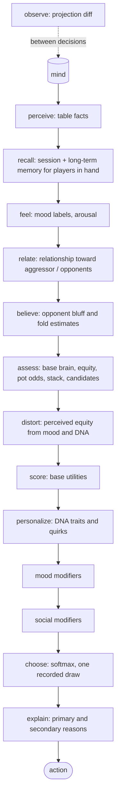

# Bot Brain: character bots that play like people

Status: architecture approved 2026-10-19 (decisions in §25). **Phase 1 built** (§26); phase 2 not started.
Written against `private-club` at `e4561b4a`.

The characters are the five bots with art in `design/mascots/bots/`: **Rohit** (blind king), **Virat**
(maniac), **GG** (rock), **Samay** (calls to see it) and **Dhoni** (the adaptive shark). Ids and
names live in `src/lib/bots/cast.js`; an earlier draft used placeholder names.
Extends `docs/ANALYTICS_SPEC.md` §15 (bots); where the two disagree, this document says so and why.

The product test: **after enough hands, can a player tell which bot they are playing from how it
plays, and when they meet it again, does it feel like the same character who remembers the
table?** Every decision below is judged against that, then against fairness, then cost.

---

## 1. Current architecture

### 1.1 How a bot decision flows today (Cloudflare)

```
host taps "Add bot (normal)"            src/lib/teen-patti/TeenPattiTable.svelte:771-930
  → room DO 'addBot'                    server/cloudflare/room-object.mjs:618
      payload { botId: bot-<uuid>, name: pickBotName(), level }
  → engine transition 'addBot'          server/engine.mjs:712   (p.bot = { level, rebuys })
  → recorder freezes identity           server/analytics/recorder.mjs:238  identityForLevel(level)

every commit → scheduleAlarm → planBot(room)          room-object.mjs:1042
  botDue(room, connected)  (cheap: who must act)      server/bots/runner.mjs
  delay = botDelay(secureRandom, quick)  2-4 s, 1-1.7 s follow-up
alarm → playBot()                                      room-object.mjs:1063
  draws = botRandom(randomUint32)   128-bit seed, counted draws (recorder.mjs:167)
  move  = nextBotMove(room, connected, draws.random)
            → projection(room, botId)    the bot's own seat view, hidden cards masked
            → decide(view, botId, random, profile)     server/bots/strategy.mjs
                 choose(): table move → discard → mistake roll → blind ladder
                           → winChance (96 Monte Carlo samples) → threshold ladder
            → { action, payload, reason }   reason ∈ REASONS (16 fixed codes)
  transition(...) → commit(..., step { kind:'bot', bot:{ seed, draws, reason } })
  recorder: hand capture → outbox → Mongo hand_records / hand_private / hand_sealed
  replay:   verifyBotDecision re-runs nextBotMove with the recorded seed  (recorder.mjs:454)
  sealed:   botTrace[] { chosen, params, probs:{}, reason, memoryRefs:[], rngSeed, rngDraws, verified }
```

The Node server (`server/index.mjs:697-720`) runs the same runner with an in-memory plan map.

### 1.2 Files and functions involved

| File                                                                          | What it owns                                                                                  |
| ----------------------------------------------------------------------------- | --------------------------------------------------------------------------------------------- |
| `server/bots/strategy.mjs`                                                    | `decide`, `choose`, `winChance`, `bestDiscard`, `tableMove`, `PROFILES`, `REASONS`            |
| `server/bots/runner.mjs`                                                      | `nextBotMove`, `botDue`, `botDelay`, `humansPresent`, `pickBotName`, `BOT_NAMES`              |
| `server/bots/identity.mjs`                                                    | `LEGACY_STYLES`, `LEGACY_BOTS`, `STYLES`, `identityForLevel`, `styleConfigHash`               |
| `server/engine.mjs`                                                           | `addBot`/`removeBot` validation (`BOT_LEVELS`), bot rebuys at deal, `projection`, `limits`    |
| `server/cloudflare/room-object.mjs`                                           | `planBot`, `playBot`, bot commits, durable SQLite meta                                        |
| `server/analytics/recorder.mjs`                                               | identity freezing, `botRandom`, `replayHand`, `verifyBotDecision`, `styleProfile`, `botTrace` |
| `server/analytics/store.mjs`                                                  | `bots`, `bot_styles` collections, validators, publishing legacy styles                        |
| `tests/server/bots.test.mjs`                                                  | seat rules, hidden-card invariance, `winChance` sanity, bot-table soak per variant            |
| `tests/server/helpers/table-sim.mjs`                                          | `TableSim`: a table driven exactly like the DO, with the recorder                             |
| `tests/fixtures/replay-corpus.json.gz`                                        | recorded hands that must replay exactly                                                       |
| `src/lib/teen-patti/TeenPattiTable.svelte`, `src/lib/start/StartPanel.svelte` | level picker, `?bots=N&level=`                                                                |

### 1.3 What already exists that we reuse

1. **The information boundary is already structural.** A bot only ever sees `projection(room, botId)`.
   The new brain keeps that as its _only_ window on the live table, so fairness carries over by construction.
2. **Recorded randomness and exact replay.** `botRandom` + `verifyBotDecision` already prove each
   bot decision is reproducible. The new policy plugs into the same mechanism; it needs one more input (§6.4).
3. **Identity and immutable styles.** `bots` / `bot_styles` with `policy`, `tendencies`, `configHash`
   are exactly the shape character bots need. A character is a new bot with a style whose `policy`
   is the new code and whose `tendencies` is its personality DNA.
4. **`botTrace` in the sealed tier** already has empty `probs` and `memoryRefs` slots waiting for this.
5. **`winChance` and `bestDiscard`** are good, variant-aware, cached Teen Patti skill. They become the base brain's equity estimate unchanged.
6. **The pure engine** (`transition` + `projection`) is fast enough for simulation as it is (measured below), so no second "fast engine" is needed.
7. **Analytics compute** (`server/analytics/compute/*`) already derives per-player tendencies from records; long-term opponent memory (§7.4) is the same kind of computation, filtered to what one bot observed.
8. **Five bots already have character art** (`design/mascots/bots/`): Rohit, Virat, Dhoni, GG and Samay. Legacy practice bots keep their own random names (`BOT_NAMES`).

**Measured baseline (2026-10-19, M-series Mac, Node 26, one core):** 5 legacy bots, classic,
2,000 hands: 38,896 decisions in 2.74 s → **~730 hands/s, 0.07 ms per decision including the
engine transition.** One million hands ≈ 23 min on one core, ≈ 3 to 4 min on 8 worker threads.

### 1.4 Problems and limits of today's bots

| #   | Problem                                                                                        | Consequence                                                                                              |
| --- | ---------------------------------------------------------------------------------------------- | -------------------------------------------------------------------------------------------------------- |
| 1   | Bots differ only in 7 thresholds tuned for difficulty                                          | Easy/normal/hard feel like the same bot at different skill, never like different people                  |
| 2   | **Stateless**: every decision reads only the current snapshot                                  | No memory of the last hand, of who raised whom, of who bluffed. Nothing can tilt, hold a grudge or adapt |
| 3   | The projection has **no in-hand action history**, only `handBet`, `isBlind`, `isPacked`, `pot` | "Who raised me?" is not even observable to `choose()` today; it needs an observation stream              |
| 4   | `mistake` is a uniform random click                                                            | Mistakes look robotic: packing a trail for no reason. Humans err for reasons                             |
| 5   | One monolithic `choose()` with an if-ladder                                                    | Adding personality means more branches per character; no per-step explanation; no `probs`                |
| 6   | Only `hard` reads opponents, by one fixed multiplier (`strength *= 0.9`)                       | No opponent models at all                                                                                |
| 7   | Bets are only `minBet` or `maxBet`                                                             | Fine for v1; sizing personality (e.g. small blind raises) needs a middle size later                      |
| 8   | Same think time for everyone                                                                   | A cheap, visible personality cue is unused                                                               |
| 9   | Policy registry is hardcoded: `styleProfile` accepts only `LEGACY_POLICY`                      | A second policy needs a small registry                                                                   |
| 10  | Character names are handed to anonymous legacy bots at random                                  | A "Rohit" in history may be a `legacy-easy` seat; names must become character-owned                      |
| 11  | Bot-vs-bot soak test exists but no measurement                                                 | Nothing says what a bot's style actually _is_ in numbers                                                 |

---

## 2. Architecture overview

```
 live table (DO / Node)                      offline (Mac, scripts/, never in prod)
 ─────────────────────                       ──────────────────────────────────────
 engine.transition ──commit──┐               sim/ headless league (worker threads)
                             ▼                    │  same engine, same policies
 observe(): projection diff per seated bot        ▼
   → BotObservation events (public only)     training records (gz, columnar rows)
                             ▼               fingerprints, gates, league tables
 updateMind(): appraise → mood, relations,        │
   opponent models, session memory                ▼
   (pure; persisted per seat; snapshot at deal)   tuning (search over DNA), later AI-assisted
                             ▼                    │
 decide(): named-node graph                       ▼
   perceive → recall → feel → relate → believe    publish new immutable style version
   → assess → distort → score → personalize       (gates + owner review)
   → mood → social → choose → explain
                             ▼
 { action, payload, reason, trace } → transition → recorder (seed, draws, mind snapshot, trace)
```

Three rules hold the whole thing together:

1. **Decide reads, observe writes.** `decide(view, mind, style, random)` never mutates the mind.
   The mind changes only in `updateMind(mind, observation, style)`, which runs after commits.
   Both are pure. That separation is what makes every decision replayable and testable.
2. **The mind is built only from observations, and observations are built only from the bot's
   own projections.** No other path into a bot exists. Fairness is a property of the plumbing,
   not of each node's good behaviour.
3. **Personality is data; the policy is code.** Five characters share one policy
   (`tp-character@1`). A character is a DNA vector plus named quirks drawn from a fixed registry.
   No `if (bot === 'rohit-sharma')` anywhere.

---

## 3. Decision 1: a named-node graph in plain code

**Decision.** The decision process is a list of named, pure nodes executed in order by a ~60-line
runner in `server/bots/graph.mjs`. Each node declares `id`, what it reads and writes on a
per-decision `scratch` object, and returns contributions. The runner records the node path and
each node's contributions. `toMermaid(graph, path?)` renders the same definition, optionally
highlighting the path one recorded decision took.

**Why.** It gives named stages, per-stage explanation, a drawable graph and a replay highlight,
with zero dependencies, synchronous execution (Worker-safe) and the same determinism as today.

**Alternatives.**

| Option                                             | Verdict                                                                                                                                                                 |
| -------------------------------------------------- | ----------------------------------------------------------------------------------------------------------------------------------------------------------------------- |
| LangGraph (JS) in the live loop                    | Rejected. Async runtime, a dependency in the Worker, per-step overhead, built for LLM agent state; buys only a diagram we can draw ourselves. Fine later, offline (§21) |
| XState / a state-machine library                   | Rejected. The decision is a feed-forward pipeline, not a state machine; adds a dependency for nothing                                                                   |
| Keep one `choose()` and add branches per character | Rejected. Becomes five intertwined functions; no `probs`, no attribution                                                                                                |
| One function per character                         | Rejected. Duplicates Teen Patti skill five times; personalities drift apart in skill as well as style                                                                   |

**Tradeoff.** A fixed linear order is less flexible than an arbitrary DAG. The decision really is
linear (each layer refines the last), so a DAG would add complexity without behaviour.

## 4. Decision 2: utilities and a softmax instead of a threshold ladder

**Decision.** The base brain scores every legal _candidate_ (`pack`, `see`, `chaal` = minBet,
`raise` = maxBet, `show`; plus forced moves) with a baseline utility. Later nodes add **named
deltas** to those scores ("rivalry +0.4 to raise"). The `choose` node turns scores into
probabilities with a softmax whose temperature comes from personality and mood, then samples once
from the recorded random source.

```
score(a) = base(a)                      Teen Patti skill: equity, pot odds, stack, opponents
         + Σ personality modifiers(a)   DNA traits and quirks
         + Σ mood modifiers(a)          frustration, fear, confidence...
         + Σ social modifiers(a)        rivalry, suspicion, beliefs about the aggressor
p(a)     = softmax(score / τ),  τ = τ₀ · (1.4 − discipline) · (1 + 0.8 · arousal)
```

**Why.**

- Personality becomes a **smooth bias**, not a different rulebook. Virat and GG see the same
  situation the same way and _lean_ differently, which is what a person does.
- It fills `botTrace.probs`, which the spec reserved and §15.8 needs for entropy and predictability.
- **Attribution is free:** the primary reason is the named delta that most separates the chosen
  action from the runner-up; secondary reasons are the next ones.
- **Mistakes become explainable:** a tilted bot has a higher τ and an inflated perceived equity,
  so its "mistakes" carry reasons (`tilt`, `ego`, `fear`), not `mistake`.

**Alternatives.** Threshold ladder per trait (today's shape: brittle, no probabilities);
expectiminimax or CFR solving (Teen Patti with 6 players and 20 variants is not solvable cheaply,
and an equilibrium bot has no personality); a learned neural policy (no data or measurement yet;
see §21).

**Tradeoff.** Utilities are less readable than "raise if strength ≥ 0.72". Mitigated by scenario
tests (§18) and by fingerprints that report what the bot actually does.

---

## 5. Data structures

### 5.1 Character style (immutable, in `bot_styles`)

The existing style document stays; `tendencies` carries DNA for the new policy.

```js
{
  _id: 'rohit-sharma@1', botId: 'rohit-sharma', version: 1, parent: null, status: 'published',
  policy: 'tp-character@1',
  supportedGames: ['teen-patti'], supportedVariants: ['*'],
  tendencies: {
    dna:    { aggression: 0.55, patience: 0.6, ... },         // §8, all 0..1
    quirks: [{ id: 'blindPride', strength: 0.8 }],             // fixed registry, §8.3
    tempo:  { thinkMs: [1800, 3400], snapOnBlind: 0.6 },       // presentation only, §16.3
    targets: { fingerprint: 'fp@1', bands: { blindRounds: [3, 6], ... } }   // §14, §19
  },
  configHash, source: 'manual', validation: { ... }
}
```

`configHash` already covers `tendencies`, so DNA, quirks and targets are versioned and hashed with no schema change.

### 5.2 Bot mind (per bot seat, mutable between decisions)

```js
{
  v: 'mind@1', botId: 'rohit-sharma', styleId: 'rohit-sharma@1',
  asOf: { nightId, handNo, rev },                 // last observation folded in
  mood:  { confidence: .5, frustration: .1, fear: .2, suspicion: .3, excitement: .2 },   // §9
  self:  { hands: 37, net: -14, streak: -2, rebuys: 1, lastBig: { hand: 35, delta: -9, by: 'p7' } },  // boots
  others: {                                        // keyed by player id (human or bot seat)
    p7: {
      model: { ... },                              // opponent model, §11
      rel:   { familiarity: .4, respect: .5, rivalry: .7, annoyance: .3, trust: .4, fear: .2 },  // §9.3
      recent: { won: 3, raisedMe: 2, caughtBluffing: 1, lastSeenHand: 36 }
    }
  },
  table: { aggression: .55, tightness: .4, tempoHands: 8 },   // EWMAs, §10
  hand:  { raises: [[who, amount, blind]], pressure: 0, aggressor: 'p7', revealed: {} },   // reset each deal
  longTerm: { version: 'ltm@1#a91c', players: { ... } }        // read-only snapshot, §7.4, phase 5
}
```

Bounded by construction: at most 5 `others` per table (plus departed players dropped after the
night), fixed fields, `hand` cleared each deal. Target ≤ 2 KB serialized per bot.

### 5.3 Observation (the only input to the mind): versioned interface `obs@1`

The observation stream is the foundation of memory, relationships, opponent models and training
data, so it is a **versioned interface**: adding an optional field is a minor change; renaming,
removing or changing the meaning of a field, or changing when an event fires, is `obs@2`, and
every stored mind and training shard records the version it was built from.

```js
{ k: 'bet',    who, amount, blind, boots, raised }       // raised: above the previous stake
{ k: 'see',    who }
{ k: 'pack',   who, facing: 'raise' | 'chaal' | null }
{ k: 'show',   who, against }
{ k: 'deal',   handNo, seats, stacks }
{ k: 'result', winners, amounts, reason, revealed: { id: [cards] } }   // only cards this bot's projection shows
{ k: 'seat',   who, joined | left }
```

Built by `observe(prevView, nextView)` from two consecutive projections **for that bot**, so an
observation can contain nothing the bot could not see on screen.

`{ k: 'rebuy', who, amount }` is also observed, as a **stack event only** (approval A11): mood reacts
to the hand result that preceded it (e.g. `BIG_LOSS`), never to the rebuy itself, so a loss is never
felt twice.

### 5.4 Decision output and trace

```js
decide(...) → {
  action, payload,
  reason: 'rivalry-pressure',                 // primary, from the extended REASONS list
  trace: {
    path: ['perceive','recall','feel','relate','believe','assess','distort','score','personalize','mood','social','choose'],
    probs: { pack: .12, chaal: .31, raise: .57 },
    factors: [['social.rivalry','raise',.42], ['mood.frustration','raise',.30], ['base.equity','pack',.25]],  // top 6
    secondary: ['suspected-bluff', 'tilt'],
    equity: .31, perceived: .44,              // own-card information: sealed tier only
    mood: [.5,.8,.1,.6,.4], focus: 'p7', mindHash
  }
}
```

---

## 6. The live mind: where it lives and how it stays replayable

### 6.1 Update path

On every commit in the DO (and in the Node server's equivalent), for each seated bot:
`obs = observe(projection(before, bot), projection(after, bot))` → `mind = updateMind(mind, obs, style)`.
Projections for 5 bots on each commit cost tens of microseconds (§16).

### 6.2 Storage

- **DO:** new SQLite table `bot_minds(seat_id TEXT PRIMARY KEY, json TEXT)`, written in the same
  transaction as the commit, so minds survive DO restarts and never diverge from the room.
- **Node server:** an in-memory map beside `botPlans`; the Node server is for local play, where losing minds on restart is acceptable.
- The engine `room` snapshot is **not** changed. Minds are not game state and must never reach clients.

### 6.3 Why not put the mind in the room state

It would flow through `projection` and client snapshots, bloat every commit and history row, and
mix bot psychology with game rules. Keeping it beside the room, keyed by seat, keeps the engine
untouched.

### 6.4 Replay

A recorded hand must still re-run each bot decision exactly.

1. At the deal, the recorder stores each bot's **mind snapshot** (`mindAtDeal`, ≤ 2 KB) and its hash in the hand capture → sealed tier.
2. During replay, `verifyBotDecision` rebuilds the in-hand mind by folding `observe()` over the
   replayed states from the deal to the step, then re-runs `decide` with the recorded seed.
3. The seat records `memoryAsOf` / `memoryVersion` as the spec already reserves (`mindAtDeal.asOf`, `longTerm.version`).

Hands therefore replay **independently**, without replaying the whole night. A policy the code
can no longer run reports `policy-unavailable`, as today.

### 6.5 Policy registry

`server/bots/policies.mjs`: `{ 'tp-heuristic@1': legacyDecide, 'tp-character@1': characterDecide }`.
`styleProfile` / `verifyBotDecision` look up `style.policy` instead of comparing to `LEGACY_POLICY`.

---

## 7. Memory model

| Horizon        | Contents                                                                                                      | Lives in                                 | Lifetime                    | Bound                        |
| -------------- | ------------------------------------------------------------------------------------------------------------- | ---------------------------------------- | --------------------------- | ---------------------------- |
| **Short-term** | this hand: raise log, who pressured me, aggressor, pot pressure, my mood now; last 3 hands summary            | `mind.hand`, `mind.recent`               | cleared at deal / rolling 3 | fixed size                   |
| **Session**    | tonight: per opponent counts, bluffs caught, who raised me, who's winning, who looks tilted, rivalry and mood | `mind.others`, `mind.self`, `mind.table` | one night at one table      | ≤ 5 opponents × fixed fields |
| **Long-term**  | per (bot, person): summarized tendencies with n, rivalry history, notable counts                              | Mongo `bot_player_memory`                | across nights               | fixed fields per pair        |

### 7.1 Why summaries, not raw history

Raw history already exists, immutable, in `hand_records`. Memory is a **cache with a version**,
rebuildable from it. That gives boundedness, a clean schema version (`ltm@1`) and the ability to
recompute after a bug fix. The spec's §15.5 rule "authoritative hands never live only in memory" holds.

### 7.2 Session → long-term

At the end of a night (the existing `afterNight` hook), the session `others` for human players
are merged into long-term memory by an offline-safe merge (counts add, EWMAs blend by n,
relationships move a fraction toward the session value). **Phase 5.** Until then, bots remember a
night but start the next one fresh.

### 7.3 Bot-to-bot memory

Bots keep session relationships with other bot seats (Rohit and Virat can feud during a night).
Long-term bot↔bot memory is **not** stored in v1 (approval A5): it would let bots co-evolve
stories that no human saw, and it complicates simulation (sims would pollute it).

The schema is ready for it anyway: every relationship and model is keyed by **subject**
(`{ kind: 'human' | 'bot', id }`, where a bot subject is its `botId`, not its per-table seat id), in
the mind and in `bot_player_memory`. Enabling persistent bot↔bot memory later is a merge-policy
flag in the end-of-night step (today: drop `kind: 'bot'` subjects), not a redesign.

### 7.4 Long-term memory rebuild

`bot_player_memory` rows are computed by the analytics compute layer from `hand_records` filtered
to hands where that bot sat **and** to events in its `observers` / `observedBy`. Built offline or
in the outbox drain, never during a decision. The DO loads a bot's rows for the seated players
when the bot sits down and between hands (async, off the decision path), and pins the version into
the mind (`longTerm.version`).

---

## 8. Personality model (DNA)

### 8.1 Traits

All in [0, 1], 0.5 = population typical. Grouped by where they act. Traits from the request that
overlapped were merged (`riskTolerance` absorbs the stack side of `courage`; `curiosity` is the
"I need to see it" call urge; `suspicion` is the prior on bluffs).

| Group   | Trait                | Acts in node        | Meaning                                                         |
| ------- | -------------------- | ------------------- | --------------------------------------------------------------- |
| Play    | `aggression`         | personalize         | prefers raise over chaal, chaal over pack                       |
|         | `bluffAffinity`      | personalize         | bonus to raise with low perceived equity                        |
|         | `blindPreference`    | personalize         | utility of staying blind vs seeing                              |
|         | `showPreference`     | personalize         | asks for show early vs grinds                                   |
|         | `curiosity`          | personalize         | calls to "see what you have"                                    |
|         | `riskTolerance`      | assess, personalize | how stack depth and pot size scale caution                      |
|         | `patience`           | personalize         | willingness to pack marginal hands and wait                     |
|         | `discipline`         | choose              | lower temperature, smaller emotional distortion                 |
| Feeling | `lossSensitivity`    | appraise            | frustration gained from losses                                  |
|         | `winElation`         | appraise            | confidence gained from wins                                     |
|         | `pressureResistance` | appraise, mood      | fear gained from being raised                                   |
|         | `ego`                | appraise            | reaction to being shown up (caught bluff, beaten after raising) |
|         | `moodRecovery`       | appraise            | how fast mood returns to baseline per hand                      |
| Social  | `revenge`            | social              | rivalry turns into raises against that player                   |
|         | `suspicion`          | believe             | prior that aggression is a bluff                                |
|         | `sociality`          | relate              | how strongly relationships move at all                          |
|         | `adaptability`       | believe             | weight on opponent models vs priors; model learning rate        |
|         | `memoryWeight`       | recall              | how much long-term memory counts vs tonight                     |

Plus a **mood baseline** (`mood0`) the mood decays toward: Virat's resting frustration is higher than GG's.

### 8.2 Why this shape

- Each trait maps to **one** place in the graph, so a trait's effect is testable in isolation and a fingerprint metric can be tied back to it.
- Traits are continuous, so tuning (§22) can search them without code changes.
- Alternatives: Big-Five style abstract traits mapped through a matrix (too indirect to tune or
  explain); raw probabilities like today (no emotion or social hooks).

### 8.3 Quirks: signature moves without per-character code

A quirk is a named, versioned modifier in a registry (`server/bots/quirks.mjs`) with a strength
parameter. Characters list the quirks they have; anyone could have any quirk.

| Quirk          | Effect                                                                                                  | Starting owner |
| -------------- | ------------------------------------------------------------------------------------------------------- | -------------- |
| `blindPride`   | penalty on `see` that **grows** when others pressure him while blind; blind wins raise confidence extra | Rohit          |
| `tiltSpiral`   | frustration also raises τ and inflates perceived equity                                                 | Virat          |
| `revengeRaise` | raise bonus against whoever beat or embarrassed him in the last N hands                                 | Virat          |
| `survivalMode` | fear rises with session losses; utility of pack rises with pot size                                     | GG             |
| `bluffCatcher` | strong call bonus against players caught bluffing; memory of each catch                                 | Samay          |
| `readsTable`   | uses opponent models at full weight with confidence gating; balances its own bluff rate                 | Dhoni          |

### 8.4 Starting cast

The published numbers are in `server/bots/characters.mjs` (style `@1`); this table was the design sketch.

Numbers are first guesses to be corrected by simulation (§14). Shown: the traits that define each one.

|                 | Rohit, Blind King | Virat, Maniac            | GG, Rock     | Samay, Calling Station | Dhoni, Shark  |
| --------------- | ----------------- | ------------------------ | ------------ | ---------------------- | ------------- |
| aggression      | .6                | .9                       | .25          | .3                     | .55           |
| bluffAffinity   | .45 (blind)       | .8                       | .1           | .2                     | .4 (balanced) |
| blindPreference | .95               | .5                       | .2           | .45                    | .5            |
| showPreference  | .35               | .7                       | .55          | .75                    | .5            |
| curiosity       | .4                | .5                       | .2           | .9                     | .4            |
| patience        | .5                | .1                       | .9           | .35                    | .8            |
| discipline      | .45               | .15                      | .75          | .4                     | .9            |
| lossSensitivity | .5                | .95                      | .7 (→ fear)  | .4                     | .2            |
| ego             | .8                | .8                       | .2           | .4                     | .3            |
| revenge         | .4                | .9                       | .1           | .3                     | .2            |
| suspicion       | .4                | .5                       | .5           | .9                     | .6            |
| adaptability    | .2                | .2                       | .3           | .4                     | .95           |
| quirks          | blindPride        | tiltSpiral, revengeRaise | survivalMode | bluffCatcher           | readsTable    |

Dhoni is the only character whose design goal includes **low exploitability**; the others are
deliberately exploitable in recognizable ways (approval item A8).

---

## 9. Emotion and relationship model

### 9.1 Mood: five continuous dimensions

`confidence`, `frustration`, `fear`, `suspicion`, `excitement`, each in [0, 1]. Named states are
**labels derived for display and traces**, not stored state:

| Label      | Rule (v1)                                |
| ---------- | ---------------------------------------- |
| tilted     | frustration > .7 and discipline-adjusted |
| cocky      | confidence > .75                         |
| nervous    | fear > .6                                |
| desperate  | fear > .5 and stack < 10 boots           |
| suspicious | suspicion > .65                          |
| calm       | everything within .15 of baseline        |

**Why continuous.** Discrete states jump; people drift. Continuous mood decays smoothly toward
the character's baseline (`moodRecovery` per hand) and composes with other signals as numbers.
**Alternative**: a finite state machine of moods: simpler to display, but transitions become
another rulebook per character.

### 9.2 Appraisal: one event, different reactions

Events (from observations, §10) pass through **one generic appraisal table** whose weights are
DNA traits. Different characters react differently because their traits differ, not because the
code branches.

| Event                                       | Δ mood (weights)                                                                                                                | Δ relationship toward actor        |
| ------------------------------------------- | ------------------------------------------------------------------------------------------------------------------------------- | ---------------------------------- |
| `BIG_LOSS` (≥ 8 boots)                      | frustration += lossSensitivity·k; confidence −= ...; fear += (1−riskTolerance)·k                                                | rivalry += ego·k toward winner     |
| `CAUGHT_BLUFF` (I called, they showed junk) | confidence += k; suspicion toward them ↑                                                                                        | trust −=, respect −=               |
| `GOT_BLUFFED` (I packed, later shown weak)  | frustration += ego·k                                                                                                            | annoyance +=, rivalry += revenge·k |
| `RAISED_INTO_ME`                            | fear += (1−pressureResistance)·k                                                                                                | annoyance += k·(repeat count)      |
| `BLIND_WIN`                                 | confidence += k·(1 + blindPride)                                                                                                |                                    |
| `OPP_STREAK` (someone won 3 of last 5)      | Rohit: rivalry↑ via ego; Virat: rivalry↑ via revenge; GG: fear↑; Samay: suspicion↑; Dhoni: model learning rate ↑ (adaptability) |                                    |
| `REVENGE_SUCCESS`                           | confidence ↑, frustration ↓                                                                                                     | rivalry ↓ slightly                 |

### 9.3 Relationships

Per other player: `familiarity`, `respect`, `rivalry`, `annoyance`, `trust`, `fear`. Each moves by
an EWMA step scaled by `sociality`, so relationships evolve over many events rather than flipping.
Annoyance decays per hand; rivalry decays per night; familiarity only grows.

**Example (from the request):** Rohit bluffs Virat twice (Virat packs, Rohit shows weak at a later
showdown → `GOT_BLUFFED` twice: Virat's annoyance and rivalry toward Rohit rise). Virat catches the
third (`CAUGHT_BLUFF`: Virat's confidence and suspicion-of-Rohit rise, trust falls). Next time Rohit
raises into Virat, the `social` node adds rivalry and suspected-bluff bonuses to Virat's call and
raise. Trace: `primary: rivalry-pressure, secondary: suspected-bluff`.

### 9.4 How mood and relationships change decisions

- **Distort** node: `perceived = equity + bias`, where bias grows with confidence and frustration
  (Virat, `tiltSpiral`) and shrinks with fear (GG). Clamped, and scaled by (1 − discipline).
- **Choose** node: τ grows with arousal (frustration + excitement), so tilted bots are noisier.
- **Social** node: deltas toward the current aggressor or remaining opponent from rivalry,
  annoyance, fear and the opponent's estimated bluff rate.

These replace the `mistake` roll. A small irreducible ε (≤ 1%, uniform over legal actions)
remains so no bot is perfectly predictable; its reason is `noise`.

---

## 10. Table perception

**Decision.** The `perceive` node turns the mind's short-term and session data into a list of
**facts** with a strength and an optional subject: `{ f: 'bully', who: 'p7', on: 'p3', s: .8 }`.
Modifiers query facts; traces record the top facts.

| Fact                             | Derived from (all observable)                                                                    |
| -------------------------------- | ------------------------------------------------------------------------------------------------ |
| `headsUp`                        | two players left                                                                                 |
| `underPressure` (me)             | raises since my last action, in boots                                                            |
| `aggressor`                      | who raised last / most this hand                                                                 |
| `bully` (who, on)                | same player raising the same target repeatedly, tonight                                          |
| `targeted` (on)                  | ≥ 2 players raising one player this hand                                                         |
| `revengeChance` (who)            | that player beat or bluffed me in the last 3 hands and is now in a pot with me                   |
| `suspectedBluff` (who, p)        | their model's bluff estimate × unexpectedness of this raise                                      |
| `unexpected` (who)               | action surprise under their model (−log p > threshold)                                           |
| `shortStack` / `richBully` (who) | stack in boots, relative to table                                                                |
| `hotStreak` (who)                | wins in recent hands                                                                             |
| `onTilt` (who)                   | **observed** behaviour shift after a big loss (raise rate jump), never inferred from hidden data |
| `tableWild` / `tableTight`       | table aggression EWMA vs population prior                                                        |
| `behaviourShift` (who)           | recent vs session model divergence                                                               |

**Why facts, not just numbers.** They make traces human-readable ("Virat saw: Atishay bullying
GG"), they are the vocabulary for table-talk cues (§17), and modifiers stay small.
**Alternative:** raw feature vectors only, which suit learning but read badly in a debug view.
The training record stores the numeric form (§13); the facts are a view over the same numbers.

---

## 11. Opponent models

Per opponent, from observations only:

```js
model: {
  n: 43,                                         // decisions observed
  blind: { rounds: [sum, n] },                   // mean blind duration
  seen:  { raise: [a, b], chaal: [a, b], pack: [a, b] },     // Beta counts when seen
  foldToRaise: [a, b],
  showAsk: [a, b],
  bluff: { shown: 6, weakShown: 2 },             // from hands they showed at showdown only
  recent: { raise: ewma, pack: ewma },           // for behaviour-change detection
}
```

- Priors come from a **population default** shipped with the policy version (hand-set in v1;
  later from aggregate, de-identified data as allowed by spec §15.2 rule 4).
- **Confidence** is the posterior's n; a belief only moves a decision in proportion to
  `adaptability × confidence(n)`. Dhoni trusts 30 observations; Rohit barely uses them.
- **Bluff estimate** is learned only from cards a player actually showed. A packed hand never
  reveals anything, so a player who never shows down keeps the prior. That is the fairness line.
- Beliefs enter the score in two places: calling a raise (P(bluff) raises the call utility) and
  raising (estimated fold-to-raise raises bluff utility). That is "Dhoni has figured out how I play".

**Alternatives.** Hand-range modelling (Bayesian over opponent holdings): far more expensive per
decision and over-precise for a friends' game; maybe Phase 5+ for Dhoni only. Learned embedding
models: no data yet.

---

## 12. The decision graph



- Short-circuits keep today's correct behaviour: forced table moves and discards are handled
  first by `assess` (reusing `tableMove` / `bestDiscard`) and skip the rest of the graph; the path records the skip.
- The appraisal step (`updateMind`) is **not** in the decision graph; it is its own small graph
  (`observe → appraise → relate → model → cues`) run on commits.
- `toMermaid(GRAPH, trace.path)` colours the nodes a decision visited and labels edges with the
  largest factor, which is the replay/debug highlight.

### 12.1 Reasons

`REASONS` stays as is (legacy policy only). The new policy has `REASONS_CHARACTER@1`, a superset:
the 15 non-`mistake` legacy codes plus

`rivalry-pressure, revenge-raise, suspected-bluff, bluff-catch, tilt, fear-pack, ego-call,
blind-pride, curiosity-call, pot-control, model-exploit-fold, model-exploit-call, table-wild,
short-stack-shove, noise`.

Reasons stay a fixed vocabulary (no free text), as spec §15.6 requires.

---

## 13. Simulation and training records

### 13.1 Simulator

`server/sim/` (pure, no I/O) + `scripts/sim/*.mjs` (CLI, worker threads, file output).

- **Same engine, no fork.** Hands run through `transition` + `projection` + the real policies,
  exactly like `TableSim`. 730 hands/s/core today; a 2 to 3× slower character policy still gives
  ≈ 1M hands in 10 to 20 minutes on 8 threads. A separate fast engine is not built unless
  measurement demands it, because a second rules implementation is a fairness and correctness risk.
- **Seeds:** `simSeed → tableSeed(i) → handSeed(i, h)` and `decisionSeed(table, hand, step)` by a
  counter-based hash (no shared PRNG stream), so any single hand reproduces from `(simSeed, i, h)`
  without replaying the run.
- **Duplicate mode** to cut variance: the same deck sequence is replayed with seats rotated, so luck mostly cancels in comparisons (Virat v12 vs v13).
- **Population registry** (`server/sim/population.mjs`): any style id (`rohit-sharma@3`, `legacy-hard@1`),
  baseline bots (`random`, `always-chaal`, `always-raise`, `rock`, `station`), synthetic human
  archetypes (§13.3) and historical checkpoints. A table spec is either fixed or sampled (`{ draw: 5, from: [...] , weights }`).
- **Minds in sim:** each sim seat runs the real `observe` / `updateMind`. Sims start from an empty
  long-term memory or a synthetic one; they never write to Mongo.
- **Nights:** a sim "night" is N hands at one table so session memory, tilt and rivalry matter.

### 13.2 Training records (`tp-train@1`)

One row per bot decision, **arrays, not objects**, with one header per shard:

```
header: { schema: 'tp-train@1', fp: 'fp@1', engine, policyVersions, columns: [...], dicts: { style: [...], reason: [...] } }
row:    [sim, table, hand, step, style, variant, stage, alive, blinds, amBlind, potB, stackB, costB,
         headsUp, showOk, legalMask, eq8, perc8, mood5..., facts32, focusRel6..., focusModel5...,
         probs5..., chosen, reason, reason2, outNet, outShowdown, outWon]
```

- Numbers quantized: equity and 0..1 values as 0..255 integers, money in tenths of a boot.
- **Outcome** columns are filled at hand end (buffer per hand). **Rewards are not stored**; they are
  computed offline from outcomes so reward definitions can change with a version, not a re-run.
- Format: gzip NDJSON of arrays, one shard per worker per 100k hands. ≈ 70 to 90 bytes raw per
  row; 20M rows (1M hands) ≈ 1.6 GB raw, ≈ 300 to 400 MB gzipped. **No dependency.** If this
  becomes a bottleneck, switch to raw typed-array column files (still no dependency) before
  considering Parquet (Apache Arrow) as an offline-only dev dependency.
- Live hands do **not** produce training rows; their sealed-tier traces can be exported to the same
  format offline, through the privacy path in §23.

### 13.3 Synthetic human archetypes

Implemented as DNA presets on the same character policy (no new code): `beginner` (high τ, curious,
sees early), `very-conservative`, `aggressive`, `frequent-bluffer`, `calling-station`, `random`,
`short-stack-desperate`, `rich-bully`, `emotional` (high loss sensitivity), `unpredictable` (high τ),
and `expert-baseline` (Dhoni-like DNA with no quirks). Plus `legacy-easy/normal/hard` as fixed references.

---

## 14. Behavioural fingerprint (`fp@1`)

Computed from simulated (or recorded) decisions with CIs. Teen-Patti-specific definitions:

| Metric                         | Definition                                                                                 |
| ------------------------------ | ------------------------------------------------------------------------------------------ |
| Blind rounds                   | mean bets placed blind before `see` (or until hand end)                                    |
| Blind raise rate               | P(maxBet \| blind, bet)                                                                    |
| Stay-in rate (VPIP equivalent) | P(still in after first seen decision)                                                      |
| Chaal / raise / pack rates     | per decision, split blind vs seen                                                          |
| Aggression factor              | raises / chaals while seen                                                                 |
| Fold to raise                  | P(pack \| faced a raise since last action)                                                 |
| Show ask rate                  | P(show \| show legal) and mean rounds before asking                                        |
| Showdown rate, won-at-showdown | per hand                                                                                   |
| Bluff rate (oracle, bots only) | P(raise \| perceived-free equity < .35)                                                    |
| Call-down rate                 | P(chaal \| facing raise, equity < .5)                                                      |
| Tilt index                     | Δ aggression and Δ τ in the 3 hands after a BIG_LOSS vs baseline                           |
| After-win delta                | same after a win ≥ 8 boots                                                                 |
| Revenge index                  | P(raise vs X \| X beat me last 3 hands) − P(raise vs others)                               |
| Stack sensitivity              | aggression slope vs stack in boots                                                         |
| Adaptation                     | Jensen-Shannon divergence of action distribution vs one opponent, early vs late in a night |
| Entropy                        | mean policy entropy per decision type (from `probs`)                                       |
| Strength                       | boots/100 hands vs the reference population, duplicate mode                                |

**Identifiability**, the product test made measurable: a simple nearest-centroid (or logistic)
classifier on **public** fingerprint features of k-hand windows must name the right character.
Measured at **10, 25, 50 and 100 hands** with a confusion matrix at each, so the report shows how
fast a personality becomes recognizable. Target ≥ 90% at 50 hands, but no version is optimized for
that one number (approval A9).

**Diversity within a character** is measured alongside: the spread of one character's windows
around its own centroid, against the distance between character centroids. Rohit should stay
recognizably Rohit while individual Rohit sessions still vary. Very high identifiability with very
low within-character spread is a warning sign (a caricature), not a win.

**Three axes, always reported separately:** playing competence (boots/100 against a fixed field),
character identity (identifiability, distances), human believability (needs people; never replaced
by a proxy number). Optimizing one must not be read as progress on another.

---

## 15. Storage implications

| Store                               | New                                                                       | Size                                                  |
| ----------------------------------- | ------------------------------------------------------------------------- | ----------------------------------------------------- |
| Mongo `bot_styles`                  | character styles; DNA in `tendencies`                                     | tiny                                                  |
| Mongo `bots`                        | 5 character rows (+ owner-added later)                                    | tiny                                                  |
| Mongo `hand_sealed`                 | `mindAtDeal` per bot seat (≤ 2 KB) + richer `botTrace` (≈ 250 B/decision) | ≈ +10 to 15 KB per bot-heavy hand; fine at club scale |
| Mongo `bot_player_memory` (phase 5) | one row per (bot, person), fixed fields                                   | ≈ 1 KB × bots × members                               |
| DO SQLite `bot_minds`               | one row per bot seat                                                      | ≤ 2 KB × 5                                            |
| Local disk (Mac)                    | sim shards, fingerprints, league results                                  | GBs; never uploaded to prod                           |

The `hand_sealed` validator (`store.mjs`) needs new optional fields; the recorder version bumps.

---

## 16. Worker performance

- **Per decision:** today 0.07 ms including the transition. Budget for the character policy:
  **≤ 1 ms p99 in Node**, measured by a test. `winChance`'s 96 samples dominate and stay.
- **Per commit:** `observe` + `updateMind` for ≤ 5 bots ≈ 5 projections + small arithmetic; budget ≤ 0.5 ms.
- **No async in decide or observe.** Long-term memory is loaded at seat time / between hands, never awaited inside a turn.
- **Memory:** minds ≤ 10 KB per room; the score cache is unchanged.
- **Think time** (`botDelay`) gets per-character ranges from `tempo`, but stays drawn from
  `secureRandom` outside the recorded decision, as today, and **never depends on cards** (§17).

---

## 17. Fairness and hidden-information risks

| Risk                             | Mitigation                                                                                                                                                                                                         |
| -------------------------------- | ------------------------------------------------------------------------------------------------------------------------------------------------------------------------------------------------------------------ |
| A node reads the raw room        | Nodes receive only `view` (projection) and `mind`. `decide` and `observe` take no room argument. Lint-style test: `server/bots/**` may not import the room store, Mongo or recorder internals                      |
| Mind built from hidden data      | `observe` takes two projections of the same bot. Expanded invariance test: swap every opponent's hidden cards across a **whole hand** and a **whole night**; the bot's minds and decisions must be identical       |
| Future information               | Mind snapshot pinned at deal; long-term memory version pinned; `observe` only folds the past; test that a later hand cannot change an earlier `mindAtDeal` hash                                                    |
| Bluff learning from folded hands | Bluff estimates only update from `result.revealed`, which comes from the bot's projection                                                                                                                          |
| Bot-to-bot collusion             | Each bot's mind is private to its seat; no shared state. Bot↔bot relationships are emotional, never informational. Test: a bot's decision is invariant to every other bot's mind                                   |
| **Card-dependent tells**         | Think time and table-talk cues must not reveal private-card information mid-hand. Cues computed only from public observations; card-derived cues (e.g. "confident") are held until the hand ends. Approval item A6 |
| Debug view leaks                 | Traces live in the sealed tier; the inspector is owner-only (existing admin auth), and never shows a human's private cards                                                                                         |
| Long-term memory scouting        | `bot_player_memory` is built from public-tier data the bot observed, as spec §15.2 rule 3; never from other bots' memories or admin analytics                                                                      |

---

## 18. Testing strategy

1. **Legacy unchanged:** existing `bots.test.mjs` and the replay corpus must pass byte-for-byte with `tp-heuristic@1`.
2. **Determinism:** same seed → identical decision, trace and mind, for every node.
3. **Replay:** character decisions reproduce from `mindAtDeal` + steps + seed (`verified: 'reproduced'`).
4. **Invariance (expanded):** hidden-card swaps across a hand and a night; other-bot-mind independence; no-future checks.
5. **Node unit tests:** e.g. `BIG_LOSS` raises Virat's frustration ≥ 3× GG's; GG's fear rises instead.
6. **Scenario tests (behavioural):** scripted positions with asserted probability bounds, e.g.
   "Rohit, blind, round 3, one raise faced: P(see) < .2"; "Samay vs a player caught bluffing twice: P(chaal) > .7".
7. **Bounds:** mind size ≤ 2 KB after 500 simulated hands; trace size ≤ 400 B.
8. **Performance:** decision p99 ≤ 1 ms in Node on a fixed scenario set.
9. **Fingerprint gates (offline, pre-publish):** bands per character + identifiability ≥ 90% @ 50 hands + strength floor. Run by a script, not in `npm test` (too slow); a 2k-hand smoke version runs in `npm test`.
10. **Soak:** every Teen Patti variant with 5 character bots, no stalls, chips conserved (extends the existing soak).

---

## 19. Migration strategy

1. Keep `tp-heuristic@1` and the legacy styles forever: they are baseline, fallback, regression opponent and sim participant.
2. Add a policy registry; legacy goes through it with byte-identical behaviour (corpus proves it).
3. Engine: `addBot` accepts `{ character: 'rohit-sharma' }` as well as `{ level }`; `p.bot = { level?, character, styleId, rebuys }`.
   Projection keeps `bot: level` for legacy seats and gains `bot: 'rohit-sharma'` for characters.
   One character per table.
4. `BOT_NAMES` loses the five character names; legacy seats get other names. History is unaffected (analytics keys on `botId`).
5. Picker: characters appear first for owners only (flag), then for everyone; legacy levels remain under "Practice" until the owner retires them (spec says retire).
6. Fallback: if the character policy throws, the bot plays that turn with `tp-heuristic@1` at
   `normal`, recorded as such (`reason: 'fallback'`), so a bug never wedges a table.
7. Node server gets the same runner changes; minds in memory.

---

## 20. Implementation phases

Changed from the proposed order in one way: **a minimal simulator and fingerprint move into
Phase 1.** Without measurement, Phase 1's personalities cannot be checked against their intent,
and every later phase builds on numbers we never looked at.

### Phase 1: Skeleton, DNA and measurement

- `graph.mjs` (runner, Mermaid export), policy registry, `tp-character@1` with **personality only**
  (perceive/assess/score/personalize/choose/explain; no mind yet: those nodes are no-ops).
- Base brain extracted from `choose()` as functions (equity, pot odds, candidates) without changing the legacy policy.
- 5 character styles (`rohit-sharma@1` ...), quirks that need no memory (`blindPride` blind part, `survivalMode` pot part).
- Engine/DO/Node `addBot` by character; picker behind owner flag; `BOT_NAMES` change.
- Trace: `path`, `probs`, `factors`, extended reasons; recorder + validator update; replay verification.
- Minimal headless sim CLI (single thread) + `fp@1` core metrics + identifiability check.
- **Exit:** legacy byte-identical; character decisions replay; 5 characters distinguishable ≥ 80% @ 50 hands on DNA alone.

### Phase 2: The mind

- `observe`, `updateMind`, appraisal table, mood, relationships, session opponent models, perception facts.
- `bot_minds` SQLite table; `mindAtDeal` in captures; replay with minds.
- Remaining quirks (`tiltSpiral`, `revengeRaise`, `bluffCatcher`, `readsTable`).
- Semantic cue events emitted (not yet shown).
- CLI decision inspector (`scripts/bots-explain.mjs <handId>`) printing the request's "BUNTY DECISION" block from sealed traces.
- **Exit:** expanded invariance suite green; identifiability ≥ 90% @ 50 hands; tilt/revenge indices show the intended direction per character.

### Phase 3: Simulation at scale

- Worker threads, seed derivation, duplicate mode, population registry, archetypes, `tp-train@1` shards, nights.
- **Exit:** 1M hands < 30 min on the Mac; any hand reproducible from `(simSeed, table, hand)`.

### Phase 4: Gates and league

- Full `fp@1`, bands per character, regression gate script, version-vs-version report ("did Virat get stronger, is he still Virat").
- League: boots/100 matrix by matchup with CIs, population strength, convergence check (distance between characters' fingerprints over versions). Rating: matchup matrix first; a TrueSkill-like rating only if the matrix is not enough.

### Phase 5: Long-term memory and tuning

- `bot_player_memory`, rebuild job, end-of-night merge, DO loading and pinning.
- Personality-preserving search over DNA (random search / CMA-ES-style, no ML dependency) with an objective of strength subject to fingerprint bands and identifiability.
- Self-play populations with historical checkpoints.

### Phase 6: Tools and presentation

- Admin Bots pages (spec §15.7), graph view with replay highlight, owner decision inspector.
- Table talk from cue events (fixed phrase lists per character first).
- Optional offline AI-assisted tuning: Claude proposes DNA drafts; possibly LangGraph to orchestrate propose → simulate → gate → human review. Output is always a plain style config through the normal pipeline.

---

## 21. Not built yet (on purpose)

- LangGraph or any LLM framework, in any runtime path.
- Neural policies, RL infrastructure (PPO, CFR), GPU anything.
- Vector database / episodic memory (spec §15.5 phase 3) until structured memory is measured as insufficient.
- Hand-range Bayesian opponent modelling.
- A second fast engine.
- Parquet / Arrow, a data warehouse.
- Elo/TrueSkill before the matchup matrix proves insufficient.
- Live self-retraining from real games (forbidden, §23).
- LLM-generated table talk.
- Bet sizes between min and max (v1 keeps two sizes).

## 22. Tuning and evolution interface (designed now, built in Phase 5)

```js
// server/sim/evaluate.mjs
evaluate(styleDraft, { population, hands, seed }) →
  { strength: { bootsPer100, ci }, fingerprint, identifiability, exploit: null, bands: { pass, misses } }
// scripts/sim/tune.mjs
tune(baseStyle, { mutate: dnaGaussian(σ), objective, constraints: bands, generations }) → candidates[]
```

Because DNA is a flat vector and gates are pure functions of simulation output, evolutionary or
gradient-free search needs no change to the live system; a winning candidate is published as a new
immutable style version like any manual edit.

## 23. Learning from real games

Unchanged from spec §15.4: real games → privacy-safe aggregates (population priors, never keyed
to a person) → offline analysis → simulation → fairness + personality gates → owner approval →
new style version. Live bots never update their style. They update **memory** (which is
observation-only, versioned and rebuildable), and that is the only thing that changes between nights.

## 24. Versioned things

| Thing                              | Version id                              |
| ---------------------------------- | --------------------------------------- |
| Base policy code                   | `tp-character@1` (and `tp-heuristic@1`) |
| Personality                        | `rohit-sharma@1` (`configHash`)         |
| Mind schema                        | `mind@1`                                |
| Long-term memory schema / snapshot | `ltm@1`, plus snapshot version per bot  |
| Reasons vocabulary                 | `REASONS_CHARACTER@1`                   |
| Fingerprint definition             | `fp@1`                                  |
| Simulator                          | `sim@1` (+ engine build)                |
| Training rows                      | `tp-train@1`                            |
| Tuning config                      | stored with each candidate              |

Every live decision carries `styleId`, `configHash`, `policy`, `mindHash` and memory version on its trace.

---

## 25. Approved decisions (2026-10-19)

| #   | Decision                                                                                                                                                                                                                                                |
| --- | ------------------------------------------------------------------------------------------------------------------------------------------------------------------------------------------------------------------------------------------------------- |
| A1  | One instance of each named character per table                                                                                                                                                                                                          |
| A2  | Characters are the primary bot experience; easy/normal/hard stay as **Practice** and as regression and simulation baselines                                                                                                                             |
| A3  | Character names belong to the character system only; legacy bots never get them                                                                                                                                                                         |
| A4  | Bots will remember people across nights, per club, from what that bot could legitimately observe                                                                                                                                                        |
| A5  | Bot↔bot relationships last one night in v1; the schema supports persistence later (§7.3)                                                                                                                                                                |
| A6  | **No card-dependent timing, animation, speech, reaction or any other observable tell** during a live hand                                                                                                                                               |
| A7  | Two bet sizes (chaal / double) in v1                                                                                                                                                                                                                    |
| A8  | Dhoni is the strongest and most adaptive. The others are **capable players with recognizable weaknesses** that come from personality (Rohit overvalues blind, Virat over-aggresses, GG over-cautions, Samay calls too wide), never artificial stupidity |
| A9  | Identifiability ≥ 90% at 50 hands, also reported at 10, 25 and 100 hands with confusion matrices; not optimized for the 50-hand number alone                                                                                                            |
| A10 | Characters support every variant the legacy bots support                                                                                                                                                                                                |
| A11 | A rebuy is a stack event, recorded but **not** an emotional event; mood reacts to the preceding result                                                                                                                                                  |
| A12 | CLI inspector first, admin UI later                                                                                                                                                                                                                     |
| A13 | Character artwork stays separate from bot intelligence                                                                                                                                                                                                  |

Further requirements from the same review: Phase 1 trains nothing; the legacy policy is preserved
exactly (proved by the replay corpus and a golden digest); the simulator uses the real engine;
traces keep probabilities and causal contributions; irreducible noise starts tiny; the observation
schema is versioned; simulations reproduce from (seed, table, hand); PHH, OpenSpiel, RLCard, RL,
LangGraph, neural networks and external data stay out of Phase 1.

## 26. Phase 1 as built

Measured results: `docs/bots/PHASE1_REPORT.md` (regenerate with `npm run sim:phase1`).

| Piece                                                                                  | Where                                                                               |
| -------------------------------------------------------------------------------------- | ----------------------------------------------------------------------------------- |
| Cast (ids, names, taglines)                                                            | `src/lib/bots/cast.js`                                                              |
| Graph runner, Mermaid export                                                           | `server/bots/graph.mjs`                                                             |
| Base brain (situation, candidates, strength, base utilities, forced moves)             | `server/bots/brain.mjs`                                                             |
| Policy `tp-character@1` (nodes perceive, assess, personalize, quirks, choose, explain) | `server/bots/character.mjs`                                                         |
| Quirk registry                                                                         | `server/bots/quirks.mjs`                                                            |
| Character DNA `@1`                                                                     | `server/bots/characters.mjs`                                                        |
| Styles, identities, `styleForSeat`                                                     | `server/bots/identity.mjs`                                                          |
| Policy registry                                                                        | `server/bots/policies.mjs`                                                          |
| Seating, tempo, deciders                                                               | `server/bots/runner.mjs`, `server/engine.mjs` (`addBot` by character)               |
| Simulator (`sim@1`), seeds, baselines, population                                      | `server/sim/*.mjs`                                                                  |
| Fingerprint `fp@1`, identifiability                                                    | `server/sim/fingerprint.mjs`, `server/sim/identify.mjs`                             |
| Report, inspector, graph CLIs                                                          | `scripts/sim/phase1-report.mjs`, `scripts/sim/explain.mjs`, `scripts/sim/graph.mjs` |

**Differences from the plan above, and why**

1. **The graph has six nodes, not twelve.** Only nodes that do something exist. `recall`, `feel`,
   `relate`, `believe`, `distort`, `mood` and `social` arrive with the mind in phase 2, so the
   Mermaid diagram never shows a stage that did not run.
2. **`observe` / `obs@1` is specified (§5.3) but not implemented.** Nothing consumes it until the
   mind exists. The phase 1 fingerprints are computed from the simulator's own decision log
   (public facts only).
3. **No owner-only picker flag.** A2 made characters the primary experience, so the table picker
   lists the five characters first and the levels as "Practice".
4. **Trait reasons depend on direction** (`patience-pack` vs `impatience`, `curiosity-call` vs
   `incurious-pack`, ...). A single code per trait mislabelled low traits.
5. **Baseline bots are simple fixed rules** (random, rock, station, aggressive) on the shared base
   brain, not DNA presets, so they stay independent of the policy they measure. Synthetic human
   archetypes as DNA presets remain phase 3.
6. **The simulator replays a table from hand 0** to reproduce hand h (stacks carry over), about 2 ms
   a hand. Per-hand snapshots are not stored.
7. **Phase 2 traits and quirks are in the published DNA** but unused by `tp-character@1`
   (`tiltSpiral`, `revengeRaise`, `bluffCatcher`, `readsTable`; `lossSensitivity` and the other
   feeling and social traits). Phase 2 publishes `@2` styles under a new policy version.

## 27. Phase 1.1: behavioural foundation correction

Measured results: `docs/bots/PHASE1_1_REPORT.md` (`npm run sim:phase11`). Review that prompted it:
the Phase 1 behaviour review (personality overpowered hand strength, quirks double-counted traits,
Rohit had no blind-aggression path, explanations compared against trivial alternatives).

**Versioning.** Nothing published was edited. `tp-character@1` and the five `@1` styles stay
(pinned by a golden digest in `tests/server/bot-legacy-golden.test.mjs`) so v1 can be re-measured
next to v2. The corrections are a new policy, `tp-character@2` (`server/bots/character-v2.mjs`),
and new styles `@2` (`CHARACTER_DNA_V2` in `server/bots/characters.mjs`, parent `@1`). New seats
sit on `@2`.

**Structural changes in `tp-character@2`**

1. **Bound** (new graph node between `quirks` and `choose`). Personality and quirk deltas are
   multiplied by `λ = 1 / (1 + (clarity / reach)²)`, where `clarity` is the gap between the base
   brain's best and second-best move and `reach = 0.12 · (0.6 + 0.8 · (1 − discipline))`.
   Ambiguous spots (λ near 1) are personality's to decide; obvious ones (λ small) rarely flip.
   Generic: driven by base confidence, game state and the discipline trait only.
2. **Evidence, not customs.** Clarity counts base factors from cards and money (equity, value,
   show value, stack pressure) fully, blind pressure at 0.25, and blind conventions (when to look,
   chaal vs double unseen) at 0.1. How long to play blind is a style choice, so it stays open to
   personality; whether to fold a strong seen hand is not.
3. **No double counting.** `aggression` acts only once cards are seen; the new `blindAggression`
   trait acts only while blind (raise vs chaal, any style); `bluffAffinity` only with weak seen
   hands; `blindPreference` owns ordinary blind play. Quirks are conditional moments:
   `blindPride` acts only when seen players have bet over the blind player (and pushes back rather
   than duplicating blindPreference); `survivalMode` only in big pots and barely touches strong hands.
4. **Base brain for blind play** (v2 only; seen play is the shared base brain unchanged): the urge
   to look grows with the log of commitment, so stakes doubling does not rush every blind player
   into looking; a blind double scores closer to a blind chaal; seen players betting over a blind
   player add "blind pressure" toward looking.
5. **Explanations.** The comparison move ("key") is the base brain's choice whenever the bot departed
   from it; otherwise the move personality pulled hardest toward if that pull was real; otherwise
   the likeliest other move. Every alternative's gap is recorded split into base, personality and
   quirk. `fundamentals-held` plus `resisted` say when hand strength stopped a personality move.
   `bluff-raise` only when the seen hand wins the field 35% or less. `mixing` when a move was sampled
   with no factor behind it. Traces also record `baseBest`, `best`, `override`, `overridden`,
   `overriddenEvidence` and `quirkOverride`.

**Measurement added**

- `server/sim/judge.mjs` (`judge@1`): grades each decision with the deciding bot's own cards against
  an exact table of all 22,100 classic hands, the same ruler for every policy. Metrics: strong hand
  packed, strong hand only called, very weak hand continued, very weak hand raised, monster not raised,
  seeing under blind pressure vs without, personality override rate, big override rate (beat more than
  0.1 of evidence), mean evidence overridden, quirk override rate.
- `fp@2`: 14 public identification features (adds raise, chaal, pack, see rates and aggression).
  `identifiability(..., without)` for single-feature and group ablation.
- **Same-field strength** ("hero" runs): every policy takes the same seat at the same tables against
  the same four reference opponents with the same decks; v1 vs v2 compared pairwise per table. This is
  lightweight duplicate evaluation: it does not rotate one deal through every seat, and opponents'
  later decisions diverge once the hero acts differently. Full duplicate mode remains phase 3.
- Clean timing (one thread, no simulation running) with p50/p95/p99, and peak process memory.

**Limitation that remains: within-character session variation.** Phase 1 bots are stateless, so the
spread of a character's windows is sampling noise plus table context, not genuine variation between
sessions. Proper measurement needs (phase 3) repeated sessions on identical decks and opponents with
different decision seeds (noise floor), then varied opponents (context), leaving true session
variation; and (phase 2) a mind, which is the first thing that can make sessions genuinely differ.

## 28. Phase 2: the mind (as built)

Measured results: `docs/bots/PHASE2_REPORT.md` (`npm run sim:phase2`). Published: policy
`tp-character@3` (`server/bots/character-v3.mjs`) and styles `@3` (`CHARACTER_DNA_V3`, parent `@2`).
`tp-character@1/@2` and their styles are unchanged and still replay (golden digests).

**Observation stream `obs@1`** (`server/bots/observe.mjs`): `deal`, `rebuy` (stack event only, A11),
`see`, `bet` (with `blind` and `raised`), `pack`, `result` (winners, bets, and only the cards the
projection reveals). Built from two consecutive projections of the same bot.

**Mind `mind@1`** (`server/bots/mind.mjs`), pure and JSON:

- **mood**: confidence, frustration, fear, suspicion, excitement in [0, 1]; appraisal pushes them by
  DNA feeling traits (lossSensitivity, winElation, pressureResistance, ego, suspicion); each deal
  they recover toward their resting level at `0.1 + 0.35 · moodRecovery`, so a big pot colours
  several hands.
- **tonight's form** (`nightForm`): a per-session offset to the resting mood, drawn once at the first
  hand the bot sees from a hash of its seat and that hand's id (public and unique per session, so
  replay rebuilds it), amplitude `0.25 · (1.2 − discipline)`: the disciplined vary less night to night.
- **events appraised**: big loss / big win (at least 6 boots and 20% of the starting stack), winning
  blind, own bluff got through / got caught (own cards, at the result), caught an opponent bluffing,
  was bluffed off a pot (only when the bluffer's cards are shown), raised into, hot streaks.
- **self**: session net (boots), streak, last 5 results, bluffs tried / through / caught, rebuys.
- **others** (at most 8, keyed by table id with `kind: 'human' | 'bot'`): opponent model (decayed
  counts: blind bets, sees and when, chaals, raises, packs, facing a raise and folding to it,
  showdowns, weak and honest raises shown, wins, recent aggression), relationship (rivalry,
  annoyance, respect, fear; annoyance decays per hand, rivalry slowly) and recent history.
- **hand**: who raised (blind or seen), who bet after looking, this bot's own actions.

**Beliefs**: rates shrunk toward population priors (`PRIORS`, from simulated play: fold to a raise
0.15, give up 0.25, bluffs shown 0.25, aggression 0.25) with confidence `n / (n + 12)`; a belief moves
a decision in proportion to `adaptability × confidence`. `givesUp` (packs per decision) is needed
because the tightest players are gone before anyone raises them, so fold-to-raise alone misses them.

**Policy `tp-character@3`**: graph `perceive > recall > assess > personalize > state > social >
beliefs > quirks > bound > choose > explain`.

- `state`: mood deviations, scaled by `1.2 − discipline`. Mind-driven aggression (frustration,
  excitement, rivalry, tilt, revenge) acts only on seen decisions; blind play stays with the blind traits.
  Frustration comes out by temperament instead: the undisciplined tilt (raise more), the disciplined
  tighten up (release marginal hands; reason `tightened-up`).
- `social`: rivalry (by ego and revenge), annoyance (stubborn calls), fear, by sociality.
- `beliefs`: **fold equity**: the believed chance that everyone still in gives up, minus what the
  population would do, times `(1 − strength)`: a raise that makes everyone fold wins a pot the cards
  would have lost (the base brain prices raises as if nobody folds). A product over players, so a bluff
  into four rarely pays. Against players who call raises, strong raises earn more (this read only adds).
  Facing a raise, a raiser's shown bluffs and aggression make calls lighter, scaled by `1 / players in`.
- quirks now live: `tiltSpiral`, `revengeRaise`, `bluffCatcher`, `readsTable` (doubles belief weight).
- **caps** per source (mood 0.25, relations 0.15, beliefs 0.4, quirks 0.25), then the evidence bound
  for everything **except beliefs**: an opponent read is evidence about what a move is worth, not a
  taste for one move, so how clear the cards alone make the choice does not shrink it. The cap,
  adaptability and confidence limit it instead; junk is still never raised and monsters never packed
  (test `bounded`). `readsTable` counts in the beliefs group.
- **base brain changes**: pressure is seen players still in who bet after looking (blind bets are half
  price, so total bets made every seen player look like pressure); a future cost on continuing seen
  hands far below a fair share; value raises climb faster for very strong hands, and a monster (beats
  over 95% of single hands) wants the pot built even multiway; no show bonus for monsters.

**Tuning pass after the first Phase 2 report** (same policy and style versions; none had been
released). The first report found the mind safe but nearly inert: beliefs were shrunk by the
evidence bound to almost nothing, the fold prior (0.3) was twice the population's real rate so Dhoni
read nearly everyone as a calling station and stopped bluffing everyone, moods were back at baseline
within one or two hands, disciplined frustration was muted twice, and nothing varied by night. Fixed
generically as above; DNA v3 also moves Dhoni (aggression 0.62, bluffAffinity 0.55, blindPreference
0.6, showPreference 0.62: a calm, patient finisher whose public signature does not depend on the
table) and Virat (blindAggression 0.6). Quick checks: `npm run sim:tune`. Session variation is now
also measured as a night effect (`nightEffect`, see the report §7).

**Live**: the room Durable Object keeps minds in `room_meta.botMinds`, updated inside every commit
(`updateMinds`, the same pure function the simulator and replay use); a deal records the minds in the
step (`minds`) so each hand replays on its own; `verifyBotDecision` folds minds forward and compares
the trace. The Node server keeps minds in memory. Inspector for recorded hands: `npm run bots:explain -- <room:handId>`.

**Judge `judge@2`**: forced moves (pack the only legal move) are not graded; Rohit's Phase 1.1
"18% strong hands packed" was almost entirely forced packs when too short to call.

**Cues** (`mind.cues`, last 5, vocabulary `CUES`): BIG_LOSS, BIG_WIN, BLIND_WIN, BLUFF_THROUGH, CAUGHT_BLUFFING, CAUGHT_THEIR_BLUFF, GOT_BLUFFED, REVENGE_SUCCESS, RIVAL_ON_STREAK. Emitted only when a hand ends (A6); not shown in the UI yet.

Not built (phase 3+): showing cues as table talk, long-term memory across nights, persistent bot↔bot memory.

Open data sources are in `docs/BOT_DATASETS.md`.
