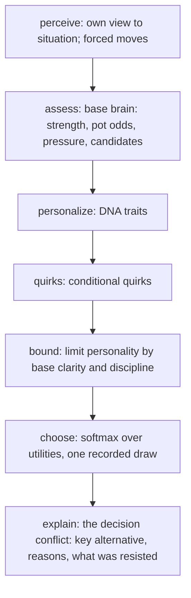

# Bot Brain Phase 1.1 report: character styles v1 vs v2

Generated by `node scripts/sim/phase11-report.mjs --seed 11 --hands 200 --scale 1` on 2026-10-20.
Real engine; sim@1, fingerprint fp@2, decision judge judge@1; variant `classic-1`; boot 10, stack 100 boots, automatic rebuys.
v1 = styles `@1` on `tp-character@1` (unchanged, pinned by a golden test). v2 = styles `@2` on `tp-character@2`.

**Scale:** 600,000 hands, 11,508,473 decisions in 440 s on 7 worker processes. Peak memory: 171 MB per worker process, 1650 MB for the parent holding all results.

## Answers

**1. Does each bot still play Teen Patti competently?** Yes, more evenly than v1. Against one shared field, every v2 character is profitable:

| Character | v2 boots/100 | v1 boots/100 |
|---|---:|---:|
| Virat | 266 | −82 |
| Rohit | 425 | 926 |
| Samay | 463 | 353 |
| GG | 488 | 75 |
| Dhoni | 494 | 404 |

For comparison, against the same field: legacy-normal 310, baseline-rock 409, legacy-hard 676.
- **Paired v1 → v2 changes:** only GG is clearly better (+413 ± 211). Rohit is the only one likely worse (−500 ± 443).
- **Why Rohit fell:** v1 Rohit called blind almost indefinitely, which happens to exploit this reference field.
- **The CIs (±200 to 300) are too wide to rank the characters.** Dhoni is not measurably the strongest; his edge (adaptation) arrives in Phase 2.

**2. Can I recognize the character?** Yes: 79% at 10 hands, 88% at 25, 92% at 50, 95% at 100 (v1: 90 / 95 / 97 / 98). The drop from v1 is the expected cost of removing the cartoonish giveaways.

**3. Without one trivial giveaway?** Mostly.
- **No single feature is load-bearing:** removing any one leaves 88% or more at 50 hands. The worst case is blind rounds (88%).
- **Two characters still lean on raising:** removing the whole raise group (5 features) drops overall accuracy to 80%, Samay to 68% and Dhoni to 74%. Samay's identity still depends heavily on "rarely raises".

**4. Does personality influence decisions without routinely overriding obvious game logic?** Yes.
- Big overrides (personality beating more than 0.1 of card and money evidence): **0 to 2%** in v2, vs 8 to 18% in v1.
- Overrides still happen, at 4 to 31% of decisions, but mostly in ambiguous spots (mean evidence overridden 0.02 to 0.06).
- Strong hands are packed 10 to 18% of the time, close to legacy-normal's 13%. GG fell from 26% to 14%.
- Very weak hands are no longer called wide: Virat 55% → 19%, Samay 71% → 17%.
- Monsters get raised: Samay's monster-not-raised fell from 82% to 31%.

**Concerns that remain (not tuned; for review):**
- **GG** is now the most deterministic character (entropy 0.17; looks at once 100% of the time) and is still nearest to baseline-rock (2.06).
- **Samay** no longer measures as the widest caller: stay-after-seeing is 49%, against Virat's 53% and Rohit's 48%. His nearest reference is now legacy-hard (1.51). The bound tamed his calling more than his identity can afford.
- **Rohit and Virat converged:** they are now the closest pair (1.77). Both blind-raise at about 45%, so blind raising stopped identifying Virat but now partly blurs the two.
- **Rohit** packs strong hands 18% of the time, the highest of the five (legacy-normal 13%).
- **Dhoni** is still nearest to legacy-normal (1.54). That's expected until Phase 2.
- **Within-character session variation** still cannot be measured (see §6).

## 1. Strength against one field (hero runs)

Each policy takes the same seat at the same 160 tables, against the same four reference opponents, with the same decks, 150 hands per table. CI is over tables.

| policy | boots/100 | 95% CI |
|---|---:|---:|
| Rohit v1 | 926 | ± 365 |
| Virat v1 | -82 | ± 391 |
| GG v1 | 75 | ± 90 |
| Samay v1 | 353 | ± 337 |
| Dhoni v1 | 404 | ± 232 |
| Rohit v2 | 425 | ± 292 |
| Virat v2 | 266 | ± 303 |
| GG v2 | 488 | ± 195 |
| Samay v2 | 463 | ± 245 |
| Dhoni v2 | 494 | ± 232 |
| legacy-easy | -463 | ± 117 |
| legacy-normal | 310 | ± 234 |
| legacy-hard | 676 | ± 254 |
| baseline-random | -705 | ± 75 |
| baseline-rock | 409 | ± 165 |
| baseline-station | -861 | ± 260 |
| baseline-aggressive | 629 | ± 600 |

**Paired change v1 → v2** (same tables, same cards, same opponents):

| character | v2 minus v1, boots/100 |
|---|---:|
| Rohit | -500 ± 443 |
| Virat | +348 ± 399 |
| GG | +413 ± 211 |
| Samay | +109 ± 386 |
| Dhoni | +90 ± 263 |

Limitation: this is lightweight duplicate evaluation (same cards, same seat, same opponents). It does not rotate one deal through every seat, and opponents' later decisions diverge once the hero acts differently. Full duplicate mode is phase 3.

## 2. Fingerprints, v1 and v2 (mixed tables; same compositions and decks for both versions)

| metric | Rohit v1 | Rohit v2 | Virat v1 | Virat v2 | GG v1 | GG v2 | Samay v1 | Samay v2 | Dhoni v1 | Dhoni v2 |
|---|---:|---:|---:|---:|---:|---:|---:|---:|---:|---:|
| blind rounds | 2.98 | 1.66 | 1.16 | 0.88 | 0.11 | 0.00 | 0.93 | 0.65 | 1.03 | 0.85 |
| blind raise | 1% | 47% | 61% | 41% | 0% | 6% | 0% | 4% | 0% | 4% |
| chaal | 66% | 35% | 32% | 33% | 12% | 11% | 64% | 47% | 40% | 37% |
| raise | 6% | 26% | 35% | 23% | 10% | 16% | 1% | 5% | 14% | 12% |
| pack | 10% | 15% | 11% | 16% | 36% | 31% | 11% | 17% | 19% | 20% |
| see | 13% | 21% | 20% | 25% | 39% | 38% | 19% | 26% | 25% | 28% |
| show (when legal) | 21% | 14% | 8% | 17% | 90% | 91% | 51% | 56% | 58% | 51% |
| aggression (seen R/C) | 0.51 | 0.53 | 0.89 | 0.69 | 1.33 | 1.42 | 0.03 | 0.14 | 0.97 | 0.77 |
| raise after seeing | 22% | 20% | 37% | 28% | 19% | 27% | 2% | 8% | 29% | 24% |
| pack after seeing | 34% | 41% | 20% | 32% | 67% | 54% | 19% | 32% | 40% | 45% |
| fold to raise | 8% | 10% | 20% | 15% | 31% | 18% | 15% | 12% | 10% | 11% |
| stay after seeing | 55% | 48% | 73% | 53% | 17% | 26% | 70% | 49% | 36% | 37% |
| showdown | 35% | 28% | 31% | 27% | 6% | 14% | 39% | 30% | 21% | 22% |
| won at showdown | 45% | 46% | 41% | 45% | 84% | 72% | 48% | 51% | 68% | 62% |
| entropy (bits) | 0.37 | 0.75 | 0.78 | 0.77 | 0.33 | 0.17 | 0.32 | 0.47 | 0.26 | 0.38 |

## 3. Decision quality (hero runs: one field, graded with the bot's own cards offline)

"Strong" = beats every live opponent at least twice a fair share (capped at 80%); "very weak" = under a third of a fair share; "monster" = top 1.5% of hands. Override rates count decisions where the policy's own best move differed from the base brain's; the overridden size counts evidence (cards, money) only, not blind customs. v1 cannot separate quirks.

| | strong hand packed | strong hand only called (raise legal) | very weak hand continued | very weak hand raised | monster not raised | sees under blind pressure | sees without pressure | personality override (best move differs from base) | big override (beat > 0.1 of evidence) | mean evidence overridden | quirk override |
|---|---:|---:|---:|---:|---:|---:|---:|---:|---:|---:|---:|
| Rohit v1 | 16% | 19% | 15% | 0% | 7% | 21% | 0% | 47% | 13% | 0.07 | n/a |
| Rohit v2 | 18% | 23% | 5% | 0% | 12% | 44% | 2% | 30% | 2% | 0.06 | 20% |
| Virat v1 | 21% | 7% | 55% | 3% | 6% | 57% | 12% | 54% | 18% | 0.09 | n/a |
| Virat v2 | 17% | 18% | 19% | 0% | 9% | 68% | 18% | 21% | 2% | 0.05 | 0% |
| GG v1 | 26% | 35% | 0% | 0% | 28% | 92% | 88% | 54% | 8% | 0.06 | n/a |
| GG v2 | 14% | 21% | 0% | 0% | 11% | 100% | 100% | 31% | 0% | 0.02 | 0% |
| Samay v1 | 9% | 83% | 71% | 0% | 82% | 62% | 15% | 25% | 12% | 0.11 | n/a |
| Samay v2 | 10% | 62% | 17% | 0% | 31% | 79% | 30% | 10% | 1% | 0.05 | 0% |
| Dhoni v1 | 15% | 20% | 0% | 0% | 11% | 61% | 10% | 6% | 0% | 0.04 | n/a |
| Dhoni v2 | 14% | 24% | 1% | 0% | 12% | 73% | 14% | 4% | 0% | 0.03 | 0% |
| legacy-easy | 21% | 69% | 27% | 10% | 66% | 50% | 26% | n/a | n/a | n/a | n/a |
| legacy-normal | 13% | 38% | 6% | 4% | 43% | 53% | 8% | n/a | n/a | n/a | n/a |
| legacy-hard | 9% | 38% | 4% | 5% | 40% | 56% | 9% | n/a | n/a | n/a | n/a |
| baseline-random | 44% | 48% | 56% | 33% | 66% | 27% | 26% | n/a | n/a | n/a | n/a |
| baseline-rock | 13% | 47% | 0% | 0% | 11% | 100% | 100% | n/a | n/a | n/a | n/a |
| baseline-station | 10% | 93% | 90% | 0% | 100% | 100% | 100% | n/a | n/a | n/a | n/a |
| baseline-aggressive | 19% | 0% | 88% | 9% | 0% | 61% | 13% | n/a | n/a | n/a | n/a |

## 4. Identifiability (public behaviour only; 14 features)

| hands watched | v1 accuracy | v2 accuracy |
|---:|---:|---:|
| 10 | 90% | 79% |
| 25 | 95% | 88% |
| 50 | 97% | 92% |
| 100 | 98% | 95% |

### v2 confusion at 10 hands

| actual \ predicted | Rohit v2 | Virat v2 | GG v2 | Samay v2 | Dhoni v2 | correct |
|---|---:|---:|---:|---:|---:|---:|
| Rohit v2 | **3101** | 333 | 24 | 28 | 134 | 86% |
| Virat v2 | 49 | **2691** | 177 | 224 | 399 | 76% |
| GG v2 | 0 | 164 | **2909** | 95 | 132 | 88% |
| Samay v2 | 0 | 33 | 53 | **2640** | 714 | 77% |
| Dhoni v2 | 0 | 359 | 109 | 660 | **2292** | 67% |

### v2 confusion at 25 hands

| actual \ predicted | Rohit v2 | Virat v2 | GG v2 | Samay v2 | Dhoni v2 | correct |
|---|---:|---:|---:|---:|---:|---:|
| Rohit v2 | **1329** | 66 | 8 | 1 | 44 | 92% |
| Virat v2 | 7 | **1253** | 24 | 16 | 116 | 88% |
| GG v2 | 0 | 24 | **1236** | 8 | 52 | 94% |
| Samay v2 | 0 | 1 | 3 | **1161** | 211 | 84% |
| Dhoni v2 | 0 | 89 | 26 | 127 | **1126** | 82% |

### v2 confusion at 50 hands

| actual \ predicted | Rohit v2 | Virat v2 | GG v2 | Samay v2 | Dhoni v2 | correct |
|---|---:|---:|---:|---:|---:|---:|
| Rohit v2 | **675** | 31 | 1 | 0 | 17 | 93% |
| Virat v2 | 1 | **649** | 8 | 1 | 49 | 92% |
| GG v2 | 0 | 3 | **636** | 1 | 20 | 96% |
| Samay v2 | 0 | 0 | 0 | **618** | 70 | 90% |
| Dhoni v2 | 0 | 21 | 12 | 45 | **606** | 89% |

### v2 confusion at 100 hands

| actual \ predicted | Rohit v2 | Virat v2 | GG v2 | Samay v2 | Dhoni v2 | correct |
|---|---:|---:|---:|---:|---:|---:|
| Rohit v2 | **345** | 8 | 0 | 0 | 9 | 95% |
| Virat v2 | 0 | **325** | 2 | 0 | 27 | 92% |
| GG v2 | 0 | 0 | **323** | 0 | 7 | 98% |
| Samay v2 | 0 | 0 | 0 | **328** | 16 | 95% |
| Dhoni v2 | 0 | 3 | 3 | 8 | **328** | 96% |

### v1 confusion at 50 hands (for comparison)

| actual \ predicted | Rohit v1 | Virat v1 | GG v1 | Samay v1 | Dhoni v1 | correct |
|---|---:|---:|---:|---:|---:|---:|
| Rohit v1 | **692** | 0 | 0 | 1 | 31 | 96% |
| Virat v1 | 0 | **706** | 1 | 0 | 1 | 100% |
| GG v1 | 0 | 0 | **608** | 0 | 52 | 92% |
| Samay v1 | 0 | 0 | 0 | **680** | 8 | 99% |
| Dhoni v1 | 0 | 0 | 22 | 1 | **661** | 97% |

## 5. Single-feature ablation at 50 hands

Identification with one feature (or one group) removed. A diagnostic, not a target.

| removed | v1 | v2 | Rohit v2 | Virat v2 | GG v2 | Samay v2 | Dhoni v2 |
|---|---:|---:|---:|---:|---:|---:|---:|
| none | 97% | **92%** | 93% | 92% | 96% | 90% | 89% |
| blindRounds | 96% | **88%** | 84% | 85% | 95% | 89% | 88% |
| blindRaiseRate | 95% | **89%** | 89% | 84% | 97% | 90% | 83% |
| raiseRate | 96% | **91%** | 93% | 92% | 97% | 87% | 88% |
| chaalRate | 96% | **92%** | 93% | 92% | 96% | 92% | 89% |
| packRate | 97% | **93%** | 94% | 93% | 97% | 92% | 91% |
| seeRate | 96% | **91%** | 92% | 90% | 96% | 90% | 89% |
| showRate | 96% | **90%** | 92% | 88% | 96% | 89% | 88% |
| aggression | 96% | **92%** | 93% | 92% | 97% | 87% | 89% |
| seenRaiseRate | 95% | **90%** | 93% | 93% | 97% | 79% | 87% |
| seenPackRate | 97% | **94%** | 93% | 94% | 97% | 93% | 92% |
| foldToRaise | 97% | **91%** | 92% | 90% | 97% | 90% | 88% |
| stayAfterSeeing | 97% | **93%** | 94% | 94% | 97% | 93% | 89% |
| showdownRate | 98% | **94%** | 94% | 93% | 97% | 94% | 90% |
| raiseShareOfBets | 95% | **91%** | 92% | 91% | 97% | 87% | 87% |
| blind features (blindRounds, blindRaiseRate) | 95% | **85%** | 78% | 81% | 94% | 89% | 83% |
| show behaviour (showRate, showdownRate) | 97% | **93%** | 94% | 91% | 96% | 93% | 89% |
| all raise features (5) | 91% | **80%** | 85% | 79% | 97% | 68% | 74% |
| all pack and fold features (4) | 98% | **94%** | 91% | 98% | 97% | 96% | 90% |

## 6. Distances (hero runs, one field, standardized over all 17 policies)

For scale: legacy-normal to legacy-hard 0.77 (practically the same bot); legacy-easy to legacy-normal 2.31.

| character | nearest reference v1 | nearest reference v2 | nearest character v1 | nearest character v2 |
|---|---|---|---|---|
| Rohit | legacy-hard 3.51 | legacy-normal 2.93 | Samay v1 4.24 | Virat v2 1.77 |
| Virat | baseline-aggressive 3.43 | legacy-normal 2.52 | Dhoni v1 4.35 | Rohit v2 1.77 |
| GG | baseline-rock 2.34 | baseline-rock 2.06 | Dhoni v1 5.11 | Dhoni v2 3.96 |
| Samay | baseline-station 2.27 | legacy-hard 1.51 | Rohit v1 4.24 | Dhoni v2 2.82 |
| Dhoni | legacy-normal 1.80 | legacy-normal 1.54 | Virat v1 4.35 | Virat v2 2.35 |

### Within-character spread vs between-character distance (mixed runs, 50 hands)

| | Rohit | Virat | GG | Samay | Dhoni | closest pair |
|---|---:|---:|---:|---:|---:|---|
| v1 within spread | 1.60 | 1.69 | 2.39 | 1.47 | 1.70 | Rohit v1 : Samay v1 3.07 |
| v2 within spread | 2.10 | 2.16 | 2.78 | 2.02 | 2.17 | Rohit v2 : Virat v2 2.01 |

Phase 1 bots are stateless, so this spread is sampling noise plus table context, not genuine session-to-session variation; see the limitation in BOT_BRAIN.md §27.

## 7. Performance (clean: one thread, no simulation running)

| policy | decisions | p50 ms | p95 ms | p99 ms | max ms |
|---|---:|---:|---:|---:|---:|
| legacy-easy | 8,258 | 0.021 | 0.130 | 0.191 | 1.39 |
| legacy-normal | 9,788 | 0.018 | 0.110 | 0.136 | 26.73 |
| legacy-hard | 11,011 | 0.026 | 0.108 | 0.157 | 1.42 |
| Virat v1 | 2,631 | 0.091 | 0.124 | 0.171 | 1.31 |
| GG v1 | 1,390 | 0.092 | 0.127 | 0.177 | 1.21 |
| Samay v1 | 2,553 | 0.092 | 0.125 | 0.186 | 1.43 |
| Dhoni v1 | 2,115 | 0.087 | 0.122 | 0.179 | 1.57 |
| Rohit v1 | 2,444 | 0.021 | 0.114 | 0.143 | 17.30 |
| Virat v2 | 1,964 | 0.083 | 0.130 | 0.240 | 1.43 |
| GG v2 | 1,316 | 0.101 | 0.133 | 0.222 | 22.94 |
| Samay v2 | 1,788 | 0.096 | 0.131 | 0.206 | 1.50 |
| Dhoni v2 | 1,726 | 0.036 | 0.130 | 0.210 | 6.81 |
| Rohit v2 | 1,898 | 0.029 | 0.130 | 0.158 | 1.27 |

Simulation tables (200 or 150 hands, Maglev off in workers): median 0.75 s, slowest 3.8 s (hero:baseline-aggressive, table 112).

Hands per second on one thread, including the engine: legacy 614, characters v1 439, characters v2 497. Peak memory: 171 MB per worker process; parent 1650 MB (heap 1365 MB, holding every result).

## 8. Example decision traces (v2; table 4242)

Hand 0, step 12, reproduced from seed: yes

```
ROHIT DECISION
  Situation:   blind, 3.0 rounds in, 3 players in
  Options:     pack   0%  see  76%  chaal  11%  raise  13%
  Utility:     pack +0.00  see +0.51  chaal +0.38  raise +0.40   (temperature 0.315)
  Base:        pack +0.00  see +1.05  chaal +0.35  raise +0.20
  Personality: pack +0.00  see -0.29  chaal +0.03  raise +0.10   (scaled by 0.521: base clarity 0.115)
  Quirks:      pack +0.00  see -0.25  chaal +0.00  raise +0.10
  Factors:
    base.blind-cheap       chaal +0.35  raise +0.20
    base.see-timing        see +0.75
    base.blind-pressure    see +0.30
    dna.blindAggression    raise +0.09
    dna.blindPreference    see -0.29  chaal +0.03
    dna.riskTolerance      chaal +0.00  raise +0.00
    quirk.blindPride       see -0.25  raise +0.10
  vs others:   pack: total +0.51 (base +1.05, personality -0.29, quirk -0.25); chaal: total +0.13 (base +0.70, personality -0.33, quirk -0.25); raise: total +0.11 (base +0.85, personality -0.39, quirk -0.35)
  Base brain:  would pick see; policy's best see
  Why see over raise: base.see-timing +0.75, base.blind-pressure +0.30
  Resisted:    blind-pride, blind-preference, blind-aggression (fundamentals held)
  Decision:    see
  Primary:     blind-see   Secondary: fundamentals-held, blind-pressure-see
  Path:        perceive > assess > personalize > quirks > bound > choose > explain
```

Hand 4, step 8, reproduced from seed: yes

```
VIRAT DECISION
  Situation:   seen, 2.0 rounds in, 4 players in
  Hand:        beats one random hand  81%; vs everyone still in  56%
  Options:     pack   0%  chaal  52%  raise  48%
  Utility:     pack +0.00  chaal +0.43  raise +0.42   (temperature 0.402)
  Base:        pack +0.00  chaal +0.35  raise +0.26
  Personality: pack +0.00  chaal +0.08  raise +0.17   (scaled by 0.697: base clarity 0.095)
  Factors:
    base.equity            chaal +0.35  raise +0.31
    base.value-raise       raise -0.06
    dna.aggression         raise +0.13  chaal +0.03
    dna.patience           chaal +0.05  raise +0.03
    dna.riskTolerance      chaal +0.01  raise +0.01
  vs others:   pack: total +0.42 (base +0.26, personality +0.17); chaal: total -0.01 (base -0.10, personality +0.09)
  Base brain:  would pick chaal; policy's best chaal
  Why raise over chaal: dna.aggression +0.11
  Decision:    raise
  Primary:     aggression
  Path:        perceive > assess > personalize > quirks > bound > choose > explain
```

Hand 2, step 3, reproduced from seed: yes

```
GG DECISION
  Situation:   seen, 1.0 rounds in, 4 players in
  Hand:        beats one random hand  71%; vs everyone still in  44%
  Options:     pack  27%  chaal  72%  raise   1%
  Utility:     pack +0.00  chaal +0.04  raise -0.13   (temperature 0.21)
  Base:        pack +0.00  chaal +0.11  raise -0.09
  Personality: pack +0.00  chaal -0.07  raise -0.04   (scaled by 0.401: base clarity 0.111)
  Factors:
    base.equity            chaal +0.11  raise +0.07
    base.value-raise       raise -0.17
    dna.aggression         raise -0.02  chaal -0.00
    dna.patience           chaal -0.03  raise -0.02
    dna.curiosity          chaal -0.04
    dna.riskTolerance      chaal -0.00  raise -0.00
  vs others:   pack: total +0.04 (base +0.11, personality -0.07); raise: total +0.17 (base +0.20, personality -0.03)
  Base brain:  would pick chaal; policy's best chaal
  Why chaal over pack: base.equity +0.11
  Resisted:    incurious-pack, patience-pack (fundamentals held)
  Decision:    chaal
  Primary:     pot-odds-call   Secondary: fundamentals-held
  Path:        perceive > assess > personalize > quirks > bound > choose > explain
```

Hand 1, step 9, reproduced from seed: yes

```
SAMAY DECISION
  Situation:   seen, 3.0 rounds in, 3 players in
  Hand:        beats one random hand  95%; vs everyone still in  92%
  Options:     pack   0%  chaal   5%  raise  95%
  Utility:     pack +0.00  chaal +0.68  raise +0.86   (temperature 0.315)
  Base:        pack +0.00  chaal +0.64  raise +0.87
  Personality: pack +0.00  chaal +0.03  raise -0.01   (scaled by 0.217: base clarity 0.228)
  Factors:
    base.equity            chaal +0.64  raise +0.60
    base.value-raise       raise +0.27
    dna.aggression         raise -0.01  chaal -0.00
    dna.patience           chaal +0.00  raise +0.00
    dna.curiosity          chaal +0.03
  vs others:   pack: total +0.86 (base +0.87, personality -0.01); chaal: total +0.19 (base +0.23, personality -0.04)
  Base brain:  would pick raise; policy's best raise
  Why raise over chaal: base.value-raise +0.27
  Decision:    raise
  Primary:     strong-raise
  Path:        perceive > assess > personalize > quirks > bound > choose > explain
```

Hand 0, step 11, reproduced from seed: yes

```
DHONI DECISION
  Situation:   seen, 3.0 rounds in, 4 players in
  Hand:        beats one random hand  62%; vs everyone still in  26%
  Options:     pack  51%  chaal  49%  raise   0%
  Utility:     pack +0.00  chaal -0.00  raise -0.31   (temperature 0.238)
  Base:        pack +0.00  chaal +0.06  raise -0.30
  Personality: pack +0.00  chaal -0.07  raise -0.01   (scaled by 0.71: base clarity 0.063)
  Factors:
    base.equity            chaal +0.06  raise +0.02
    base.value-raise       raise -0.32
    dna.aggression         raise +0.02  chaal +0.00
    dna.patience           chaal -0.05  raise -0.03
    dna.curiosity          chaal -0.02
  vs others:   chaal: total +0.00 (base -0.06, personality +0.07); raise: total +0.31 (base +0.30, personality +0.01)
  Base brain:  would pick chaal; policy's best pack (personality override)
  Why pack over chaal: dna.patience +0.05
  Decision:    pack
  Primary:     patience-pack
  Path:        perceive > assess > personalize > quirks > bound > choose > explain
```

## 9. Decision graph (generated from `CHARACTER_GRAPH_V2`)



Styles published: 13.
