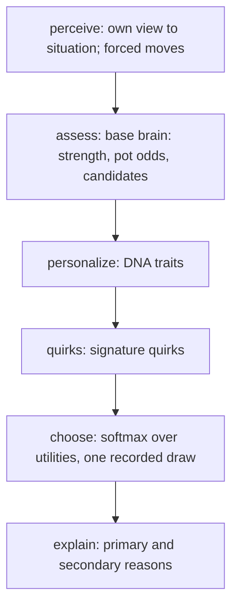

# Bot Brain Phase 1 report

Generated by `node scripts/sim/phase1-report.mjs --seed 1 --hands 200 --scale 1` on 2026-10-19.
Engine: the real `server/engine.mjs`. Simulator sim@1, fingerprint fp@1, variant `classic-1`, boot 10, stack 1,000 (100 boots), automatic rebuys.
Character styles: `rohit-sharma@1` (45a80b53edb6ea86), `virat-kohli@1` (a938ec2c70d7eb46), `gg@1` (26378b8ead80b33f), `samay-raina@1` (6b46ba8197863ef0), `ms-dhoni@1` (ba25d732acb5204b). Policy `tp-character@1`. Nothing was tuned or trained for this report.

**Scale:** 224,000 hands, 4,486,168 decisions, 133.3 s wall on 7 worker threads.

## Three separate axes

| Axis | Phase 1 measure | Status |
|---|---|---|
| Playing competence | boots/100 against a fixed field of reference bots (run C) | measured |
| Character identity | identifiability at 10/25/50/100 hands, confusion matrices, centroid distances | measured |
| Human believability | needs people watching or playing (and phase 2 mood and memory) | **unavailable**: no number is given rather than a proxy |

## 1. Reference fingerprints (run A: reference bots only, random 5-seat tables)

| metric | legacy-easy | legacy-normal | legacy-hard | baseline-random | baseline-rock | baseline-station | baseline-aggressive |
|---|---:|---:|---:|---:|---:|---:|---:|
| hands | 34,200 | 32,400 | 36,000 | 34,200 | 36,800 | 34,000 | 32,400 |
| decisions | 114,667 | 128,403 | 149,381 | 93,189 | 94,121 | 157,589 | 142,315 |
| boots/100 | -581 ± 56 | 340 ± 93 | 746 ± 100 | -831 ± 32 | 587 ± 78 | -880 ± 83 | 578 ± 120 |
| blind rounds | 0.77 | 1.14 | 1.16 | 0.81 | 0.00 | 0.00 | 0.98 |
| blind raise | 24% | 10% | 10% | 50% | n/a | n/a | 99% |
| chaal | 40% | 46% | 47% | 24% | 14% | 61% | 21% |
| raise | 11% | 9% | 9% | 24% | 10% | 0% | 52% |
| pack | 24% | 17% | 16% | 33% | 35% | 9% | 5% |
| see | 23% | 23% | 23% | 18% | 39% | 22% | 22% |
| show (when legal) | 43% | 44% | 44% | 23% | 98% | 97% | 0% |
| aggression (seen R/C) | 0.23 | 0.32 | 0.28 | 0.97 | 0.68 | 0.00 | 1.44 |
| fold to raise | 31% | 14% | 11% | 42% | 21% | 14% | 11% |
| stay after seeing | 54% | 47% | 46% | 55% | 19% | 87% | 94% |
| showdown | 16% | 27% | 29% | 7% | 9% | 52% | 55% |
| won at showdown | 56% | 63% | 66% | 38% | 86% | 41% | 36% |
| entropy (bits) | unavailable | unavailable | unavailable | 1.72 | 0.00 | 0.00 | 0.00 |

## 2. Character fingerprints (run B: 2 to 5 characters per table, rest references)

| metric | Rohit | Virat | GG | Samay | Dhoni |
|---|---:|---:|---:|---:|---:|
| hands | 70,200 | 66,200 | 66,200 | 67,000 | 67,800 |
| decisions | 376,828 | 319,056 | 168,047 | 349,212 | 271,482 |
| boots/100 | 214 ± 70 | -400 ± 68 | 159 ± 35 | -335 ± 67 | 645 ± 71 |
| blind rounds | 3.03 | 1.16 | 0.11 | 0.94 | 1.03 |
| blind raise | 1% | 61% | 1% | 0% | 0% |
| chaal | 67% | 33% | 12% | 65% | 40% |
| raise | 6% | 35% | 11% | 1% | 14% |
| pack | 10% | 12% | 36% | 10% | 19% |
| see | 13% | 20% | 39% | 19% | 25% |
| show (when legal) | 21% | 8% | 93% | 50% | 60% |
| aggression (seen R/C) | 0.52 | 0.86 | 1.41 | 0.03 | 0.96 |
| fold to raise | 8% | 21% | 31% | 14% | 10% |
| stay after seeing | 55% | 73% | 17% | 71% | 36% |
| showdown | 35% | 31% | 6% | 40% | 20% |
| won at showdown | 45% | 40% | 84% | 48% | 69% |
| entropy (bits) | 0.36 | 0.77 | 0.33 | 0.32 | 0.26 |

### Competence against a fixed field (run C: one character + four reference bots per table)

| | Rohit | Virat | GG | Samay | Dhoni |
|---|---:|---:|---:|---:|---:|
| boots/100 vs references | 606 ± 149 | 96 ± 148 | 6 ± 44 | 405 ± 159 | 521 ± 134 |
| hands | 16,000 | 16,000 | 16,000 | 16,000 | 16,000 |

For scale, in run A: legacy-easy -581, legacy-normal 340, legacy-hard 746, baseline-random -831, baseline-rock 587, baseline-station -880, baseline-aggressive 578 boots/100.

### Not measurable in phase 1

Tilt index, after-win delta, revenge index and adaptation are **unavailable**: phase 1 bots have no mood, relationships or opponent models, so these would only measure noise.

## 3. Identifiability (run B, public behaviour only)

Nearest-centroid classifier on 9 standardized public features (blindRounds, blindRaiseRate, seenRaiseRate, seenPackRate, showRate, foldToRaise, stayAfterSeeing, showdownRate, raiseShareOfBets). Trained on windows from even-numbered tables, tested on windows from odd-numbered tables, so a test window never shares a table with training data. Chance is 20%.

| hands watched | test windows | accuracy |
|---:|---:|---:|
| 10 | 17,060 | **90%** |
| 25 | 6,824 | **94%** |
| 50 | 3,412 | **96%** |
| 100 | 1,706 | **96%** |

### Confusion matrix at 10 hands

| actual \ predicted | Rohit | Virat | GG | Samay | Dhoni | correct |
|---|---:|---:|---:|---:|---:|---:|
| Rohit | **3446** | 2 | 15 | 35 | 162 | 94% |
| Virat | 0 | **3352** | 26 | 18 | 24 | 98% |
| GG | 0 | 2 | **2790** | 5 | 503 | 85% |
| Samay | 0 | 0 | 22 | **2992** | 186 | 94% |
| Dhoni | 0 | 23 | 461 | 137 | **2859** | 82% |

### Confusion matrix at 25 hands

| actual \ predicted | Rohit | Virat | GG | Samay | Dhoni | correct |
|---|---:|---:|---:|---:|---:|---:|
| Rohit | **1424** | 0 | 2 | 1 | 37 | 97% |
| Virat | 0 | **1362** | 2 | 0 | 4 | 100% |
| GG | 0 | 0 | **1121** | 0 | 199 | 85% |
| Samay | 0 | 0 | 0 | **1259** | 21 | 98% |
| Dhoni | 1 | 0 | 119 | 10 | **1262** | 91% |

### Confusion matrix at 50 hands

| actual \ predicted | Rohit | Virat | GG | Samay | Dhoni | correct |
|---|---:|---:|---:|---:|---:|---:|
| Rohit | **720** | 0 | 0 | 0 | 12 | 98% |
| Virat | 0 | **683** | 0 | 0 | 1 | 100% |
| GG | 0 | 0 | **574** | 0 | 86 | 87% |
| Samay | 0 | 0 | 0 | **638** | 2 | 100% |
| Dhoni | 0 | 0 | 46 | 0 | **650** | 93% |

### Confusion matrix at 100 hands

| actual \ predicted | Rohit | Virat | GG | Samay | Dhoni | correct |
|---|---:|---:|---:|---:|---:|---:|
| Rohit | **362** | 0 | 0 | 0 | 4 | 99% |
| Virat | 0 | **342** | 0 | 0 | 0 | 100% |
| GG | 0 | 0 | **289** | 0 | 41 | 88% |
| Samay | 0 | 0 | 0 | **319** | 1 | 100% |
| Dhoni | 0 | 0 | 19 | 0 | **329** | 95% |

### Between-character distance and within-character variation (50 hands)

Distances are in standardized feature units. Within-character spread is the mean distance of one 50-hand window from that character's own centroid: large means a character's sessions vary; it is reported, not optimized.

| pair | centroid distance |
|---|---:|
| GG : Dhoni | 2.66 |
| Rohit : Dhoni | 2.81 |
| Rohit : Samay | 2.98 |
| Samay : Dhoni | 3.03 |
| Virat : Dhoni | 3.97 |
| Rohit : Virat | 4.10 |
| Virat : Samay | 4.50 |
| GG : Samay | 4.71 |
| Rohit : GG | 4.95 |
| Virat : GG | 5.20 |

| character | within spread |
|---|---:|
| Rohit | 1.34 |
| Virat | 1.39 |
| GG | 1.88 |
| Samay | 1.24 |
| Dhoni | 1.45 |

## 4. Performance

| | hands/s (1 thread) | ms per decision incl. engine |
|---|---:|---:|
| 5 legacy bots | 446 | 0.117 |
| 5 character bots | 379 | 0.120 |

Decision time alone (sampled, under 7-thread load):

| member | p50 ms | p99 ms |
|---|---:|---:|
| baseline-aggressive | 0.116 | 0.855 |
| baseline-random | 0.019 | 0.167 |
| baseline-rock | 0.105 | 0.837 |
| baseline-station | 0.022 | 0.189 |
| GG | 0.063 | 0.917 |
| legacy-easy | 0.024 | 0.644 |
| legacy-hard | 0.038 | 0.753 |
| legacy-normal | 0.030 | 0.692 |
| Dhoni | 0.067 | 0.718 |
| Rohit | 0.035 | 0.568 |
| Samay | 0.140 | 1.023 |
| Virat | 0.127 | 0.796 |

## 5. Example decision traces

Table 4242, hand 0, step 2, reproduced from seed: yes

```
GG DECISION
  Situation:   seen, 1.0 rounds in, 5 players in
  Hand:        beats one random hand  76%; vs everyone still in  42%
  Options:     pack  95%  chaal   5%  raise   0%
  Utility:     pack +0.00  chaal -0.13  raise -0.41   (temperature 0.227)
  Factors:
    base.equity            chaal +0.13  raise +0.09
    dna.patience           chaal -0.12  raise -0.07
    base.value-raise       raise -0.18
    dna.bluffAffinity      raise -0.14
    dna.curiosity          chaal -0.11
    dna.aggression         raise -0.09  chaal -0.02
    dna.riskTolerance      chaal -0.01  raise -0.01
  Why pack over chaal: dna.patience +0.12, dna.curiosity +0.11, dna.aggression +0.02
  Decision:    pack
  Primary:     patience-pack   Secondary: incurious-pack, caution
  Path:        perceive > assess > personalize > quirks > choose > explain
```

Table 4242, hand 0, step 8, reproduced from seed: yes

```
SAMAY DECISION
  Situation:   seen, 2.0 rounds in, 4 players in
  Hand:        beats one random hand  14%; vs everyone still in   1%
  Options:     pack  64%  chaal  36%  raise   0%
  Utility:     pack +0.00  chaal -0.04  raise -1.08   (temperature 0.332)
  Factors:
    base.equity            chaal -0.30  raise -0.34
    base.value-raise       raise -0.55
    dna.curiosity          chaal +0.18
    dna.bluffAffinity      raise -0.17
    dna.patience           chaal +0.10  raise +0.06
    dna.aggression         raise -0.07  chaal -0.02
  Why chaal over pack: dna.curiosity +0.18, dna.patience +0.10
  Decision:    chaal
  Primary:     curiosity-call   Secondary: impatience
  Path:        perceive > assess > personalize > quirks > choose > explain
```

Table 4242, hand 0, step 10, reproduced from seed: yes

```
DHONI DECISION
  Situation:   seen, 2.0 rounds in, 4 players in
  Hand:        beats one random hand  39%; vs everyone still in   9%
  Options:     pack 100%  chaal   0%  raise   0%
  Utility:     pack +0.00  chaal -0.29  raise -0.71   (temperature 0.192)
  Factors:
    base.value-raise       raise -0.47
    base.equity            chaal -0.16  raise -0.20
    dna.patience           chaal -0.11  raise -0.07
    dna.aggression         raise +0.03  chaal +0.01
    dna.curiosity          chaal -0.02
  Why pack over chaal: base.equity +0.16, dna.patience +0.11, dna.curiosity +0.02
  Decision:    pack
  Primary:     weak-pack   Secondary: patience-pack, incurious-pack
  Path:        perceive > assess > personalize > quirks > choose > explain
```

Table 4242, hand 0, step 13, reproduced from seed: yes

```
VIRAT DECISION
  Situation:   seen, 4.0 rounds in, 3 players in
  Hand:        beats one random hand  58%; vs everyone still in  39%
  Options:     pack   1%  chaal  51%  raise  48%
  Utility:     pack +0.00  chaal +0.33  raise +0.32   (temperature 0.42)
  Factors:
    base.equity            chaal +0.16  raise +0.12
    dna.aggression         raise +0.20  chaal +0.05
    base.value-raise       raise -0.21
    dna.patience           chaal +0.11  raise +0.06
    dna.bluffAffinity      raise +0.13
    dna.riskTolerance      chaal +0.02  raise +0.02
  Why raise over chaal: dna.aggression +0.15, dna.bluffAffinity +0.13
  Decision:    raise
  Primary:     aggression   Secondary: bluff-raise
  Path:        perceive > assess > personalize > quirks > choose > explain
```

Table 4242, hand 0, step 19, reproduced from seed: yes

```
ROHIT DECISION
  Situation:   seen, 8.0 rounds in, 3 players in
  Hand:        beats one random hand  24%; vs everyone still in   9%
  Options:     pack  86%  chaal  14%  raise   0%
  Utility:     pack +0.00  chaal -0.12  raise -0.56   (temperature 0.332)
  Factors:
    base.value-raise       raise -0.48
    base.equity            chaal -0.14  raise -0.18
    dna.aggression         raise +0.06  chaal +0.01
    dna.riskTolerance      chaal +0.03  raise +0.04
    dna.curiosity          chaal -0.02
  Why pack over chaal: base.equity +0.14, dna.curiosity +0.02
  Decision:    pack
  Primary:     weak-pack   Secondary: incurious-pack
  Path:        perceive > assess > personalize > quirks > choose > explain
```

Table 4242, hand 0, step 11

```
ROHIT DECISION
  Situation:   blind, 2.0 rounds in, 3 players in, facing a raise
  Options:     pack   0%  see   0%  chaal  99%  raise   1%
  Utility:     pack +0.00  see -0.58  chaal +0.46  raise +0.17   (temperature 0.332)
  Factors:
    dna.blindPreference    see -0.54  chaal +0.09
    quirk.blindPride       see -0.49
    base.see-timing        see +0.45
    base.blind-cheap       chaal +0.35  raise +0.10
    dna.aggression         raise +0.06  chaal +0.01
    dna.riskTolerance      chaal +0.00  raise +0.01
  Why chaal over raise: base.blind-cheap +0.25, dna.blindPreference +0.09
  Decision:    chaal
  Primary:     blind-hold   Secondary: blind-preference
  Path:        perceive > assess > personalize > quirks > choose > explain
```

## 6. Decision graph (generated from `CHARACTER_GRAPH`)



Styles published: 8.
