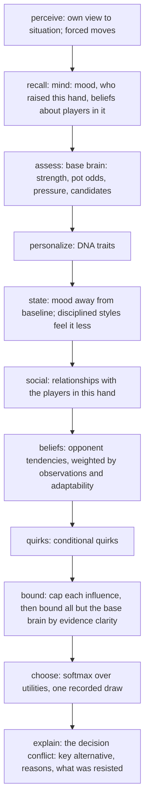

# Bot Brain Phase 2 report: the mind (v2 vs v3)

Generated by `node scripts/sim/phase2-report.mjs --seed 21 --hands 200 --scale 1` on 2026-10-20.
Real engine; sim@1, fingerprint fp@3, judge judge@2, mind@1, obs@1; variant `classic-1`; boot 10, stack 100 boots, automatic rebuys.
v2 = styles `@2` on `tp-character@2` (Phase 1.1, stateless). v3 = styles `@3` on `tp-character@3` (Phase 2, with a mind).

**Scale:** 960,000 hands, 23,352,170 decisions, 2224 s on 7 worker processes. Slowest table 965.5 s. Peak memory 212 MB per worker, 4547 MB parent.

## Answers

This report is the second full run of Phase 2. The first run (preserved in the BOT_BRAIN.md §28 notes) found the mind safe but nearly inert and recommended NOT READY. A tuning pass followed, with no new policy or style version because none had been released:

- **Opponent reads count as evidence.** They are no longer shrunk by the evidence bound.
- **Fold equity.** It is computed from a new `givesUp` read and population priors, replacing the earlier fold prior of 0.3, which was twice the real rate.
- **Moods last longer.** Each mood fades over several hands.
- **Frustration depends on temperament.** Undisciplined characters tilt; disciplined ones tighten up.
- **Tonight's form.** Each session starts with a slightly different mood.
- **Monsters get raised.** A new base value term covers multiway pots.
- **DNA changes:** Dhoni stays blind a little longer, asks for more shows and is a bit more aggressive; Virat keeps some blind hitting.

| | first Phase 2 run | this run | v2 |
|---|---:|---:|---:|
| identified at 10 / 25 / 50 / 100 hands | 71 / 81 / 87 / 90% | **74 / 85 / 89 / 93%** | 80 / 90 / 94 / 97% |
| whole sessions identified | 88% | 85% | 91% |
| Dhoni: memory changed the best move | 4% | **11%** | n/a |
| Rohit / Virat: mood changed the best move | 3 / 5% | **7 / 8%** | n/a |
| Dhoni thin raises vs rocks → vs stations | 1% → 1% | **31% → 0%** | 1% → 1% |
| monsters not raised (worst character) | 28% (Samay) | **4% (Dhoni)** | 31% |

**What Phase 2 achieved**

- **Dhoni adapts, and you can watch it happen.**
  - Against rocks, who give up often, his thin raises (bluffs) go from 13% in hands 1–40 to 32% in hands 121–200, and his value raises from 60% to 84%.
  - Against calling stations he never bluffs (0%).
  - v2, which has no memory, stays at 0–1% throughout.
  - Against the shared field he gained +282 ± 310 boots/100 (not significant) and is the second-strongest character (893). §9.
- **Moods last and show by temperament.** In the 3 hands after a big loss:
  - Virat's raise-to-call ratio after seeing rises from 1.68 to 2.64 (v2: flat).
  - GG tightens: his ratio rises from 1.44 to 1.64 because he calls less (v2: 1.36 to 1.41).
  - After a big win, Rohit raises after seeing 31% of the time, against a base of 24%. §8.
- **Each night has a character for three of the five.** The night effect, measured beyond what a stateless bot shows at the same table, rises:
  - Dhoni: +1.25 (1.14 → 2.39 ± 0.29)
  - Virat: +0.88
  - Rohit: +0.44 (marginal against its interval)
  - GG is as steady as v2, which suits him: the disciplined vary least by design.
  - Samay shows no night effect. §7.
- **The Phase 1.1 issues are all resolved:**
  - **GG** is no longer deterministic: he looks immediately 55% of the time, otherwise after one blind bet.
  - **Samay** keeps his wide-caller identity: 77% continue with a third to two thirds of a fair share, and he is recognized 98% of the time.
  - **Rohit and Virat** are separate: blind raising is 41% vs 24%, Virat raises 46–72% once seen, and their distance is 3.08.
  - **Rohit's strong packs** are 1%; the earlier figure was a measurement artefact.
  - **Dhoni** has a behaviour of his own (adaptation), but see the concerns below.
- **Fundamentals hold for every character.**
  - Strong hands packed: 0–5%.
  - Very weak hands continued: 0–5%. For Dhoni these are mostly fold-equity bluffs against folders.
  - Monster hands not raised: 1–4% (v2: 8–31%).
  - Big evidence overrides: 1–8%. Virat's 8% is mostly raising where the base brain would call or show.

**Remaining concerns, as Phase 3 acceptance criteria**

- **Identification is 89% at 50 hands**, just under the 90% target (93% at 100 hands). Whole-session identification is 85% (v2: 91%).
  - The gap is Dhoni: he is recognized 76% of the time at 50 hands, and 116 of 712 windows are mistaken for Samay.
  - An adaptive player looks different at different tables, which a fixed-centroid identifier penalizes by design. Still, Dhoni needs a stronger table-independent signature.
- **Dhoni's static fingerprint sits near legacy-hard** in the reference field (distance 1.15). His identity shows in how he adapts, not in his averages.
- **Dhoni folds to raises more against maniacs (17%) than against rocks (10%).** That's the wrong direction for exploiting a maniac. The "call a light raiser" read is weak in multiway pots by design, and his results against maniacs are within very wide intervals (±1,100 boots/100).
- **Samay's mood and night form barely reach his decisions.** His play is curiosity-driven, while mood mostly moves raising.
- **"Mind adds" columns compare v3 with v2**, so they also contain the v3 base-brain changes (pressure, future cost, monster value). GG's +40-point call index comes from those, not memory. Dhoni's within-session growth (13% → 32%) isolates what memory does.

**Performance (§10, clean process)**
- A v3 decision takes p50 0.05 ms and p99 0.14 ms.
- Mind upkeep for five bots takes p99 0.15 ms per commit.
- The largest mind is 2.7 KB.
- This run took 2,224 s. Another workload kept the machine at a load average of about 50, so the table timings are inflated; the benchmark ran separately.

**Recommendation: READY FOR PHASE 3.** The reasons for the earlier NOT READY are resolved:
- **Memory now changes play.** It changes Dhoni's best move in 11% of decisions, and mood changes Rohit's and Virat's in 7–8%.
- **Dhoni's adaptation is demonstrated.** It grows within a session and is absent in v2.
- **Nights differ for Dhoni, Virat and Rohit** beyond decision noise.
- **Recognition is at the target within sampling noise:** 89% at 50 hands and 93% at 100.

What remains (Dhoni's table-independent signature, his response to maniacs, Samay's moods) is per-character calibration. Phase 3's offline, per-character tuning against each character's own targets is the right tool for it. That tuning should keep these as acceptance criteria and must not learn from live players.

## 1. Strength against one field (hero runs: same seat, tables, opponents and decks)

| | boots/100 | 95% CI |
|---|---:|---:|
| Rohit v2 | 374 | ± 291 |
| Virat v2 | 654 | ± 336 |
| GG v2 | 353 | ± 189 |
| Samay v2 | 856 | ± 282 |
| Dhoni v2 | 611 | ± 246 |
| Rohit v3 | 255 | ± 322 |
| Virat v3 | 480 | ± 357 |
| GG v3 | 359 | ± 200 |
| Samay v3 | 1104 | ± 338 |
| Dhoni v3 | 893 | ± 315 |
| legacy-easy | -454 | ± 122 |
| legacy-normal | 374 | ± 236 |
| legacy-hard | 650 | ± 275 |
| baseline-random | -803 | ± 71 |
| baseline-rock | 529 | ± 182 |
| baseline-station | -756 | ± 281 |
| baseline-aggressive | -46 | ± 564 |

| paired v2 → v3 | change in boots/100 |
|---|---:|
| Rohit | -119 ± 387 |
| Virat | -174 ± 388 |
| GG | +6 ± 198 |
| Samay | +248 ± 413 |
| Dhoni | +282 ± 310 |

## 2. Fingerprints (mixed tables; identical compositions and decks for v2 and v3)

| | Rohit v2 | Rohit v3 | Virat v2 | Virat v3 | GG v2 | GG v3 | Samay v2 | Samay v3 | Dhoni v2 | Dhoni v3 |
|---|---:|---:|---:|---:|---:|---:|---:|---:|---:|---:|
| blind rounds | 1.64 | 1.65 | 0.87 | 0.83 | 0.00 | 0.45 | 0.66 | 0.66 | 0.83 | 1.05 |
| blind raise | 47% | 41% | 40% | 23% | 12% | 0% | 4% | 5% | 4% | 3% |
| chaal | 34% | 35% | 33% | 28% | 11% | 24% | 48% | 49% | 37% | 43% |
| raise | 26% | 25% | 23% | 27% | 16% | 13% | 5% | 5% | 12% | 12% |
| pack | 15% | 16% | 16% | 18% | 32% | 27% | 17% | 17% | 20% | 17% |
| show (when legal) | 15% | 11% | 17% | 10% | 91% | 60% | 58% | 32% | 49% | 25% |
| aggression (seen R/C) | 0.54 | 0.73 | 0.72 | 1.94 | 1.41 | 1.51 | 0.14 | 0.12 | 0.75 | 0.67 |
| raise after seeing | 21% | 25% | 28% | 43% | 27% | 27% | 8% | 7% | 24% | 25% |
| fold to raise | 10% | 13% | 14% | 17% | 18% | 17% | 12% | 13% | 10% | 11% |
| stay after seeing | 48% | 47% | 53% | 49% | 25% | 28% | 49% | 48% | 37% | 45% |
| showdown | 28% | 22% | 27% | 19% | 14% | 14% | 30% | 25% | 23% | 22% |
| entropy (bits) | 0.75 | 0.69 | 0.77 | 0.65 | 0.17 | 0.38 | 0.46 | 0.42 | 0.39 | 0.34 |

## 3. Decision quality and influence (hero runs, judge with the bot's own cards)

Forced moves (pack the only legal move) are not graded (judge@2). "Big evidence override" = the policy's best move beat the base brain's by more than 0.1 of card and money evidence. Mood / memory "moved" = a non-zero contribution; "changed best move" = without it the best move would differ.

| | strong hand packed | very weak continued | very weak raised | monster not raised | big evidence override | personality override | quirk override | mood moved decision | memory moved decision | mood changed best move | memory changed best move | belief confidence (mean) |
|---|---:|---:|---:|---:|---:|---:|---:|---:|---:|---:|---:|---:|
| Rohit v2 | 1% | 5% | 0% | 11% | 2% | 31% | 20% | n/a | n/a | n/a | n/a | n/a |
| Rohit v3 | 1% | 1% | 0% | 2% | 2% | 33% | 19% | 99% | 34% | 7% | 4% | 0.77 |
| Virat v2 | 0% | 20% | 0% | 8% | 3% | 22% | 0% | n/a | n/a | n/a | n/a | n/a |
| Virat v3 | 0% | 3% | 0% | 1% | 8% | 20% | 3% | 100% | 50% | 8% | 3% | 0.77 |
| GG v2 | 4% | 0% | 0% | 11% | 0% | 30% | 0% | n/a | n/a | n/a | n/a | n/a |
| GG v3 | 5% | 0% | 0% | 2% | 1% | 13% | 1% | 95% | 49% | 1% | 2% | 0.76 |
| Samay v2 | 0% | 17% | 0% | 31% | 1% | 10% | 0% | n/a | n/a | n/a | n/a | n/a |
| Samay v3 | 0% | 4% | 0% | 3% | 4% | 15% | 1% | 99% | 63% | 0% | 2% | 0.77 |
| Dhoni v2 | 1% | 1% | 0% | 13% | 0% | 4% | 0% | n/a | n/a | n/a | n/a | n/a |
| Dhoni v3 | 0% | 5% | 0% | 4% | 4% | 18% | 0% | 98% | 49% | 1% | 11% | 0.77 |
| legacy-easy | 9% | 29% | 10% | 64% | n/a | n/a | n/a | n/a | n/a | n/a | n/a | n/a |
| legacy-normal | 2% | 6% | 5% | 42% | n/a | n/a | n/a | n/a | n/a | n/a | n/a | n/a |
| legacy-hard | 0% | 5% | 5% | 41% | n/a | n/a | n/a | n/a | n/a | n/a | n/a | n/a |
| baseline-random | 32% | 66% | 33% | 70% | n/a | n/a | n/a | n/a | n/a | n/a | n/a | n/a |
| baseline-rock | 4% | 0% | 0% | 12% | n/a | n/a | n/a | n/a | n/a | n/a | n/a | n/a |
| baseline-station | 0% | 100% | 0% | 100% | n/a | n/a | n/a | n/a | n/a | n/a | n/a | n/a |
| baseline-aggressive | 0% | 100% | 8% | 0% | n/a | n/a | n/a | n/a | n/a | n/a | n/a | n/a |

## 4. Identifiability (public behaviour, 14 features)

| hands watched | v2 | v3 |
|---:|---:|---:|
| 10 | 80% | 74% |
| 25 | 90% | 85% |
| 50 | 94% | 89% |
| 100 | 97% | 93% |
| whole 200-hand session (varied tables) | 91% | 85% |

### v3 confusion at 10 hands

| actual \ predicted | Rohit v3 | Virat v3 | GG v3 | Samay v3 | Dhoni v3 | correct |
|---|---:|---:|---:|---:|---:|---:|
| Rohit v3 | **3137** | 123 | 45 | 19 | 156 | 90% |
| Virat v3 | 91 | **2360** | 425 | 56 | 348 | 72% |
| GG v3 | 0 | 469 | **2635** | 180 | 236 | 75% |
| Samay v3 | 2 | 22 | 378 | **2723** | 235 | 81% |
| Dhoni v3 | 2 | 458 | 338 | 874 | **1888** | 53% |

### v3 confusion at 25 hands

| actual \ predicted | Rohit v3 | Virat v3 | GG v3 | Samay v3 | Dhoni v3 | correct |
|---|---:|---:|---:|---:|---:|---:|
| Rohit v3 | **1337** | 18 | 12 | 0 | 25 | 96% |
| Virat v3 | 18 | **1108** | 87 | 1 | 98 | 84% |
| GG v3 | 0 | 107 | **1187** | 19 | 95 | 84% |
| Samay v3 | 0 | 0 | 58 | **1245** | 41 | 93% |
| Dhoni v3 | 0 | 108 | 76 | 258 | **982** | 69% |

### v3 confusion at 50 hands

| actual \ predicted | Rohit v3 | Virat v3 | GG v3 | Samay v3 | Dhoni v3 | correct |
|---|---:|---:|---:|---:|---:|---:|
| Rohit v3 | **682** | 7 | 4 | 0 | 3 | 98% |
| Virat v3 | 7 | **584** | 32 | 0 | 33 | 89% |
| GG v3 | 0 | 45 | **611** | 2 | 46 | 87% |
| Samay v3 | 0 | 0 | 12 | **656** | 4 | 98% |
| Dhoni v3 | 0 | 39 | 13 | 116 | **544** | 76% |

### v3 confusion at 100 hands

| actual \ predicted | Rohit v3 | Virat v3 | GG v3 | Samay v3 | Dhoni v3 | correct |
|---|---:|---:|---:|---:|---:|---:|
| Rohit v3 | **344** | 2 | 2 | 0 | 0 | 99% |
| Virat v3 | 3 | **306** | 12 | 0 | 7 | 93% |
| GG v3 | 0 | 10 | **325** | 0 | 17 | 92% |
| Samay v3 | 0 | 0 | 2 | **334** | 0 | 99% |
| Dhoni v3 | 0 | 12 | 3 | 47 | **294** | 83% |

### v2 confusion at 50 hands (Phase 1.1, for comparison)

| actual \ predicted | Rohit v2 | Virat v2 | GG v2 | Samay v2 | Dhoni v2 | correct |
|---|---:|---:|---:|---:|---:|---:|
| Rohit v2 | **679** | 9 | 1 | 0 | 7 | 98% |
| Virat v2 | 0 | **627** | 4 | 2 | 23 | 96% |
| GG v2 | 0 | 10 | **675** | 1 | 18 | 96% |
| Samay v2 | 0 | 0 | 0 | **630** | 42 | 94% |
| Dhoni v2 | 0 | 28 | 11 | 54 | **619** | 87% |

## 5. Single-feature ablation at 50 hands

| removed | v2 | v3 | Rohit v3 | Virat v3 | GG v3 | Samay v3 | Dhoni v3 |
|---|---:|---:|---:|---:|---:|---:|---:|
| none | 94% | **89%** | 98% | 89% | 87% | 98% | 76% |
| blindRounds | 91% | **86%** | 97% | 84% | 86% | 96% | 70% |
| blindRaiseRate | 91% | **87%** | 93% | 88% | 86% | 97% | 73% |
| raiseRate | 94% | **90%** | 98% | 89% | 87% | 97% | 79% |
| chaalRate | 94% | **89%** | 99% | 89% | 86% | 97% | 74% |
| packRate | 95% | **91%** | 99% | 91% | 89% | 98% | 76% |
| seeRate | 94% | **89%** | 98% | 88% | 87% | 98% | 75% |
| showRate | 92% | **88%** | 98% | 85% | 84% | 97% | 77% |
| aggression | 94% | **90%** | 98% | 91% | 88% | 97% | 77% |
| seenRaiseRate | 92% | **90%** | 97% | 90% | 88% | 96% | 82% |
| seenPackRate | 95% | **90%** | 98% | 91% | 88% | 98% | 75% |
| foldToRaise | 93% | **90%** | 98% | 90% | 88% | 98% | 76% |
| stayAfterSeeing | 95% | **90%** | 99% | 90% | 86% | 98% | 77% |
| showdownRate | 95% | **90%** | 99% | 91% | 88% | 98% | 75% |
| raiseShareOfBets | 93% | **89%** | 99% | 89% | 87% | 96% | 77% |
| blind features (2) | 88% | **83%** | 89% | 80% | 85% | 96% | 67% |
| show behaviour (2) | 94% | **88%** | 98% | 85% | 85% | 97% | 75% |
| all raise features (5) | 82% | **85%** | 91% | 82% | 87% | 86% | 77% |
| all pack and fold features (4) | 96% | **91%** | 98% | 93% | 91% | 99% | 74% |

## 6. Distances (hero runs, one field)

For scale: legacy-normal to legacy-hard 0.70.

| character | nearest reference v2 | nearest reference v3 | nearest character v2 | nearest character v3 |
|---|---|---|---|---|
| Rohit | legacy-normal 3.24 | legacy-normal 3.08 | Virat v2 2.21 | Virat v3 3.08 |
| Virat | legacy-normal 2.84 | legacy-normal 4.13 | Rohit v2 2.21 | Rohit v3 3.08 |
| GG | baseline-rock 2.02 | baseline-rock 2.64 | Dhoni v2 4.52 | Virat v3 3.65 |
| Samay | legacy-hard 1.99 | legacy-hard 2.08 | Dhoni v2 3.39 | Dhoni v3 2.25 |
| Dhoni | legacy-normal 1.88 | legacy-hard 1.15 | Virat v2 2.65 | Samay v3 2.25 |

## 7. Session variation: same person, different night

Whole-session fingerprints (200 hands), standardized over every session in the study. **Same table**: 30 sessions with identical opponents and decks, only the decision seed differs. **Varied**: 30 sessions at different tables. Spread = mean distance of a session from that character's own centre.

| | same-table spread v2 | same-table spread v3 | varied spread v2 | varied spread v3 |
|---|---:|---:|---:|---:|
| Rohit | 1.66 | 1.96 | 2.07 | 2.16 |
| Virat | 2.02 | 2.03 | 2.26 | 2.31 |
| GG | 1.39 | 1.07 | 2.44 | 2.50 |
| Samay | 0.70 | 0.69 | 2.15 | 2.12 |
| Dhoni | 1.06 | 1.97 | 1.77 | 2.57 |

**Night effect** (same table, `nightEffect` in `server/sim/fingerprint.mjs`): each session split into even and odd hands. Within = distance between the two halves of one night; between = distance to the other nights' halves; night = between minus within, with its 95% interval. Different choices send even a stateless policy down different paths at the same table, so v2 is not zero: **v3 minus v2 is what the mind adds** (mood, tonight's form, memory).

| | within v2 | within v3 | night v2 | night v3 | mind adds |
|---|---:|---:|---:|---:|---:|
| Rohit | 3.30 | 2.88 | 1.67 ± 0.47 | 2.11 ± 0.49 | +0.44 |
| Virat | 3.57 | 2.80 | 1.41 ± 0.47 | 2.29 ± 0.43 | +0.88 |
| GG | 4.73 | 4.95 | 0.56 ± 0.57 | 0.37 ± 0.52 | -0.19 |
| Samay | 4.50 | 4.78 | 0.70 ± 0.50 | 0.66 ± 0.50 | -0.03 |
| Dhoni | 4.05 | 2.58 | 1.14 ± 0.48 | 2.39 ± 0.29 | +1.25 |

## 8. Behaviour after significant events (mixed tables)

The 3 hands after a loss or win of 20+ boots, against all other hands. A stateless policy (v2) should show only table-context differences.

| | aggression after seeing (raise per call): base / after loss / after win | raise after seeing: base / after loss / after win | stay after seeing: base / after loss | hands after loss |
|---|---|---|---|---:|
| Rohit v2 | 0.52 / 0.55 / 0.56 | 20% / 19% / 24% | 48% / 45% | 30,883 |
| Rohit v3 | 0.68 / 0.73 / 0.78 | 24% / 22% / 31% | 46% / 42% | 31,468 |
| Virat v2 | 0.70 / 0.71 / 0.75 | 28% / 27% / 32% | 52% / 51% | 28,743 |
| Virat v3 | 1.68 / 2.64 / 1.55 | 40% / 43% / 45% | 48% / 47% | 30,487 |
| GG v2 | 1.36 / 1.41 / 1.50 | 26% / 25% / 30% | 24% / 25% | 13,072 |
| GG v3 | 1.44 / 1.64 / 1.57 | 26% / 26% / 33% | 26% / 27% | 15,109 |
| Samay v2 | 0.13 / 0.14 / 0.15 | 8% / 8% / 10% | 47% / 48% | 26,554 |
| Samay v3 | 0.11 / 0.13 / 0.11 | 7% / 7% / 8% | 46% / 46% | 26,723 |
| Dhoni v2 | 0.72 / 0.70 / 0.83 | 23% / 21% / 28% | 36% / 36% | 19,432 |
| Dhoni v3 | 0.62 / 0.68 / 0.73 | 23% / 23% / 30% | 42% / 42% | 24,852 |

## 9. Character questions

### Rohit vs Virat: where the aggression happens (mixed tables)

| raise rate where | Rohit v2 | Rohit v3 | Virat v2 | Virat v3 |
|---|---:|---:|---:|---:|
| blind | 47% | 41% | 41% | 24% |
| seenOpen | 21% | 29% | 28% | 46% |
| seenFacingRaise | 27% | 26% | 38% | 56% |
| headsUp | 27% | 39% | 46% | 72% |
| multiway | 19% | 22% | 26% | 41% |
| late | 23% | 30% | 35% | 60% |

### Samay: continuing by hand strength and by ambiguity (hero runs)

Continue = anything but pack, on seen decisions. Strength is the chance to beat every live opponent, as a multiple of a fair share.

| | < 1/3 fair | 1/3 to 2/3 | 2/3 to 1.25 (borderline) | 1.25 to 2 | 2x fair or more | ambiguous (clarity < 0.1) | clear |
|---|---:|---:|---:|---:|---:|---:|---:|
| Rohit v2 | 5% | 34% | 82% | 97% | 99% | 83% | 58% |
| Rohit v3 | 1% | 25% | 84% | 98% | 99% | 90% | 56% |
| Virat v2 | 20% | 69% | 92% | 98% | 100% | 94% | 64% |
| Virat v3 | 3% | 57% | 95% | 99% | 100% | 98% | 61% |
| GG v2 | 0% | 1% | 34% | 85% | 96% | 71% | 44% |
| GG v3 | 0% | 1% | 39% | 85% | 94% | 68% | 45% |
| Samay v2 | 17% | 77% | 96% | 99% | 100% | 98% | 71% |
| Samay v3 | 4% | 77% | 98% | 100% | 100% | 100% | 73% |
| Dhoni v2 | 1% | 10% | 71% | 94% | 98% | 76% | 58% |
| Dhoni v3 | 5% | 42% | 89% | 98% | 100% | 90% | 66% |

### GG: when he looks (mixed tables)

| | after 0 blind bets | 1 | 2 | 3+ | never looked |
|---|---:|---:|---:|---:|---:|
| Rohit v2 | 0% | 33% | 51% | 4% | 12% |
| Rohit v3 | 0% | 32% | 52% | 5% | 11% |
| Virat v2 | 16% | 78% | 4% | 0% | 2% |
| Virat v3 | 21% | 74% | 4% | 0% | 2% |
| GG v2 | 100% | 0% | 0% | 0% | 0% |
| GG v3 | 55% | 45% | 0% | 0% | 0% |
| Samay v2 | 34% | 64% | 1% | 0% | 1% |
| Samay v3 | 35% | 63% | 1% | 0% | 1% |
| Dhoni v2 | 18% | 81% | 1% | 0% | 1% |
| Dhoni v3 | 6% | 81% | 11% | 0% | 2% |

### Dhoni: adaptation against one opponent type (hands 1 to 40 vs 121 to 200)

| opponents | character | thin raise (≤ fair share) early → late | value raise (> 1.25x fair) early → late | continue facing a raise early → late | boots/100 early → late |
|---|---|---|---|---|---|
| baseline-rock | Virat v2 | 9% → 8% | 58% → 59% | 83% → 84% | -349 → -435 |
| baseline-rock | Virat v3 | 22% → 26% | 77% → 82% | 85% → 85% | -235 → -404 |
| baseline-rock | Samay v2 | 0% → 0% | 5% → 9% | 78% → 76% | -330 → -408 |
| baseline-rock | Samay v3 | 0% → 0% | 12% → 15% | 83% → 80% | -234 → -310 |
| baseline-rock | Dhoni v2 | 1% → 0% | 30% → 32% | 82% → 82% | -249 → -266 |
| baseline-rock | Dhoni v3 | 13% → 32% | 60% → 84% | 90% → 89% | -176 → -305 |
| baseline-station | Virat v2 | 4% → 4% | 23% → 20% | 100% → 100% | 1144 → 3219 |
| baseline-station | Virat v3 | 13% → 9% | 31% → 28% | 100% → 100% | 2311 → 3823 |
| baseline-station | Samay v2 | 0% → 0% | 2% → 2% | 100% → 100% | 2608 → 4592 |
| baseline-station | Samay v3 | 0% → 0% | 4% → 4% | 100% → 100% | 3121 → 5010 |
| baseline-station | Dhoni v2 | 0% → 0% | 9% → 10% | 100% → 100% | 1267 → 3434 |
| baseline-station | Dhoni v3 | 0% → 0% | 11% → 12% | 100% → 100% | 1755 → 3855 |
| baseline-aggressive | Virat v2 | 5% → 6% | 56% → 52% | 91% → 89% | -148 → 8 |
| baseline-aggressive | Virat v3 | 15% → 11% | 76% → 70% | 90% → 86% | -337 → -253 |
| baseline-aggressive | Samay v2 | 0% → 0% | 8% → 10% | 93% → 92% | 1063 → 608 |
| baseline-aggressive | Samay v3 | 0% → 0% | 12% → 14% | 89% → 87% | 264 → 426 |
| baseline-aggressive | Dhoni v2 | 1% → 0% | 24% → 28% | 96% → 95% | 13 → 625 |
| baseline-aggressive | Dhoni v3 | 3% → 5% | 31% → 33% | 89% → 83% | 10 → -31 |

### Exploitation: playing folders, callers and maniacs differently (hands 41 to 200, 40 tables each)

Thin raise = raise after seeing with at most a fair share. **Bluff index** = thin raises against rocks minus against stations; **call index** = folding to a raise against rocks minus against maniacs. "Mind adds" = v3 index minus v2 index (v2 has no memory, so its differences come only from the opponents' play).

| character | thin raise vs rock v2 → v3 | vs station v2 → v3 | bluff index: mind adds | fold to raise vs rock / maniac v3 | call index: mind adds | boots/100 vs rock / station / maniac v2 | v3 |
|---|---|---|---:|---|---:|---|---|
| Rohit | 4% → 7% | 2% → 2% | +3 pts | 7% / 30% | +3 pts | -438 / 3137 / -87 | -502 / 3450 / 100 |
| Virat | 8% → 26% | 3% → 9% | +13 pts | 14% / 13% | -3 pts | -374 / 3315 / -8 | -376 / 3898 / -212 |
| GG | 0% → 1% | 0% → 0% | +1 pts | 30% / 25% | +40 pts | -164 / 2747 / -171 | -104 / 2671 / -415 |
| Samay | 0% → 0% | 0% → 0% | +0 pts | 19% / 13% | -10 pts | -350 / 4471 / 796 | -270 / 4973 / 602 |
| Dhoni | 1% → 31% | 1% → 0% | +31 pts | 10% / 17% | -19 pts | -250 / 3249 / 471 | -284 / 3591 / -63 |

## 10. Performance (clean: `scripts/sim/bench.mjs` in a fresh process, after JIT warm-up)

| policy (5 seats) | hands/s incl. engine | decision p50 ms | p95 ms | p99 ms | max ms |
|---|---:|---:|---:|---:|---:|
| legacy | 659 | 0.017 | 0.073 | 0.082 | 0.4 |
| v2 | 627 | 0.064 | 0.080 | 0.095 | 0.2 |
| v3 | 207 | 0.052 | 0.119 | 0.139 | 0.5 |

Mind upkeep for v3 (all five bots observing one commit): p50 0.13 ms, p95 0.14 ms, p99 0.15 ms. Largest mind after 200 hands: 2.7 KB of JSON. Benchmark process 132 MB.

## 11. Example decision traces (v3, table 4242)

Hand 0, step 5, reproduced from seed: yes

```
ROHIT DECISION
  Situation:   blind, 1.0 rounds in, 4 players in, facing a raise
  Options:     pack   0%  see   0%  chaal  52%  raise  49%
  Utility:     pack +0.00  see -0.37  chaal +0.42  raise +0.42   (temperature 0.315)
  Base:        pack +0.00  see +0.20  chaal +0.35  raise +0.20
  Personality: pack +0.00  see -0.55  chaal +0.06  raise +0.18   (scaled by 0.985: base clarity 0.015)
  Mood:        pack +0.00  see -0.02  chaal +0.01  raise +0.04
  Mind:        confidence 0.62, frustration 0.12, fear 0.10, suspicion 0.41, excitement 0.34; pressure 0; facing a raise from bot-seat-3
  Factors:
    base.blind-cheap       chaal +0.35  raise +0.20
    base.see-timing        see +0.20
    dna.blindAggression    raise +0.18
    dna.blindPreference    see -0.55  chaal +0.06
    dna.riskTolerance      chaal +0.00  raise +0.00
    state.confidence       see -0.02  raise +0.01
    state.fear             raise +0.03  chaal +0.01
  vs others:   pack: total +0.42 (base +0.20, personality +0.18, mood +0.04); see: total +0.79 (base +0.00, personality +0.73, mood +0.06); chaal: total -0.00 (base -0.15, personality +0.12, mood +0.03)
  Base brain:  would pick chaal; policy's best chaal
  Why raise over chaal: dna.blindAggression +0.18
  Decision:    raise
  Primary:     blind-aggression
  Path:        perceive > recall > assess > personalize > state > social > beliefs > quirks > bound > choose > explain
```

Hand 0, step 14, reproduced from seed: yes

```
VIRAT DECISION
  Situation:   seen, 10.0 rounds in, 2 players in, show available
  Hand:        beats one random hand  83%; vs everyone still in  77%
  Options:     pack   0%  chaal   4%  raise  77%  show  18%
  Utility:     pack +0.00  chaal +0.59  raise +0.83  show +0.71   (temperature 0.402)
  Base:        pack +0.00  chaal +0.52  raise +0.62  show +0.69
  Personality: pack +0.00  chaal +0.09  raise +0.23  show +0.03   (scaled by 0.832: base clarity 0.065)
  Mood:        pack +0.00  chaal -0.02  raise -0.04  show +0.00
  Quirks:      pack +0.00  chaal +0.00  raise +0.02  show +0.00
  Mind:        confidence 0.35, frustration 0.33, fear 0.37, suspicion 0.34, excitement 0.18; pressure 1
  Beliefs:     bot-seat-0 foldToRaise 13% (n=1); bot-seat-0 givesUp 21% (n=1)
  Factors:
    base.equity            chaal +0.52  raise +0.48  show +0.56
    base.value-raise       raise +0.13
    base.show-value        show +0.13
    base.value-raise       raise +0.01
    dna.aggression         raise +0.17  chaal +0.04
    dna.patience           chaal +0.03  raise +0.02
    dna.showPreference     show +0.03
    dna.riskTolerance      chaal +0.03  raise +0.03
    state.confidence       raise -0.04  chaal -0.01
    state.frustration      raise +0.05  chaal +0.01
    state.fear             raise -0.05  chaal -0.02
    quirk.tiltSpiral       raise +0.02  chaal +0.00
  vs others:   pack: total +0.83 (base +0.62, personality +0.23, mood -0.04, quirk +0.02); chaal: total +0.24 (base +0.10, personality +0.14, mood -0.02, quirk +0.01); show: total +0.12 (base -0.07, personality +0.20, mood -0.04, quirk +0.02)
  Base brain:  would pick show; policy's best raise (personality override)
  Why raise over show: dna.aggression +0.17, base.value-raise +0.13, state.frustration +0.05, dna.riskTolerance +0.03
  Decision:    raise
  Primary:     aggression   Secondary: strong-raise, tilt, risk-appetite
  Path:        perceive > recall > assess > personalize > state > social > beliefs > quirks > bound > choose > explain
```

Hand 40, step 3, reproduced from seed: yes

```
GG DECISION
  Situation:   seen, 1.0 rounds in, 5 players in
  Hand:        beats one random hand  82%; vs everyone still in  49%
  Options:     pack  22%  chaal  71%  raise   6%
  Utility:     pack +0.00  chaal +0.05  raise -0.05   (temperature 0.217)
  Base:        pack +0.00  chaal +0.14  raise -0.01
  Personality: pack +0.00  chaal -0.09  raise -0.04   (scaled by 0.291: base clarity 0.145)
  Mood:        pack +0.00  chaal -0.02  raise -0.01
  Relations:   pack +0.00  chaal +0.00  raise +0.00
  Memory:      pack +0.00  chaal +0.01  raise +0.00
  Mind:        confidence 0.41, frustration 0.37, fear 0.28, suspicion 0.37, excitement 0.12; pressure 1; facing a raise from bot-seat-1
  Beliefs:     bot-seat-0 foldToRaise 28% (n=40); bot-seat-0 givesUp 48% (n=33); bot-seat-1 foldToRaise 37% (n=23); bot-seat-1 givesUp 44% (n=52); bot-seat-3 foldToRaise 31% (n=39); bot-seat-3 givesUp 31% (n=55); bot-seat-4 foldToRaise 38% (n=43); bot-seat-4 givesUp 48% (n=45); bot-seat-1 bluffShown 41% (n=2); bot-seat-1 aggression 66% (n=28)
  Factors:
    base.equity            chaal +0.14  raise +0.10
    base.value-raise       raise -0.11
    dna.aggression         raise -0.01  chaal -0.00
    dna.patience           chaal -0.03  raise -0.01
    dna.curiosity          chaal -0.05
    dna.riskTolerance      chaal -0.01  raise -0.01
    state.confidence       raise -0.00  chaal -0.00
    state.frustration      raise -0.01  chaal -0.02
    state.fear             raise -0.00  chaal -0.00
    state.suspicion        chaal +0.00
    state.excitement       raise -0.00
    social.annoyance       chaal +0.00
    model.pressure         raise +0.00
    model.caller           chaal +0.01
  vs others:   pack: total +0.05 (base +0.14, personality -0.09, mood -0.02, relations +0.00, memory +0.01); raise: total +0.10 (base +0.15, personality -0.05, mood -0.01, relations +0.00, memory +0.01)
  Base brain:  would pick chaal; policy's best chaal
  Why chaal over pack: base.equity +0.14
  Resisted:    incurious-pack, patience-pack, tightened-up (fundamentals held)
  Decision:    chaal
  Primary:     pot-odds-call   Secondary: fundamentals-held
  Path:        perceive > recall > assess > personalize > state > social > beliefs > quirks > bound > choose > explain
```

Hand 6, step 10, reproduced from seed: yes

```
SAMAY DECISION
  Situation:   seen, 2.0 rounds in, 3 players in
  Hand:        beats one random hand  37%; vs everyone still in  20%
  Options:     pack  68%  chaal  32%  raise   0%
  Utility:     pack +0.00  chaal -0.05  raise -0.60   (temperature 0.35)
  Base:        pack +0.00  chaal -0.18  raise -0.60
  Personality: pack +0.00  chaal +0.12  raise -0.02   (scaled by 0.339: base clarity 0.181)
  Mood:        pack +0.00  chaal -0.02  raise -0.02
  Relations:   pack +0.00  chaal +0.03  raise +0.00
  Memory:      pack +0.00  chaal +0.00  raise +0.03
  Mind:        confidence 0.41, frustration 0.17, fear 0.27, suspicion 0.14, excitement 0.10; pressure 0; facing a raise from bot-seat-0
  Beliefs:     bot-seat-0 foldToRaise 28% (n=10); bot-seat-0 givesUp 42% (n=7); bot-seat-4 foldToRaise 39% (n=8); bot-seat-4 givesUp 49% (n=7); bot-seat-0 bluffShown 20% (n=1); bot-seat-0 aggression 39% (n=3)
  Factors:
    base.equity            chaal -0.10  raise -0.14
    base.value-raise       raise -0.38
    base.future-cost       chaal -0.08  raise -0.08
    dna.aggression         raise -0.01  chaal -0.00
    dna.bluffAffinity      raise -0.03
    dna.patience           chaal +0.03  raise +0.02
    dna.curiosity          chaal +0.09
    state.confidence       raise -0.01  chaal -0.00
    state.frustration      raise +0.00  chaal -0.00
    state.fear             raise -0.01  chaal -0.00
    state.suspicion        chaal -0.01
    state.excitement       raise -0.00
    social.annoyance       chaal +0.03
    model.pressure         raise +0.03
    model.caller           chaal +0.00
  vs others:   chaal: total +0.05 (base +0.18, personality -0.12, mood +0.02, relations -0.03, memory -0.00); raise: total +0.60 (base +0.60, personality +0.02, mood +0.02, memory -0.03)
  Base brain:  would pick pack; policy's best pack
  Why pack over chaal: base.equity +0.10, base.future-cost +0.08
  Resisted:    curiosity-call, impatience, stubborn-call (fundamentals held)
  Decision:    pack
  Primary:     weak-pack   Secondary: fundamentals-held
  Path:        perceive > recall > assess > personalize > state > social > beliefs > quirks > bound > choose > explain
```

Hand 4, step 12, reproduced from seed: yes

```
DHONI DECISION
  Situation:   seen, 2.0 rounds in, 3 players in
  Hand:        beats one random hand   3%; vs everyone still in   0%
  Options:     pack 100%  chaal   0%  raise   0%
  Utility:     pack +0.00  chaal -0.56  raise -1.21   (temperature 0.238)
  Base:        pack +0.00  chaal -0.59  raise -1.27
  Personality: pack +0.00  chaal -0.00  raise +0.00   (scaled by 0.027: base clarity 0.592)
  Mood:        pack +0.00  chaal -0.00  raise +0.00
  Relations:   pack +0.00  chaal +0.00  raise +0.00
  Memory:      pack +0.00  chaal +0.04  raise +0.05
  Mind:        confidence 0.57, frustration 0.15, fear 0.19, suspicion 0.28, excitement 0.12; pressure 1; facing a raise from bot-seat-1
  Beliefs:     bot-seat-0 foldToRaise 30% (n=7); bot-seat-0 givesUp 41% (n=5); bot-seat-1 foldToRaise 10% (n=3); bot-seat-1 givesUp 30% (n=9); bot-seat-1 bluffShown 25% (n=0); bot-seat-1 aggression 54% (n=6)
  Factors:
    base.equity            chaal -0.26  raise -0.30
    base.value-raise       raise -0.56
    base.stack-pressure    chaal -0.14  raise -0.22
    base.future-cost       chaal -0.20  raise -0.20
    dna.aggression         raise +0.00  chaal +0.00
    dna.bluffAffinity      raise +0.00
    dna.patience           chaal -0.00  raise -0.00
    dna.curiosity          chaal -0.00
    state.confidence       raise +0.00  chaal +0.00
    state.frustration      raise +0.00  chaal -0.00
    state.excitement       raise +0.00
    social.annoyance       chaal +0.00
    model.pressure         raise +0.03
    quirk.readsTable       raise +0.03
    model.caller           chaal +0.02
    quirk.readsTable       chaal +0.02
  vs others:   chaal: total +0.56 (base +0.59, personality +0.00, mood +0.00, relations -0.00, memory -0.04); raise: total +1.21 (base +1.27, personality -0.00, memory -0.05)
  Base brain:  would pick pack; policy's best pack
  Why pack over raise: base.value-raise +0.56, base.equity +0.30, base.stack-pressure +0.22, base.future-cost +0.20
  Resisted:    model-pressure, model-exploit (fundamentals held)
  Decision:    pack
  Primary:     weak-pack   Secondary: fundamentals-held, stack-guard
  Path:        perceive > recall > assess > personalize > state > social > beliefs > quirks > bound > choose > explain
```

## 12. Decision graph (generated from `CHARACTER_GRAPH_V3`)



Styles published: 18.
