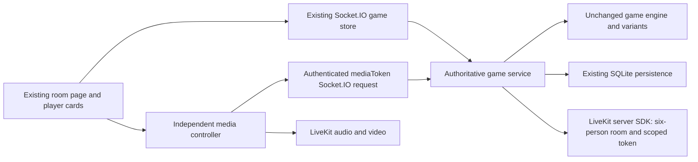

# Phase 4: optional LiveKit media in the original player grid

Camera and microphone are additive to the existing Teen Patti application. The grid, cards, theme, player headers, betting controls and rule engine are retained. This phase does not implement the perimeter table layout planned for Phase 5.

## Try it locally

The local game service runs on port 8080, LiveKit on port 7880, and the reviewed production preview on port 5174. Open `http://127.0.0.1:5174/create-room`, create or join a room and enter your name.

1. Click **Join camera/audio**. This connects media without requesting camera or microphone access.
2. Click **Camera on** and/or **Unmute mic** and allow the corresponding browser permission.
3. Use **Audio only** to turn off camera and enable the microphone. **Leave media** stops capture while keeping the game joined.
4. Before the game starts, previews appear within the media panel. During the game, video appears inside the existing player cards.

One person can check their own preview. To act as a second player, open the same game URL in a separate browser profile or private window. Ordinary tabs share game identity, and private tabs in the same private session generally share an identity. Use headphones when testing microphones in two windows on the same device.

Both devices default off. Refresh restores the game identity, seat and hand but requires joining media again; it never silently turns devices on. Without a working camera, microphone or LiveKit connection, the original game remains playable.

## Local configuration

The ignored `.env` contains only the public local-development LiveKit key pair. It is not committed. `.env.example` documents the optional settings. No production credentials are present in frontend configuration.

```dotenv
LIVEKIT_URL=ws://127.0.0.1:7880
LIVEKIT_API_KEY=devkey
LIVEKIT_API_SECRET=secret
```

Run the following in separate terminals with Node 24+:

```sh
livekit-server --dev --bind 127.0.0.1
npm run server
npm run dev
```

For the reviewed production preview, use `npm run build` followed by `npm run preview -- --host 127.0.0.1 --port 5174` instead of `npm run dev`.

On this workspace, the verified local LiveKit 1.13.9 executable is at `/tmp/teenpatti-livekit/livekit/1.13.9/bin/livekit-server`. It was extracted into temporary storage from the official Homebrew bottle; SHA-256 `187222af8a72c8d4c7c00134650a7c1d68b44be77d9078d6487a6f17f1cf1be9` matches the published bottle manifest. The temporary executable is not a project dependency or durable installation. The [official local-server guide](https://docs.livekit.io/transport/self-hosting/local/) describes installation and the development key pair.

To disable media configuration, remove all three LiveKit settings and restart the game service. A media request then returns a clear unavailable message; card play continues. Partial configuration fails explicitly at backend startup. Cloud deployment uses a `wss://` project URL and real backend-only credentials. Browser capture requires a secure context; loopback localhost works for local development. This phase does not expose the local services for remote friends or deploy a TURN/TLS setup.

## Architecture and reuse



The logical game room and LiveKit room share the same validated room name. LiveKit participant identity is the server-issued stable player ID. Seat metadata comes from the stored game participant, never the request. Rendering looks up media by that identity against the current game participant list; participant metadata is not used as authority for seats or names.

| File | Responsibility |
|---|---|
| `server/media.mjs` | Optional configuration, six-person LiveKit room, token signing and participant removal |
| `server/index.mjs` | Add authenticated media-token request, identity/room membership checks and cleanup on leave/takeover/disconnect |
| `src/lib/media/controller.ts` | Independent media connection, devices, status, recovery and teardown |
| `src/lib/media/attach.ts` | Attach/detach one track to one element |
| `src/lib/components/RoomMedia.svelte` | Small existing-style controls, lobby previews and one remote audio element per participant |
| `src/lib/components/SeatVideo.svelte` | Camera preview, camera-off state, microphone/speaking/quality status |
| Existing room page | Add media panel and optional video inside existing player cards |

The engine, both variants, socket store, create/join form, card renderer, global styles and all previous assets remain byte-identical to Phase 3. Only the existing room page gains frontend edits. Hash-based preservation tests strip its documented additive media blocks before comparing the original baseline; a frozen Phase 3 manifest separately checks every other existing source/static file and game module.

Media state is not stored in the game snapshot or SQLite. Game commands, revision checks, chip ledger and winner calculations do not depend on LiveKit. No media data channel is used for game actions.

## Admission and security

The media endpoint is the authenticated Socket.IO `mediaToken(roomName, acknowledgement)` request. Reusing the existing authenticated connection avoids adding a second browser bearer-token transport.

- The server requires the current socket for the authenticated player, the same joined room and a non-departed seat. It derives identity, display name and seat from server state.
- It rechecks admission after asynchronous LiveKit operations, preventing a pending request from returning credentials after leave or session replacement.
- Tokens last 60 seconds for initial admission, grant only one room and permit camera/microphone publication and subscriptions. They deny data publication, screen sharing, room administration and self-edited metadata.
- LiveKit rooms are explicitly capped at six participants. Token requests are rate limited and concurrent requests are bounded separately from game actions.
- Leaving the game, disconnecting the game socket or replacing a session queues server-side participant removal. New token requests wait for queued cleanup, preventing an old cleanup request from kicking a newly admitted media session.
- Frontend cleanup stops local tracks, detaches media elements and clears participant views. A device prompt resolving after leave has its late track stopped.

**Self-hosted token-replay limitation:** removing a participant from self-hosted LiveKit does not revoke an already issued token. Its 60-second initial-admission expiry is a mitigation, not a guarantee that an adversarial cached-token reconnect cannot occur. LiveKit can refresh tokens during a media session; an accepted unauthorized reconnect must not be described as automatically ending after 60 seconds. For production, use LiveKit Cloud's revocation support and validate its behavior during admission/removal races, or design and verify an equivalent self-hosted admission/revocation mechanism before launch. This local development server is not that production security boundary. See the official [token lifecycle and self-hosted limitations](https://docs.livekit.io/frontends/reference/tokens-grants/).

The server now supports LiveKit Cloud's explicit token cutoff during participant removal. Set `LIVEKIT_REVOKE_TOKENS=true` only when the configured provider supports revocation; the server passes the current Unix timestamp so tokens issued before leave/takeover are rejected on reconnect. This remains disabled for local and self-hosted development. Verify revocation against the actual production project before enabling public media.

Participant removal failures are logged without credentials and do not roll back completed game actions. Production monitoring, retry/reconciliation, webhook handling and cross-server recovery remain hardening work; a media outage must not freeze chip accounting.

## Failure behavior

| Event | Behavior |
|---|---|
| Camera denied or absent | Camera-specific message; microphone and card play remain usable |
| Microphone denied or absent | Microphone-specific message; video and card play remain usable |
| Camera off / mic muted | Independent device control and seat status |
| Audio only | Disable camera, enable microphone |
| Browser blocks playback | **Enable sound** invokes the SDK's audio-start recovery |
| Temporary media reconnect | Show reconnecting status and let the SDK recover; card commands remain separate |
| Terminal media disconnect | Stop/clear capture and offer a fresh media connection with devices off |
| Poor/lost media quality | Seat suggests audio-only; low capture settings, adaptive stream and dynacast reduce load |
| Game socket disconnect / session takeover | Stop media; game reconnection remains handled by the existing store |
| Refresh | Existing game resume; explicit fresh media join |
| Player leaves/rejoins | Remove old media connection; authorize a new one against the recovered game seat |

Video capture targets 320×180 at 15 fps with a 180 kbps publishing cap, VP8, adaptive stream and dynacast. Remote audio has one owner in RoomMedia; video elements are muted and never attach an audio track. These choices follow the [current LiveKit client SDK lifecycle and media APIs](https://docs.livekit.io/reference/client-sdk-js/).

## Verification

`npm test` passes all **75 tests**. Lint has zero errors and nine existing warnings; Svelte checking has zero errors and three existing landing-page warnings. The production build passes with the existing accessibility warnings.

The completed automated suite covers game preservation plus media grants, admission, wrong rooms, six server-owned identities, leave/takeover races, request failure/rate limits, separate permission failures, audio-only/mute/off, reconnect events, poor quality, autoplay recovery, element detachment and late permission/connect cleanup.

The real browser run uses six isolated Chrome contexts, a real local LiveKit SFU and synthetic camera/microphone devices. It verifies all six publish camera and microphone; every browser decodes six videos and attaches exactly five unique remote audio elements. Camera and microphone denials are injected separately while the other device remains functional. Refresh, explicit media leave/rejoin, participant-removal interruption, continued game betting, Muflis Show, chip conservation and game-leave cleanup are exercised.

Participant removal is the tested real media interruption. SDK automatic reconnect, degraded quality and autoplay recovery also have deterministic controller tests; this is not a claim of physical six-device WAN/TURN, browser-autoplay-policy or full SFU-restart validation. Those conditions still require production hardening and actual-device checks.

Run `npm test`, `npm run lint`, `npm run check`, and `npm run build`. Existing frontend lint/accessibility warnings are retained. `npm audit --omit=dev --json` reports zero production vulnerabilities for the installed dependencies. New exact dependencies are `livekit-client@2.22.4` and `livekit-server-sdk@2.19.1`.

With all three local services running, `npm run phase4:browser` reproduces the media evidence. This script intentionally uses the known local-development LiveKit credentials and synthetic devices; it is not configured for Cloud credentials or the user's real camera. Results and screenshots are saved under [visual-baselines/phase4](../../visual-baselines/phase4/README.md). Earlier phases' captures remain untouched.

## Next phase

Phase 5 can evolve the same player panels into seats around the existing game experience. It should reuse these media components and keep cards, chips and actions attached to the same player identities. No new design system, frontend rewrite or game-engine refactor is needed for that layout work.
