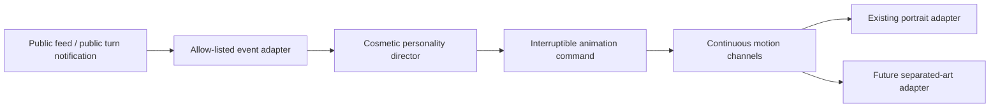

# Dhoni bot presence: isolated prototype

This is a local review of one character. Production seats, public navigation, gameplay, bot policies and the existing mascot implementation are unchanged. The route returns **404 outside Vite development mode**. Nothing was deployed or migrated.

Open `http://127.0.0.1:5188/prototypes/bot-presence` while the local dev server is running. To start it yourself:

```sh
npm run dev -- --host 127.0.0.1 --port 5188
```

## What is visible, and what is pending

The approved **MS Dhoni** artwork is reused exactly: `static/mascots/bot-ms-dhoni/signature/directions.webp`, center cell (index 4). It is an existing 1080×1080 transparent atlas with nine 360×360 flattened portraits, 181,556 bytes. Its source directory contains an approved PNG and prompt, without separated facial layers. The manifest advertises only `directions` for this bot; there is no bot blink/expression sheet.

The visible adapter animates that one portrait continuously with small eased translations/rotations, an extremely small breathing scale, varied idle pauses, event reactions and a smooth return. It does not switch between the nine drawings. A CSS crop hides stray pixels at the cell boundary; the artwork file is not edited.

**This is not a finished facial rig.** Eyes, blinking and brows have real, independent animation channels and timing, but the supplied flattened portrait cannot display those channels correctly. The preview explicitly labels these as awaiting artwork. Its channel meters are diagnostic visualizations, not animated features painted over the character. Head/shoulder movement in portrait mode moves the whole image; independent head and body deformation require separated art.

The original `Mascot.svelte` is available with **Compare original** and remains the production fallback. A separate `LayeredCharacter.svelte` renderer is implemented for artist-prepared textures; the prototype supplies no fabricated rig.

A follow-up visibility adjustment increases the portrait motion, adds a one-shot nod for public turns/outcomes, and starts one demonstration on entry. Facial features still require the separated artwork described below.

## Chosen approach

A small, framework-independent TypeScript director and DOM/CSS render adapters. No Live2D, Spine, Rive, 3D engine, live AI call or new package is added for this feasibility prototype. None of those tools can turn the existing flattened atlas into correctly separated eyes and lids without asset work.

The renderer contract can be replaced by a Live2D or Spine adapter later while retaining the event and personality layers. The initial separated-texture adapter also lets an artist test registration, eyes and eyelid travel before choosing a larger authoring runtime.



## Behavior and timing

`DHONI_PRESENCE` configures calm behavior centrally. The UI does not hardcode character timing.

- Notice delay: 90–240 ms.
- Eyes move over 150–240 ms, starting before the head by 190–330 ms.
- Head follow: 440–720 ms, followed by a 950–1700 ms hold and a 1000–1550 ms return.
- Blink gaps: randomized 3.2–7.1 seconds, with variable 135–195 ms closure cycles and occasional double blinks. These are **commands only** with current art.
- Breathing: separate randomized phase and 5.2–7.8 second period; scale amplitude at most 0.6%.
- Portrait travel: up to 4% of its canvas per normalized head channel, after head-target scaling. A full raise reaction travels about 10px at a 450px preview canvas and tilts about 2.2 degrees; this keeps the motion visible at seat sizes.
- Four idle variations: pot glance, small tilt, settle and look away. An idle does not immediately repeat its previous variation. The next idle begins after 6.5–13.5 seconds of stillness following completed choreography.
- Idle cannot interrupt a table reaction. A new public table event can interrupt any active reaction, beginning from its current interpolated pose. There is no delayed sequence left running to snap the character back.
- Duplicate event IDs are suppressed in a bounded 64-event cache. Hidden/offscreen/reduced-motion instances do not accumulate catch-up animation loops.

The available reactions are raise, call, fold, bot turn, bot win, bot loss, idle and neutral. A public result chooses a restrained nod/lift or exhale/accept variation. No interpretation of hand quality is involved.

The preview automatically plays one 22-second demonstration after its first active frame (450ms delay). Manual controls cancel pending autoplay. Reduced-motion users receive no automatic movement and see an explicit explanation. **Play a hand / Restart hand** reruns the choreographed public-event demonstration: neutral → call → raise → bot turn → pack → public result → neutral. Successive demonstrations alternate win/loss. This is an animation simulation, not a real engine hand, policy evaluation or performance claim about the bot. The manual buttons allow interruption at any point. A mobile select keeps event controls near the portrait.

## Privacy and integration boundary

`fromPublicFeed()` consumes the existing public feed vocabulary (`raise`, `chaal`, `blind`, `pack`, `win`). Split winners are processed as a batch so a bot sharing a pot never receives a loss reaction. A public turn notification supplies `BOT_TURN` separately.

Only event ID, an allow-listed semantic event type and public actor ID survive the adapter. It ignores text, cards, deck, hand strength, private legal options, policy tendencies, learned player models, analytics and arbitrary additional fields. The director imports none of those systems. Attention coordinates come from cosmetic table geometry, never card evaluation.

Each instance gets a separate browser-crypto-seeded cosmetic random stream. It does not consume or affect the gameplay random source. All shown reactions are local cosmetic behavior.

This adapter is demonstrated on the isolated route only. Wiring it into live table seats is deliberately deferred until review and real facial artwork.

## Artist handoff: exactly what is missing

Preserve the approved proportions, colors, expression style, shirt, hair and likeness. Use a common **360×360 transparent RGBA canvas** for every exported layer, with registration matching the center atlas cell. Keep the existing shoulder baseline near 73.9% of canvas height; measure final feature positions against the approved source rather than guessing them.

Supply:

| Layer                        | Required preparation                                                                                                                                               |
| ---------------------------- | ------------------------------------------------------------------------------------------------------------------------------------------------------------------ |
| Body / shoulders / shirt     | Separate layer; paint the region behind the neck/head so small movement leaves no holes.                                                                           |
| Neck                         | Separate registered layer, with overlap behind the jaw and shirt.                                                                                                  |
| Clean head / ears / face     | Neutral underlying face with pupils, eye whites, eyelid strokes, brows and mouth removed from the moving-feature regions; reconstruct the skin/shading underneath. |
| Hair                         | Separate back/front hair where needed for overlap and later secondary motion.                                                                                      |
| Left/right sclera            | Independent eye whites and any fixed socket shading.                                                                                                               |
| Left/right pupils and irises | Separate transparent parts with enough sclera underneath for bounded gaze movement.                                                                                |
| Left/right upper lids        | Independently movable neutral lid textures with sufficient paint beyond the eye opening for closure.                                                               |
| Left/right lower lids        | Same, including the lower-lid stroke and shading; no duplicate baked stroke in the head.                                                                           |
| Left/right eyebrows          | Separate registered textures; reconstruct forehead skin underneath.                                                                                                |
| Mouth                        | Registered neutral mouth; smile/smile-release variants are a later art addition.                                                                                   |

Also provide measured eye-aperture rectangles, pupil travel limits, upper/lower lid travel and seam/overlap checks. The prototype `RigAssets`/`RigEye` types specify the texture paths and normalized geometry expected by the layered renderer. Both eyes must close cleanly in frontal and mild head poses. Large perspective turns need additional views/deformers; a set of flat feature layers alone is not a full 3D head.

Do not cut pupils out of the existing face and leave the original pupils behind. Do not stretch the entire face to imitate an eyelid. Do not present a crossfade between two complete faces as independent eye movement.

## Performance design

One shared requestAnimationFrame loop, capped at 30 updates/second, services visible instances. Frame callbacks update CSS custom properties directly; the main diagnostic panel updates less often. There is no frame-by-frame Svelte component reconstruction, historical query, network inference or generated video download.

IntersectionObserver unsubscribes offscreen instances. Page visibility suspends the shared loop. `prefers-reduced-motion`, the existing `data-reduced-motion` setting and manual pause all return a stationary neutral portrait. Cleanup removes observers, media listeners, subscriptions and demonstration timers.

The optional six-copy test instantiates the **same one character**, each with independent timing. It does not enable other bot identities or change live seats. Existing atlas requests share the browser cache. No new raster assets or runtime packages are needed for this preview.

JS callback measurements exclude layout, rasterization and GPU work. Chromium mobile viewport and 4× CPU throttling are a local proxy; physical midrange-phone battery/GPU performance still needs device testing, especially once real layered artwork adds draw surfaces.

## Files

- `src/routes/prototypes/bot-presence/+page.server.ts`: development-only route gate.
- `src/routes/prototypes/bot-presence/+page.svelte`: isolated table preview, public-event controls, simulation, channel diagnostics, original comparison and six-copy test.
- `src/lib/mascots/presence/types.ts`: public events, personality, motion, animation command and separated-art contracts.
- `src/lib/mascots/presence/personality.ts`: Dhoni's cosmetic configuration and truthful art capabilities.
- `src/lib/mascots/presence/public-events.ts`: strict public event adapters.
- `src/lib/mascots/presence/director.ts`: interpolation, eye/head ordering, blinking, idle, reaction variation, interrupt and neutral scheduling.
- `src/lib/mascots/presence/clock.ts`: shared visibility-aware 30 Hz clock and callback cost measurements.
- `src/lib/mascots/presence/PresenceCharacter.svelte`: portrait adapter, subscriptions, reduced motion and original fallback.
- `src/lib/mascots/presence/LayeredCharacter.svelte`: future separated-texture renderer.
- `tests/server/bot-presence.test.mjs`: motion, interruptions, privacy, randomness, stillness and isolation tests.
- `scripts/presence/browser.mjs`: desktop/mobile interaction checks, reduced motion, visibility, six-copy measurements and optional screen recording.
- This report.

## Verification

Final checks:

| Check                                                | Result                                                                                                |
| ---------------------------------------------------- | ----------------------------------------------------------------------------------------------------- |
| `npm test`                                           | 533 passed, including 10 presence tests                                                            |
| `npm run test:cloudflare`                            | 26 passed on the initial isolated prototype; backend unchanged in the visibility revision                                                                                             |
| `npm run check`                                      | 0 errors, 0 warnings                                                                                  |
| `npm run lint`                                       | Passed                                                                                                |
| `npm run build`                                      | Passed                                                                                                |
| Local production preview, `/prototypes/bot-presence` | HTTP 404, confirmed                                                                                   |
| Desktop and 390px mobile browser QA                  | Passed, no page errors, no horizontal overflow                                                        |
| Gaze-before-head                                     | Command ordering verified while the head channel is still zero; visible eye movement awaits art       |
| Public event hand simulation                         | Call, raise, bot turn, pack and public win handled; manual loss and neutral also checked              |
| New-event interruption and neutral                   | Verified in unit and browser tests                                                                    |
| Blink and idle variation                             | Timing, bounds, stillness and instance differences verified in tests; visible blinks await eyelid art |
| Pause and reduced motion                             | Stationary transforms confirmed                                                                       |
| Background / offscreen                               | Clock suspends / zero subscribers confirmed                                                           |
| Legacy fallback                                      | Original `Mascot.svelte` renders on demand                                                            |
| Hidden information                                   | Mutating private-like fields produces identical commands and frames                                   |

Local Chromium measurements with **4× CPU throttling**:

| Case                            | Visible instances | JS callback mean | JS callback p95 |
| ------------------------------- | ----------------: | ---------------: | --------------: |
| Six copies of the one prototype |                 6 |         0.284 ms |        0.800 ms |
| 390px mobile viewport           |                 1 |         0.177 ms |        0.500 ms |

These measure callback work at the 30 Hz update cap, excluding rendering/GPU and physical-device power costs. They are not a claim of a measured 30 fps on every phone.

Review artifacts from this run:

- [Desktop screenshot](/private/tmp/chaal-presence-review/desktop.png)
- [Mobile screenshot](/private/tmp/chaal-presence-review/mobile.png)
- [12-second screen recording](/private/tmp/chaal-presence-review/presence-demo.mp4) (1440×1000, 10 fps recording, 263,741 bytes)
- [Browser results](/private/tmp/chaal-presence-review/results.json)

The clip is a local screen recording of the running prototype, not generated character animation. It shows the original portrait's restrained motion and the pending facial-channel diagnostics.

Reproduce browser checks against a local dev server with:

```sh
node scripts/presence/browser.mjs http://127.0.0.1:5188
# Also capture a 12-second local MP4 using installed ffmpeg:
PRESENCE_RECORD=1 node scripts/presence/browser.mjs http://127.0.0.1:5188
```

Artifacts go to the OS temp directory under `chaal-presence-review`, outside tracked source and the intentionally untracked `design/` directory.

## Before converting other bots

Review the restrained timing in this single portrait preview. Then commission/prep the Dhoni layers above, calibrate the eyes/lids and neck seam in the existing layered renderer, and review an actual independent-eye blink/gaze demonstration. Only then decide whether authoring in Live2D/Spine is preferable to the simple layer adapter. Measure six fully layered instances on a physical phone before adding more characters.

For Virat or Samay later, create personality data with different notice/hold/idle amplitudes and timing; keep the same public event boundary and director. Gesture art and larger expression ranges should follow an approved one-character rig, not precede it.

Visibility follow-up: actual browser-computed portrait travel was 9.945 px with 2.21° tilt on desktop and 7.49 px at a 390px mobile viewport. This check now asserts rendered CSS displacement as well as motion-channel values, so an imperceptible portrait cannot pass merely because its debug meters move. Autoplay was checked in a fresh browser session.
